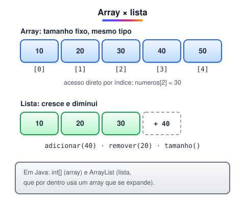

# Listas e Arrays

> 🗺️ **Nesta aula:** como guardar vários valores numa só variável com arrays e listas, quando usar cada um, como percorrê-los com para cada e um exercício com os 20 primeiros múltiplos de 2 ou 5.

## De onde paramos

Na Questão 5 da lista anterior apareceu um vetor `v(5)`. Agora vamos ver com calma as duas estruturas que guardam **coleções** de valores: o array e a lista.



## Array (vetor)

- Guarda uma quantidade **fixa** de elementos do **mesmo tipo**, definida na criação.
- Os elementos ficam lado a lado na memória, por isso o acesso pelo **índice** é imediato.
- Na maioria das linguagens o índice começa em 0 e vai até tamanho − 1.
- Inserir ou remover no meio é trabalhoso: é preciso deslocar os outros elementos ou criar outro array.

```
// declara e inicializa
inteiro[] numeros = [1, 2, 3, 4, 5]

// índice 2 = 3º elemento (vale 3)
inteiro elemento = numeros[2]
```

> ⚠️ Acessar `numeros[5]` num array de 5 elementos é um erro: os índices válidos vão de 0 a 4. Em Java isso gera `ArrayIndexOutOfBoundsException`.

## Lista

- Tem tamanho **dinâmico**: cresce e diminui durante a execução.
- Oferece operações prontas: adicionar, remover, saber o tamanho, procurar.
- Em linguagens como Python e JavaScript aceita elementos de tipos diferentes; em Java a lista tem um tipo declarado (`List<Integer>`).

```
lista numeros = [1, 2, 3, 4, 5]

// acesso pelo índice
inteiro elemento = numeros[2]

// insere no final
numeros.adicionar(6)
```

> ⚠️ **Correção:** o original dizia que os elementos de uma lista sempre ficam encadeados (cada um apontando para o próximo). Isso vale só para a **lista encadeada** (`LinkedList`). A lista mais usada em Java, `ArrayList`, guarda os dados num array interno que é trocado por um maior quando enche. Por isso o acesso pelo índice nela também é rápido.

| Característica | Array | Lista |
| --- | --- | --- |
| Tamanho | fixo | dinâmico |
| Acesso por índice | imediato | imediato no ArrayList, lento no LinkedList |
| Inserir no meio | trabalhoso | método pronto |
| Em Java | `int[]` | `ArrayList`, `LinkedList` |

## Percorrer com para cada (foreach)

O **para cada** percorre todos os elementos de uma coleção sem que você precise controlar o índice. A cada volta, a variável recebe o próximo elemento.

```
para cada n em numeros faça
  mostrar n
fim para
```

O mesmo com o para comum, usando o índice:

```
para (i <- 0; i < tamanho(numeros); i <- i + 1) faça
  mostrar numeros[i]
fim para
```

> 💡 Use o para cada quando só precisa ler os elementos. Use o para com índice quando precisa da posição ou quer alterar o array.

## Matriz: array de duas dimensões

Uma **matriz** é um array de arrays, acessado por linha e coluna. Serve para tabelas, tabuleiros e planilhas.

```
inteiro[][] m = [[1, 2, 3],
                 [4, 5, 6]]
// linha 1, coluna 2 (vale 6)
mostrar m[1][2]
```

## 📝 Exercício: múltiplos de 2 ou 5

Crie uma lista com os 20 primeiros números positivos divisíveis por 2 ou por 5 e mostre-a no final.

<details>
<summary>Ver resposta</summary>

```
inicio principal
  var lista_numeros: lista(inteiro)
  var numero_atual: inteiro
  definir 1 -> numero_atual

  enquanto (tamanho(lista_numeros) < 20) faça
    se (numero_atual % 2 == 0 ou
        numero_atual % 5 == 0) então
      adicionar numero_atual, lista_numeros
    fim se
    somar numero_atual, 1 -> numero_atual
  fim enquanto

  mostrar lista_numeros
fim
```

Saída: 2, 4, 5, 6, 8, 10, 12, 14, 15, 16, 18, 20, 22, 24, 25, 26, 28, 30, 32, 34.

</details>

> 💡 O laço é enquanto, e não para, porque não se sabe de antemão quantos números serão testados: só que a lista precisa chegar a 20 itens.

## 🧠 Revisão rápida

**Qual o último índice de um array com 10 elementos?**

9, porque o primeiro é 0.

**Quando preferir uma lista a um array?**

Quando a quantidade de elementos muda durante a execução ou não é conhecida de antemão.

> ➡️ **Próximo passo:** organizar o código em funções reutilizáveis.

## 📌 Resumo

| Item | Em uma frase |
| --- | --- |
| Array | Coleção de tamanho fixo e mesmo tipo, acessada por índice. |
| Lista | Coleção de tamanho dinâmico, com operações prontas. |
| para cada | Percorre todos os elementos sem controlar o índice. |
| Matriz | Array de duas dimensões: linha e coluna. |
