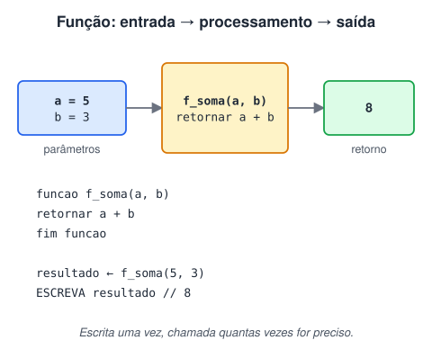

# Funções

> 🗺️ **Nesta aula:** o que é uma função, parâmetros e retorno, função × procedimento, escopo de variáveis, passagem por valor e por referência, e uma introdução à recursão.

## De onde paramos

Os algoritmos estão ficando maiores. Para não repetir o mesmo trecho em vários lugares, separamos tarefas em **funções**.

## O que é uma função

Uma função é um bloco de código com nome que faz uma tarefa específica. Ela recebe valores de entrada (**parâmetros**), executa instruções e pode devolver um resultado (**retorno**). Você a escreve uma vez e a **chama** quantas vezes quiser.



Por que usar funções:

- **Modularidade**: o programa vira partes pequenas, cada uma com uma responsabilidade.
- **Reutilização**: o mesmo código serve em vários pontos, e uma correção vale para todos.
- **Abstração**: quem chama só precisa saber o que entra e o que sai, não como funciona por dentro.
- **Legibilidade**: `calcular_imposto(salario)` diz o que acontece melhor que dez linhas de contas.

## Exemplo: função de soma

```
funcao f_soma(a: inteiro, b: inteiro): inteiro
  var resultado: inteiro
  definir a + b -> resultado
  retornar resultado
fim funcao

inicio principal
  var x, y, total: inteiro
  definir 5 -> x
  definir 3 -> y
  definir f_soma(x, y) -> total
  mostrar "O resultado da soma é: " + total
fim
```

Na chamada `f_soma(x, y)`, os **argumentos** x e y (5 e 3) são copiados para os **parâmetros** a e b. O `retornar` devolve 8, que vai para `total`.

> 💡 **Parâmetro** é o nome na definição da função (a, b). **Argumento** é o valor passado na chamada (x, y).

## Função × procedimento

- **Função**: devolve um valor com `retornar`. Ex.: `f_soma`.
- **Procedimento**: só executa uma ação e não devolve nada. Ex.: um bloco que mostra o menu. Em Java ele tem o tipo de retorno `void`.

```
procedimento mostrar_menu()
  mostrar "[1] Saldo"
  mostrar "[2] Depositar"
  mostrar "[3] Sair"
fim procedimento
```

## Escopo das variáveis

- Variável **local**: criada dentro da função, só existe enquanto ela roda. `resultado` acima é local de `f_soma`.
- Variável **global**: criada fora das funções, vista pelo programa todo.<br />Prefira variáveis locais e passe o que a função precisa por parâmetros: assim ela não depende de nada escondido e fica fácil de testar.

## Passagem por valor e por referência

- **Por valor**: a função recebe uma **cópia**. Mudar o parâmetro não muda a variável de quem chamou.
- **Por referência**: a função recebe o **endereço** da variável. Mudar o parâmetro muda o original.

> 💡 Em Java tudo é passado por valor. Mas, para objetos e arrays, o valor copiado é a referência: a função consegue alterar o conteúdo do array recebido, só não consegue trocá-lo por outro.

## Recursão

Uma função **recursiva** chama a si mesma. Ela precisa de um **caso base**, que para a recursão, senão roda até estourar a memória.

```
funcao fatorial(n: inteiro): inteiro
  // caso base
  se (n <= 1) então
    retornar 1
  fim se
  retornar n * fatorial(n - 1)
fim funcao
// fatorial(4) = 4 * 3 * 2 * 1 = 24
```

## 📝 Exercício

Escreva a função `maior(a, b)` que retorna o maior de dois números e use-a para mostrar o maior entre 7 e 12.

<details>
<summary>Ver resposta</summary>

```
funcao maior(a: inteiro, b: inteiro): inteiro
  se (a > b) então
    retornar a
  fim se
  retornar b
fim funcao

inicio principal
  mostrar maior(7, 12)
  // mostra 12
fim
```

</details>

## 🧠 Revisão rápida

**Qual a diferença entre função e procedimento?**

A função devolve um valor; o procedimento só executa uma ação.

**O que acontece com uma variável local quando a função termina?**

Ela deixa de existir.

**O que toda recursão precisa ter?**

Um caso base que interrompe as chamadas.

> ➡️ **Próximo passo:** juntar tudo num projeto: o caixa eletrônico.

## 📌 Resumo

| Item | Em uma frase |
| --- | --- |
| Função | Bloco nomeado que recebe parâmetros e retorna um valor. |
| Procedimento | Bloco que executa uma ação sem retorno (void). |
| Escopo | Local vive só dentro da função; global, no programa todo. |
| Recursão | Função que chama a si mesma até o caso base. |
