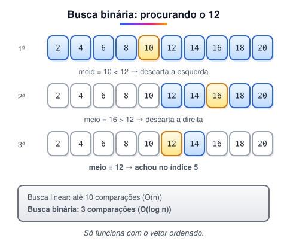
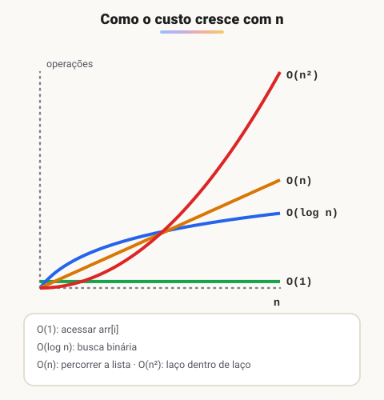

# Desempenho de algoritmos: busca binária e Big O

> 🗺️ **Nesta aula:** como medir a eficiência de um algoritmo (tempo e memória), busca linear × busca binária e a notação Big O com as complexidades mais comuns.

## De onde paramos

O caixa eletrônico funciona. Mas e se ele tivesse que procurar uma conta entre 10 milhões? Além de **funcionar**, um algoritmo precisa ser **eficiente**.

## O que é desempenho de um algoritmo

É a análise de quanto um algoritmo gasta de dois recursos:

1. **Tempo**: quantas operações básicas (comparações, atribuições, iterações) ele faz. Medimos em operações, e não em segundos, porque os segundos dependem do computador.
2. **Espaço**: quanta memória extra ele usa.<br />O que importa é como esses números **crescem** quando a entrada (n) aumenta.

## Busca linear

A forma mais simples de procurar um valor: olhar os elementos um a um, do começo ao fim. Funciona em qualquer vetor, ordenado ou não.

```
funcao busca_linear(arr: vetor, valor: inteiro): inteiro
  para (i <- 0; i < tamanho(arr); i <- i + 1) faça
    se (arr[i] == valor) então
      retornar i
    fim se
  fim para
  // não encontrado
  retornar -1
fim funcao
```

No pior caso (valor no fim ou ausente) são **n comparações**.

## Busca binária

Se o vetor estiver **ordenado**, dá para fazer muito melhor: olhar o elemento do meio e descartar metade a cada comparação, como procurar uma palavra no dicionário.



```
funcao busca_binaria(arr: vetor, valor: inteiro): inteiro
  var esquerda, direita, meio: inteiro
  definir 0 -> esquerda
  definir tamanho(arr) - 1 -> direita

  enquanto (esquerda <= direita) faça
    // divisão inteira: descarta a parte decimal
    definir piso((esquerda + direita) / 2) -> meio

    se (arr[meio] == valor) então
      retornar meio
    senão se (arr[meio] < valor) então
      definir meio + 1 -> esquerda
    senão
      definir meio - 1 -> direita
    fim se
  fim enquanto

  // não encontrado
  retornar -1
fim funcao

// uso
vetor = [2, 4, 6, 8, 10, 12, 14, 16, 18, 20]
indice = busca_binaria(vetor, 12)
// indice = 5
```

> ⚠️ **Ajuste:** o original calculava `meio = (esquerda + direita) / 2` sem dizer que a divisão é inteira. Com esquerda 5 e direita 6, a conta dá 5.5, que não é um índice válido. Usamos `piso(...)`; em Java, a divisão entre dois `int` já faz isso. Também faltava o `fim se`.

> 💡 Com 1 milhão de elementos, a busca linear pode precisar de 1 milhão de comparações; a binária precisa de no máximo 20, porque 2²⁰ ≈ 1 milhão. Em compensação, ordenar o vetor também custa tempo: só vale a pena se você for buscar muitas vezes.

## Notação Big O

A **notação Big O** (O grande) descreve como o custo de um algoritmo cresce conforme o tamanho da entrada, n. Ela ignora constantes e detalhes e olha só a **ordem de crescimento**, normalmente no **pior caso**.



| Notação | Nome | Exemplo |
| --- | --- | --- |
| O(1) | constante | acessar `arr[i]` |
| O(log n) | logarítmica | busca binária |
| O(n) | linear | busca linear, percorrer uma lista |
| O(n log n) | linearítmica | bons algoritmos de ordenação (merge sort) |
| O(n²) | quadrática | laço dentro de laço sobre os mesmos dados |

Como estimar olhando o código:

- comandos simples, sem laço: O(1);
- um laço que percorre os n elementos: O(n);
- dois laços aninhados, cada um até n: O(n²);
- um laço que divide o problema ao meio a cada volta: O(log n).

> 💡 Se n dobra: O(1) não muda, O(log n) ganha só um passo, O(n) dobra e O(n²) quadruplica.

## 📝 Exercício

Qual a complexidade deste trecho, que verifica se há valores repetidos num vetor?

```
para (i <- 0; i < n; i <- i + 1) faça
  para (j <- i + 1; j < n; j <- j + 1) faça
    se (arr[i] == arr[j]) então
      retornar verdadeiro
    fim se
  fim para
fim para
retornar falso
```

<details>
<summary>Ver resposta</summary>

**O(n²).** São dois laços aninhados sobre o mesmo vetor. O de dentro começa em i + 1, então são n(n − 1)/2 comparações no pior caso, mas o Big O descarta a constante 1/2 e fica com n².

</details>

## 🧠 Revisão rápida

**Qual a condição para usar a busca binária?**

O vetor precisa estar ordenado.

**O que a notação Big O descreve?**

Como o tempo (ou a memória) cresce quando o tamanho da entrada aumenta, em geral no pior caso.

**Quantas comparações, no máximo, a busca binária faz em 1.024 elementos?**

11 (log₂ 1024 = 10, mais a comparação final).

> ➡️ **Próximo passo:** fechar o módulo com a segunda lista de exercícios.

## 📌 Resumo

| Item | Em uma frase |
| --- | --- |
| Desempenho | Quanto tempo e memória o algoritmo gasta conforme n cresce. |
| Busca linear | Olha um a um; O(n); serve para qualquer vetor. |
| Busca binária | Divide ao meio; O(log n); exige vetor ordenado. |
| Big O | Ordem de crescimento do custo no pior caso. |
