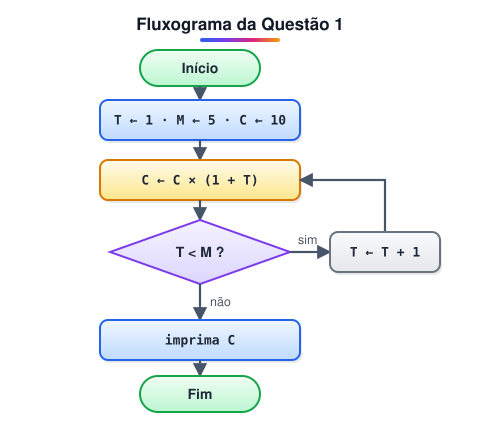

# Exercícios 2

> 🗺️ **Nesta lista:** cinco questões no estilo da prova de seleção, sobre fluxograma, operadores lógicos, atribuição, decisões aninhadas e concatenação de textos.

## De onde paramos

Esta lista fecha o módulo de algoritmos. Use teste de mesa: anote o valor de cada variável a cada linha.

## Questão 1

A equipe de desenvolvimento está testando um algoritmo que faz cálculos. O fluxograma abaixo mostra como ele funciona:



Ao executar o algoritmo, qual é o valor de C impresso ao final?

<details>
<summary>Ver resposta</summary>

**7200**

| T | C depois de C ← C × (1 + T) | T < 5? |
| --- | --- | --- |
| 1 | 10 × 2 = 20 | sim |
| 2 | 20 × 3 = 60 | sim |
| 3 | 60 × 4 = 240 | sim |
| 4 | 240 × 5 = 1200 | sim |
| 5 | 1200 × 6 = 7200 | não → imprime |

</details>

## Questão 2

Um programa de cadastro de alunos valida as variáveis `Nome` e `CPF` assim:

```
SE (Nome não é vazio E CPF não é vazio) CONTINUE
```

Essa validação testa o caminho em que os dados foram preenchidos corretamente. Se ela fosse escrita para testar o preenchimento **incorreto**, qual expressão seria usada?

<details>
<summary>Ver resposta</summary>

```
SE (Nome é vazio OU CPF é vazio) PARE
```

Basta um dos dois estar vazio para o cadastro estar errado, por isso o E vira OU. É a **lei de De Morgan**: não (A e B) é o mesmo que (não A) ou (não B).

</details>

> 💡 Lei de De Morgan, nas duas formas: não (A e B) = não A ou não B; não (A ou B) = não A e não B. Ela ajuda a inverter qualquer condição sem errar.

## Questão 3

Sabe-se que `ESCREVA` mostra uma informação na tela e `<-` atribui um valor a uma variável.

```
A <- 30
B <- 20
C <- A + B
ESCREVA C
B <- 10
ESCREVA B, C
C <- A + B
ESCREVA A, B, C
```

O que será impresso na tela?

<details>
<summary>Ver resposta</summary>

```
50
10 50
30 10 40
```

Mudar B para 10 **não** recalcula C sozinho: C continua 50 até a linha `C <- A + B` ser executada de novo.

</details>

## Questão 4

Sabe-se que:

- `REAL x` cria a variável real x;
- `SE` divide o fluxo: `ENTAO` roda se a condição for verdadeira, `SENAO` se for falsa;
- `-` é a subtração; `==` e `>` significam "igual a" e "maior que".

```
ESCREVA "--- Bem-vindo ao App Poupança ---"

INTEIRO i
REAL valor, saldo, poupanca

saldo <- 1000.00
poupanca <- 500.00
i <- 0

ENQUANTO i != 3 FAÇA
  ESCREVA "1 APLICAR, 2 RESGATAR, 3 SAIR: "
  LEIA i
  SE i == 1 ENTAO FAÇA
    ESCREVA "Valor da aplicação: "
    LEIA valor
    SE valor > saldo ENTAO FAÇA
      ESCREVA "Saldo de conta corrente insuficiente"
    SENAO FAÇA
      saldo <- saldo - valor
      poupanca <- poupanca + valor
      ESCREVA "Aplicação realizada com sucesso"
    FIM_SE
  SENAO FAÇA
    SE i == 2 ENTAO FAÇA
      ESCREVA "Valor do resgate: "
      LEIA valor
      SE valor > poupanca ENTAO FAÇA
        ESCREVA "Saldo de poupança insuficiente"
      SENAO FAÇA
        saldo <- saldo + valor
        poupanca <- poupanca - valor
        ESCREVA "Resgate realizado com sucesso"
      FIM_SE
    SENAO
      ESCREVA "Até logo!"
    FIM_SE
  FIM_SE
FIM_ENQUANTO
```

Moisés fez um resgate e depois uma aplicação. A tela mostrou, incluindo o que ele digitou:

```
--- Bem-vindo ao App Poupança ---
1 APLICAR, 2 RESGATAR, 3 SAIR: 2
Valor do resgate: X
Resgate realizado com sucesso
1 APLICAR, 2 RESGATAR, 3 SAIR: 1
Valor da aplicação: Y
Saldo de conta corrente insuficiente
1 APLICAR, 2 RESGATAR, 3 SAIR: 3
Até logo!
```

Entre as alternativas da prova, quais poderiam ser X e Y, respectivamente?

<details>
<summary>Ver resposta</summary>

**300 e 1500.**

- O resgate deu certo, então X ≤ 500 (a poupança). Com X = 300: saldo = 1300 e poupança = 200.
- A aplicação foi negada, então Y > 1300. Y = 1500 serve.<br />Qualquer par com X ≤ 500 e Y > 1000 + X funcionaria; a resposta é a alternativa que respeita as duas condições.

</details>

> ⚠️ **Ajustes:** faltava o `ENTAO` em `SE i == 2 FAÇA`. E repare num defeito do programa: qualquer opção diferente de 1 e 2 (por exemplo, 7) mostra "Até logo!", mas o laço continua, porque ele só termina com i = 3. O certo seria testar `i == 3` para o "Até logo!" e mostrar "Opção inválida" no último senão.

## Questão 5

Sabe-se que:

- `ESCREVA "a", "b"` imprime `a b` (separados por espaço);
- `CADEIA x` cria a variável x, que guarda texto;
- `LEIA z` guarda em z o que o usuário digitar;
- `+` entre textos **concatena** (junta) os textos.

```
CADEIA nome, dia, mes

ESCREVA "Bem-vindo(a) ao App"

ESCREVA "Digite o seu nome: "
LEIA nome
ESCREVA "Digite o dia que você nasceu: "
LEIA dia
ESCREVA "Digite o mês que você nasceu: "
LEIA mes

ESCREVA "Login:", dia + nome + mes
```

Qual a última linha impressa se o usuário digitar, nessa ordem, `Luiza`, `9` e `10`?

<details>
<summary>Ver resposta</summary>

**Login: 9Luiza10**<br />Como dia e mes são texto, o `+` junta os caracteres em vez de somar. A vírgula do ESCREVA coloca o espaço depois de "Login:".

</details>

> ⚠️ **Ajuste:** o original usava `CARACTER` para guardar nomes. Um caractere é um único símbolo; para texto, o tipo é cadeia (string), como na Questão 2 da lista anterior.

> ➡️ **Próximo passo:** começar o módulo de redes de computadores, a base para entender como um back-end conversa com o mundo.

## 📌 Resumo

| Questão | O que pratica |
| --- | --- |
| 1 | Leitura de fluxograma |
| 2 | Operadores lógicos e De Morgan |
| 3 | Atribuição e ordem de execução |
| 4 | Decisões aninhadas dentro de um laço |
| 5 | Concatenação de textos |
