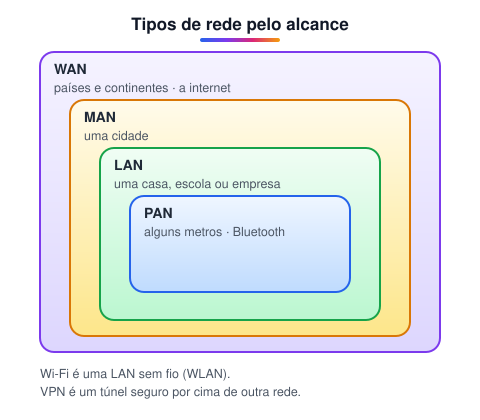
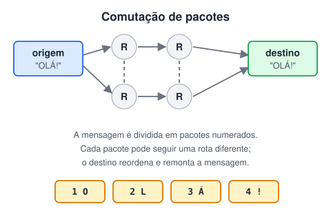
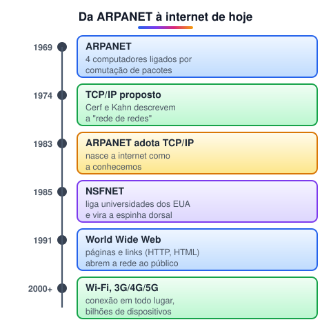

# Definição e breve história das redes

> 🗺️ **Nesta aula:** o que é uma rede de computadores, os tipos de rede pelo alcance, as topologias, o modelo cliente-servidor e a história da ARPANET até a internet.

## De onde paramos

Os algoritmos rodam num computador só. Um back-end, porém, vive conversando com outros computadores: navegadores, aplicativos, bancos de dados. Este módulo explica como essa conversa acontece.

## O que é uma rede

Uma **rede de computadores** é um conjunto de dispositivos interligados que trocam dados e compartilham recursos. Esses dispositivos (chamados de **hosts** ou nós) podem ser computadores, servidores, celulares, impressoras, roteadores. Com uma rede é possível compartilhar arquivos e impressoras, acessar a internet, trocar e-mails e fazer chamadas de vídeo, não importa onde cada aparelho esteja.

## Tipos de rede pelo alcance

| Sigla | Nome | Alcance |
| --- | --- | --- |
| PAN | Personal Area Network | alguns metros (fone Bluetooth, relógio) |
| LAN | Local Area Network | uma casa, escola ou empresa |
| MAN | Metropolitan Area Network | uma cidade |
| WAN | Wide Area Network | países e continentes; a internet é a maior |

> ⚠️ **Ajuste:** o original listava a WAN duas vezes, como "longa distância" e como "área ampla"; é a mesma coisa. Wi-Fi e VPN não são tamanhos de rede: Wi-Fi é uma LAN sem fio (WLAN) e VPN é um túnel seguro criado sobre outra rede.

## Topologias

A **topologia** é o desenho de como os dispositivos estão ligados:

- **Estrela**: todos ligados a um equipamento central (switch). É a das redes locais de hoje: se um cabo falha, só aquele aparelho cai.
- **Barramento**: todos num mesmo cabo. Era comum nas redes antigas com cabo coaxial.
- **Anel**: cada dispositivo ligado ao próximo, formando um círculo.
- **Malha**: vários caminhos entre os nós. É como a internet se organiza: se uma rota cai, outra assume.

## Cliente e servidor

Na maior parte da internet, a conversa segue o modelo **cliente-servidor**: o **cliente** (navegador, aplicativo) faz um pedido e o **servidor** responde. O back-end que você vai programar é justamente o lado servidor. No modelo **par a par** (P2P), cada máquina é cliente e servidor ao mesmo tempo, como nos programas de torrent.

## Comutação de pacotes

A ideia que tornou a internet possível: em vez de reservar uma linha inteira para cada conversa, como no telefone antigo, os dados são quebrados em **pacotes** que viajam de forma independente.

## Breve história

- **1969, ARPANET**: criada pela agência de pesquisa do Departamento de Defesa dos EUA (ARPA) para ligar computadores de universidades e centros de pesquisa. Já usava comutação de pacotes.
- **1974, TCP/IP**: Vint Cerf e Bob Kahn publicam o protocolo que permite ligar redes diferentes entre si.
- **1983**: a ARPANET adota oficialmente o TCP/IP; muitos consideram esse o nascimento da internet.
- **1985, NSFNET**: a rede da Fundação Nacional de Ciência dos EUA interliga universidades e se torna a espinha dorsal da internet acadêmica.
- **1991, World Wide Web**: Tim Berners-Lee cria as páginas com links (HTML e HTTP), que popularizam a internet.
- **De 2000 em diante**: banda larga, Wi-Fi e redes móveis (3G, 4G, 5G) tornam a conexão permanente e presente em todo lugar.

## 🧠 Revisão rápida

**Qual a diferença entre LAN e WAN?**

A LAN cobre uma área pequena, como uma casa ou empresa; a WAN cobre regiões grandes e liga várias LANs.

**O que é comutação de pacotes?**

Dividir os dados em pacotes que viajam de forma independente pela rede e são remontados no destino.

**No modelo cliente-servidor, quem começa a conversa?**

O cliente, fazendo um pedido; o servidor responde.

> ➡️ **Próximo passo:** conhecer os equipamentos que montam uma rede.

## 📌 Resumo

| Item | Em uma frase |
| --- | --- |
| Rede | Dispositivos interligados que trocam dados e recursos. |
| PAN, LAN, MAN, WAN | Tipos de rede do menor ao maior alcance. |
| Topologia estrela | Todos ligados a um ponto central; padrão nas LANs. |
| ARPANET | Rede de 1969 que deu origem à internet. |
