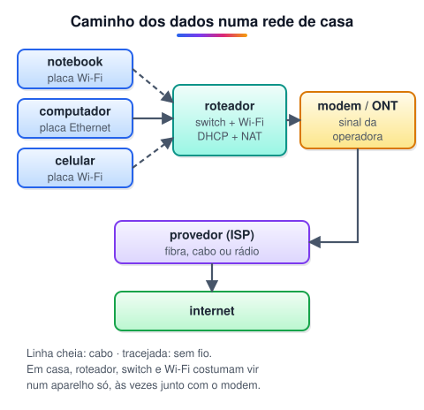
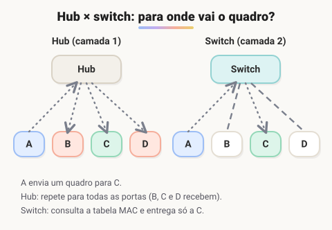

# Infraestrutura de redes e principais equipamentos

> 🗺️ **Nesta aula:** os equipamentos que formam uma rede (placa de rede, hub, switch, roteador, modem, ponto de acesso e firewall), o que cada um faz e em que camada atua.

## De onde paramos

Já sabemos o que é uma rede. Agora vamos abrir a caixa e ver as peças que a fazem funcionar, seguindo o caminho de um dado que sai do seu computador e chega à internet.

## Placa de rede (NIC)

**NIC** (Network Interface Card) é o hardware que liga o computador à rede. Ela converte os dados do computador em sinais que viajam pelo meio (elétricos no cabo, ondas de rádio no Wi-Fi) e faz o caminho inverso na recepção.

- Pode ser interna (na placa-mãe ou num slot) ou externa (adaptador USB).
- Tem padrões de conexão (Ethernet, Wi-Fi, fibra) e velocidades (100 Mbps, 1 Gbps...).
- Cada placa tem um **endereço MAC** gravado de fábrica, com 48 bits, escrito como `00:1A:2B:3C:4D:5E`. É ele que o switch usa para entregar os dados na rede local.

## Hub

O **hub** liga vários dispositivos por cabo de par trançado, mas não tem nenhuma inteligência: tudo o que chega por uma porta é repetido para **todas** as outras. Hoje está praticamente em desuso. Consequências: só um aparelho transmite por vez (os outros esperam ou há colisão) e todos recebem dados que não são para eles.

## Switch

O **switch** substituiu o hub. Ele aprende o endereço MAC de quem está ligado em cada porta, guarda numa **tabela MAC** e entrega cada quadro só na porta do destino (**unicast**).

Vantagens: várias conversas ao mesmo tempo, sem colisões, e mais privacidade. O switch atua na **camada 2** (enlace) do modelo OSI, que veremos adiante.

> 💡 **Analogia:** o hub é um alto-falante que grita cada recado para o escritório inteiro; o switch é o carteiro que lê o nome no envelope e entrega só na mesa certa.

> 💡 Hub e switch ligam aparelhos **dentro** de uma rede. Para ligar redes **diferentes** (sua casa e a internet), é preciso um roteador.

## Roteador

O **roteador** conecta redes diferentes e decide por onde cada pacote deve seguir. Ele olha o **endereço IP** de destino, consulta sua **tabela de roteamento** e encaminha o pacote ao próximo roteador do caminho, salto a salto, até o destino. Atua na **camada 3** (rede). Funções que o roteador de casa costuma acumular:

- **NAT**: deixa vários aparelhos saírem para a internet com um único IP público (detalhes na aula de IPv4 e IPv6);
- **DHCP**: distribui endereços IP para os aparelhos da casa;
- **firewall** básico e **Wi-Fi**.

## Modem

**Modem** vem de **mo**dulador/**dem**odulador. Ele converte os sinais digitais da sua rede no tipo de sinal que a linha da operadora transporta, e vice-versa. Na linha telefônica e no cabo coaxial, o sinal é elétrico analógico; na fibra, é luz.

> 💡 Na internet por fibra, o aparelho da operadora se chama **ONT** (ou ONU). Ele faz o papel do modem convertendo sinal elétrico em luz e luz em sinal elétrico. Muitas vezes o mesmo aparelho já é roteador e Wi-Fi.

## Ponto de acesso e firewall

- **Ponto de acesso** (access point): cria a rede sem fio e liga os aparelhos Wi-Fi à rede cabeada. Em empresas, vários pontos cobrem um prédio inteiro.
- **Firewall**: filtra o tráfego que entra e sai segundo regras (portas, endereços, aplicações) e bloqueia o que não é permitido. Pode ser um aparelho dedicado ou um software.

## 🧠 Revisão rápida

**Por que o switch substituiu o hub?**

Porque entrega cada quadro só ao destino (unicast) usando a tabela MAC, enquanto o hub repete tudo para todas as portas.

**Que endereço o switch usa? E o roteador?**

O switch usa o endereço MAC (camada 2); o roteador usa o endereço IP (camada 3).

**Qual equipamento liga a sua rede à linha da operadora?**

O modem (ou a ONT, na fibra).

> ➡️ **Próximo passo:** os cabos que ligam esses equipamentos e as normas do cabeamento estruturado.

## 📌 Resumo

| Equipamento | Em uma frase |
| --- | --- |
| Placa de rede | Liga o computador à rede; tem um endereço MAC. |
| Hub | Repete tudo para todas as portas; obsoleto. |
| Switch | Entrega só ao destino usando a tabela MAC (camada 2). |
| Roteador | Liga redes diferentes e escolhe rotas pelo IP (camada 3). |
| Modem/ONT | Converte o sinal da rede no sinal da operadora. |
