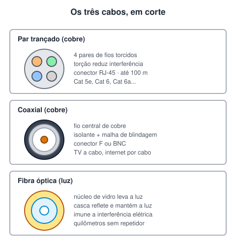

# Cabeamento estruturado

> 🗺️ **Nesta aula:** o que é cabeamento estruturado, as normas que o regem, os três tipos de cabo (par trançado, coaxial e fibra óptica) e o rack.

## De onde paramos

Os equipamentos da aula anterior precisam ser ligados entre si. Numa empresa são centenas de pontos de rede, e sem organização vira um emaranhado impossível de manter.

## O que é cabeamento estruturado

É um sistema **padronizado** de cabos, conectores e equipamentos que leva dados, voz e vídeo por um prédio de forma organizada. A ideia é que qualquer tomada de rede funcione para qualquer uso e que mudanças sejam simples: trocar um computador de mesa não exige passar cabo novo. As principais normas:

| Norma | Origem | O que define |
| --- | --- | --- |
| ANSI/TIA-568 | EUA | cabos, conectores, distâncias e testes em prédios comerciais |
| ISO/IEC 11801 | internacional | requisitos de projeto, instalação e desempenho |
| ABNT NBR 14565 | Brasil | infraestrutura de telecomunicações em edifícios, adaptada ao país |

> 💡 A TIA-568 já passou por várias revisões (C, D e E). O que importa saber: é ela que define, por exemplo, o limite de 100 m por lance de par trançado e as sequências de cores T568A e T568B do conector RJ-45.

## Os três cabos

### Par trançado

O cabo de rede mais comum. Tem **4 pares** de fios de cobre; os fios de cada par são torcidos um no outro, o que reduz a interferência eletromagnética entre eles.

- **Conector**: RJ-45, montado na sequência de cores T568A ou T568B.
- **Distância**: até 100 m por lance (90 m fixos + 10 m de cabos de ligação).
- **Blindagem**: UTP (sem blindagem, o mais usado), FTP (folha de alumínio em volta de todos os pares) e STP (cada par blindado), para ambientes com muita interferência. | Categoria | Velocidade típica | Frequência | | --- | --- | --- | | Cat 5e | 1 Gbps | 100 MHz | | Cat 6 | 1 Gbps (10 Gbps até ~55 m) | 250 MHz | | Cat 6a | 10 Gbps em 100 m | 500 MHz | | Cat 8 | 25 a 40 Gbps em até 30 m (data centers) | 2.000 MHz |

### Coaxial

Um fio central de cobre, cercado por isolante, por uma malha metálica de **blindagem** e pela capa externa. A blindagem protege bem o sinal contra ruído.

- Conectores **F** (TV e internet a cabo) e **BNC** (câmeras e redes antigas).
- Hoje aparece em TV a cabo, internet a cabo e circuitos de câmeras; nas redes locais foi substituído pelo par trançado.

### Fibra óptica

Transmite **luz** por um núcleo de vidro (ou plástico) muito fino. A casca em volta reflete a luz e a mantém dentro do núcleo.

- **Altíssima velocidade** e **longas distâncias** com pouca perda: é o que liga cidades e continentes (cabos submarinos).
- **Imune a interferência eletromagnética**, porque não conduz eletricidade.
- **Mais difícil de grampear** sem que a perda de sinal denuncie.
- **Leve e fina** para a capacidade que oferece.
- Tipos: **multimodo** (núcleo maior, distâncias de centenas de metros, mais barata) e **monomodo** (núcleo menor, dezenas de quilômetros).

> ⚠️ Resumo dos meios: par trançado e coaxial levam sinais elétricos por **cobre**; a fibra leva **luz**; o Wi-Fi usa **ondas de rádio**.

## Rack

O **rack** é o armário metálico onde ficam switches, roteadores, servidores e **patch panels** (painéis onde chegam os cabos das tomadas). A largura padrão é de 19 polegadas e a altura é medida em **U** (1U = 4,45 cm), por isso equipamentos de fabricantes diferentes se encaixam nos mesmos trilhos.

## 🧠 Revisão rápida

**Por que os fios do par trançado são torcidos?**

Para reduzir a interferência eletromagnética entre os pares e de fora para dentro.

**Qual o limite de distância de um lance de par trançado?**

100 metros.

**Cite duas vantagens da fibra sobre o cobre.**

Alcance muito maior com pouca perda e imunidade a interferência eletromagnética (também: mais banda, mais leve).

> ➡️ **Próximo passo:** entender como os dados se organizam em camadas: os modelos OSI e TCP/IP.

## 📌 Resumo

| Item | Em uma frase |
| --- | --- |
| Cabeamento estruturado | Sistema padronizado de cabos, seguindo normas como TIA-568 e NBR 14565. |
| Par trançado | Cobre, 4 pares, RJ-45, até 100 m; o padrão das LANs. |
| Coaxial | Cobre com blindagem; TV e internet a cabo. |
| Fibra óptica | Luz em vidro; rápida, longa distância, sem interferência. |
