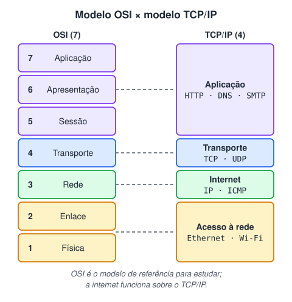
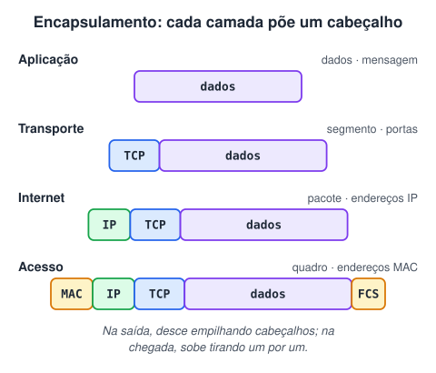
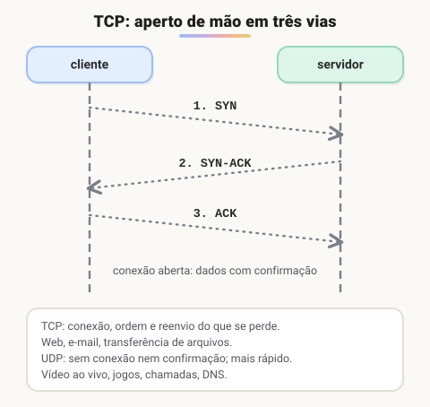

# Modelo OSI e modelo TCP-IP

> 🗺️ **Nesta aula:** por que as redes são organizadas em camadas, as 7 camadas do modelo OSI, as 4 do TCP/IP, a equivalência entre elas, o encapsulamento, TCP × UDP e as portas mais usadas.

## De onde paramos

Já vimos as peças físicas: cabos, switches, roteadores. Mas como um navegador, que só entende páginas, consegue usar um cabo, que só entende sinais elétricos? A resposta é dividir o problema em **camadas**.

## Por que camadas

Cada camada resolve uma parte do problema e só conversa com a de cima e a de baixo. Assim, trocar o cabo por Wi-Fi não exige mudar o navegador, e um novo aplicativo não exige mudar o roteador. É como enviar uma carta: você escreve (aplicação), põe no envelope com o endereço (rede), e o correio decide caminhão ou avião (física). Ninguém precisa entender o trabalho de todos.

## Modelo OSI: 7 camadas

O **OSI** (Open Systems Interconnection) foi criado pela ISO como modelo de **referência**: é o vocabulário usado para estudar e conversar sobre redes. Da camada mais baixa para a mais alta:

| Nº | Camada | Função | Exemplos |
| --- | --- | --- | --- |
| 1 | Física | transmite bits pelo meio | cabos, fibra, rádio, hub |
| 2 | Enlace | entrega entre vizinhos, detecta erros | Ethernet, Wi-Fi, MAC, switch |
| 3 | Rede | endereça e roteia pacotes | IP, ICMP, roteador |
| 4 | Transporte | entrega de ponta a ponta, portas | TCP, UDP |
| 5 | Sessão | abre, mantém e encerra diálogos | sessões, sincronização |
| 6 | Apresentação | formato, compressão, criptografia | TLS, JPEG, UTF-8 |
| 7 | Aplicação | serviços para os programas | HTTP, DNS, SMTP, FTP |

> 💡 Para decorar de baixo para cima: **F**ísica, **E**nlace, **R**ede, **T**ransporte, **S**essão, **A**presentação, **A**plicação.

## Modelo TCP/IP: 4 camadas

O **TCP/IP** é o modelo que a internet usa de fato. Ele junta algumas camadas do OSI:

1. **Aplicação**: os protocolos dos programas (HTTP, DNS, SMTP, FTP). Equivale às camadas 5, 6 e 7 do OSI.
2. **Transporte**: TCP ou UDP levam os dados de um programa a outro, identificados por **portas**.
3. **Internet**: o IP dá endereço a cada máquina e escolhe a rota dos pacotes.
4. **Acesso à rede**: a parte física e de enlace (Ethernet, Wi-Fi, cabos). Equivale às camadas 1 e 2.

## Encapsulamento

Quando você envia algo, os dados **descem** as camadas e cada uma acrescenta seu cabeçalho. Na chegada, eles **sobem** e cada camada retira o seu.

O nome da unidade muda conforme a camada: **segmento** no transporte, **pacote** na rede, **quadro** no enlace e **bits** na física.

## TCP × UDP

|  | TCP | UDP |
| --- | --- | --- |
| Conexão | abre antes (3 vias) | não abre |
| Confirmação e reenvio | sim | não |
| Ordem garantida | sim | não |
| Velocidade | menor | maior |
| Usos | web, e-mail, APIs, banco de dados | vídeo ao vivo, jogos, voz, DNS |

## Portas

O IP leva o pacote até a máquina; a **porta** diz qual programa dentro dela deve receber. Um servidor pode ter um site na porta 443 e um banco de dados na 5432 ao mesmo tempo.

| Porta | Protocolo | Uso |
| --- | --- | --- |
| 22 | SSH (TCP) | acesso remoto seguro |
| 53 | DNS (UDP e TCP) | tradução de nomes |
| 80 | HTTP (TCP) | web sem criptografia |
| 443 | HTTPS (TCP) | web com TLS |
| 5432 | PostgreSQL (TCP) | banco de dados (módulo de BD) |
| 8080 | HTTP alternativo | comum em servidores de desenvolvimento Java |

> 💡 Endereço IP + porta forma um **socket**, como `203.0.113.10:443`. Quando você sobe uma API Java no seu computador, ela costuma ouvir em `localhost:8080`.

## 🧠 Revisão rápida

**Em que camada do OSI atuam o switch e o roteador?**

Switch na 2 (enlace); roteador na 3 (rede).

**Qual a diferença principal entre TCP e UDP?**

O TCP abre conexão, confirma o recebimento e reenvia o que se perde; o UDP envia sem confirmação, com menos atraso.

**Para que serve a porta?**

Para identificar qual programa da máquina de destino deve receber os dados.

> ➡️ **Próximo passo:** o endereço da camada de rede em detalhes: IPv4 e IPv6.

## 📌 Resumo

| Item | Em uma frase |
| --- | --- |
| OSI | Modelo de referência com 7 camadas. |
| TCP/IP | Modelo da internet com 4 camadas. |
| Encapsulamento | Cada camada põe um cabeçalho ao descer e tira ao subir. |
| TCP × UDP | Confiável e ordenado × rápido e sem confirmação. |
| Porta | Número que identifica o programa de destino. |
