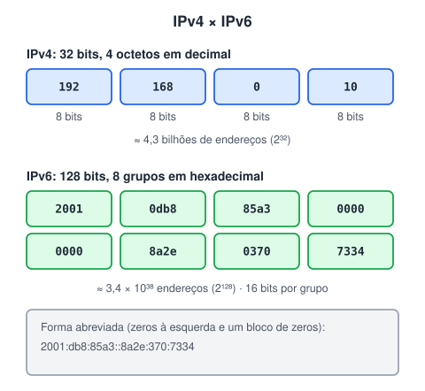
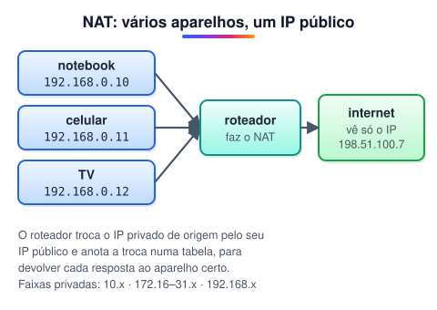

# IPv4 e IPv6

> 🗺️ **Nesta aula:** como é um endereço IPv4, por que ele acabou, endereços públicos e privados, NAT, e como o IPv6 resolve a falta de endereços.

## De onde paramos

Na camada de rede, cada dispositivo precisa de um endereço para receber pacotes: o **endereço IP**. Existem duas versões em uso.



## IPv4

O **IPv4** (Internet Protocol versão 4) usa endereços de **32 bits**, escritos como quatro números decimais de 0 a 255 separados por ponto. Cada número é um **octeto** (8 bits). Exemplo: `192.168.0.10`.<br />São cerca de **4,3 bilhões** de endereços (2³²). Parece muito, mas há mais aparelhos conectados que isso, e os blocos livres se esgotaram na década de 2010.

### Endereços especiais

| Faixa | Para que serve |
| --- | --- |
| 10.0.0.0/8 | rede privada |
| 172.16.0.0/12 (172.16 a 172.31) | rede privada |
| 192.168.0.0/16 | rede privada (a mais comum em casa) |
| 127.0.0.0/8 | loopback: a própria máquina (`localhost` = 127.0.0.1) |
| 169.254.0.0/16 | autoatribuído quando o DHCP falha |

Endereços **privados** podem ser repetidos em redes diferentes e não circulam na internet. Endereços **públicos** são únicos no mundo e distribuídos pelos registros regionais (no Brasil, via NIC.br).

### NAT: dividindo um IP público

Como sua casa recebe só um IP público, o roteador usa **NAT** (Network Address Translation) para que todos os aparelhos saiam por ele.



> 💡 **Analogia:** o IP público é o endereço do prédio; os IPs privados são os números dos apartamentos. O carteiro de fora só conhece o prédio, e o porteiro (o roteador com NAT) sabe para qual apartamento levar cada encomenda.

> 💡 Os exemplos usam faixas reservadas para documentação, como 198.51.100.0/24 e 203.0.113.0/24, que nunca pertencem a ninguém de verdade.

## IPv6

O **IPv6** usa endereços de **128 bits**, escritos em **hexadecimal**: oito grupos de quatro dígitos (16 bits cada) separados por dois-pontos.

```
2001:0db8:85a3:0000:0000:8a2e:0370:7334
```

São cerca de 3,4 × 10³⁸ endereços: dá para dar um IP para cada aparelho do planeta, muitas vezes.

### Como abreviar

1. Zeros à esquerda de cada grupo podem ser omitidos: `0db8` vira `db8`, `0370` vira `370`.
2. Uma única sequência de grupos só de zeros pode virar `::`.

```
2001:db8:85a3::8a2e:370:7334
```

> ⚠️ O `::` só pode aparecer **uma vez** no endereço; senão não daria para saber quantos grupos de zero cada um representa. O loopback do IPv6 é `::1`.

### O que mais o IPv6 traz

1. **Espaço de endereços enorme**: em geral dispensa o NAT; cada aparelho pode ter IP público.
2. **Autoconfiguração** (SLAAC): o aparelho monta o próprio endereço a partir do prefixo anunciado pelo roteador, sem precisar de DHCP.
3. **Cabeçalho mais simples**, com tamanho fixo, o que facilita o trabalho dos roteadores.
4. **IPsec** (autenticação e criptografia) previsto desde o projeto. No IPv4 ele também existe, mas como acréscimo.
5. **Multicast** melhorado e fim do broadcast (substituído por multicast).

> 💡 A transição é gradual: hoje a maioria das redes roda as duas versões juntas (**pilha dupla**). No Brasil, boa parte do acesso à internet já usa IPv6.

## 🧠 Revisão rápida

**Quantos bits têm os endereços IPv4 e IPv6?**

32 e 128 bits.

**O que é o endereço 127.0.0.1?**

O loopback: aponta para a própria máquina (localhost).

**Abrevie `2001:0db8:0000:0000:0000:0000:0000:0001`.**

`2001:db8::1`

> ➡️ **Próximo passo:** testar o que você aprendeu até aqui na primeira lista de exercícios de redes.

## 📌 Resumo

| Item | Em uma frase |
| --- | --- |
| IPv4 | 32 bits em 4 octetos decimais; cerca de 4,3 bilhões de endereços. |
| IP privado | Faixas 10.x, 172.16–31.x e 192.168.x, que não circulam na internet. |
| NAT | Faz vários aparelhos saírem por um único IP público. |
| IPv6 | 128 bits em hexadecimal; endereços praticamente ilimitados. |
