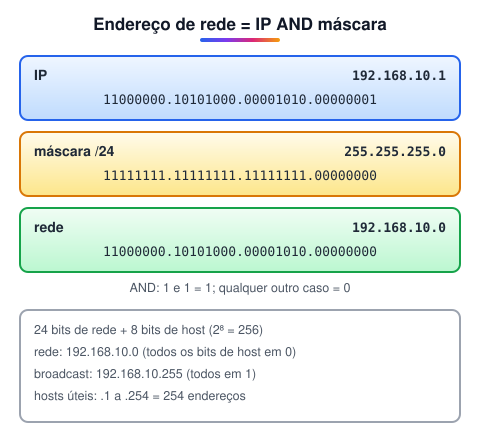

# Cálculo de sub-rede

> 🗺️ **Nesta aula:** as classes de endereço IPv4, a máscara de sub-rede e a notação CIDR, como achar a rede, o broadcast e a faixa de hosts, como dividir uma rede em sub-redes, e o que é QoS.

## De onde paramos

Um endereço IPv4 tem duas partes: uma diz **qual é a rede** e a outra diz **qual é o dispositivo** (host) dentro dela. A máscara de sub-rede é quem marca onde termina uma e começa a outra.

## Classes de endereço IPv4

No início, a divisão era fixa e dependia do primeiro octeto:

| Classe | 1º octeto | Máscara padrão | Hosts por rede |
| --- | --- | --- | --- |
| A | 1 a 126 | 255.0.0.0 (/8) | 16.777.214 (2²⁴ − 2) |
| B | 128 a 191 | 255.255.0.0 (/16) | 65.534 (2¹⁶ − 2) |
| C | 192 a 223 | 255.255.255.0 (/24) | 254 (2⁸ − 2) |
| D | 224 a 239 | não se aplica | multicast |
| E | 240 a 255 | não se aplica | experimental |

Número de redes possíveis: classe A, 126 (2⁷, tirando 0 e 127); classe B, 16.384 (2¹⁴); classe C, 2.097.152 (2²¹).

> ⚠️ **Correções:** a tabela original punha 127 na classe A e começava a faixa em 0.0.0.1. A rede 0 e a rede 127 (loopback) são reservadas, então a classe A vai de 1 a 126. Os números de redes das classes B e C também tinham um "− 2" que não se aplica a elas.

> 💡 As classes caíram em desuso nos anos 1990, porque desperdiçavam endereços: uma empresa com 300 máquinas precisava de uma classe B inteira, com 65 mil. Hoje se usa o **CIDR**, em que a máscara pode ter qualquer tamanho. As classes continuam aparecendo em provas e ajudam a entender a ideia.

## Máscara de sub-rede e CIDR

A **máscara** tem 32 bits, como o IP: os bits **1** marcam a parte de **rede** e os bits **0** marcam a parte de **host**. Os 1 vêm sempre primeiro. Na notação **CIDR**, escreve-se só a quantidade de bits 1 depois de uma barra: `255.255.255.0` = `/24`.

| CIDR | Máscara | Hosts úteis |
| --- | --- | --- |
| /24 | 255.255.255.0 | 254 |
| /25 | 255.255.255.128 | 126 |
| /26 | 255.255.255.192 | 62 |
| /27 | 255.255.255.224 | 30 |
| /28 | 255.255.255.240 | 14 |
| /30 | 255.255.255.252 | 2 |

Fórmula: com **h** bits de host, a rede tem 2ʰ endereços e 2ʰ − 2 hosts úteis. Os dois que sobram são o endereço da **rede** (todos os bits de host em 0) e o de **broadcast** (todos em 1).

## Exemplo: 192.168.10.1/24

Para achar a rede, faz-se um **AND** bit a bit entre o IP e a máscara: o bit do resultado só é 1 quando os dois bits são 1.

| Item | Valor |
| --- | --- |
| Rede | 192.168.10.0 |
| Primeiro host | 192.168.10.1 |
| Último host | 192.168.10.254 |
| Broadcast | 192.168.10.255 |
| Hosts úteis | 254 |

> ⚠️ **Correção:** o resultado do AND no original saiu com um bit a menos (`1000000.10101000...`). O primeiro octeto da rede é `11000000`, ou seja, 192.

## Dividindo em sub-redes

Pegar bits de host "emprestados" para a parte de rede cria várias sub-redes menores. Exemplo: dividir 192.168.10.0/24 em 4 partes usa 2 bits a mais (2² = 4), virando /26. Cada sub-rede fica com 6 bits de host: 64 endereços, 62 úteis.

| Sub-rede | Hosts | Broadcast |
| --- | --- | --- |
| 192.168.10.0/26 | .1 a .62 | .63 |
| 192.168.10.64/26 | .65 a .126 | .127 |
| 192.168.10.128/26 | .129 a .190 | .191 |
| 192.168.10.192/26 | .193 a .254 | .255 |

> 💡 Atalho: o tamanho do bloco é 256 menos o último octeto da máscara. Em /26 (máscara .192), o bloco é 256 − 192 = 64, então as redes começam em 0, 64, 128 e 192.

**Calculadora de sub-rede online**

🔗 [https://www.site24x7.com/pt/tools/ipv4-sub-rede-calculadora.html](https://www.site24x7.com/pt/tools/ipv4-sub-rede-calculadora.html)

## 📝 Exercício

A qual rede pertence o host 172.20.5.130/27? Qual o broadcast dela?

Ver resposta

/27 → máscara 255.255.255.224 → bloco de 256 − 224 = 32. Os blocos no último octeto são 0, 32, 64, 96, 128, 160... O 130 está no bloco que começa em 128.

- Rede: **172.20.5.128/27**
- Hosts: .129 a .158
- Broadcast: **172.20.5.159**

## QoS (qualidade de serviço)

**QoS** (Quality of Service) é o conjunto de técnicas que dá **prioridade** a certos tipos de tráfego quando a rede está congestionada. Uma chamada de vídeo sofre com atraso de meio segundo; um download, não. Com QoS, o roteador marca e classifica os pacotes, põe os de voz e vídeo na frente da fila e pode limitar a banda de outros. Os parâmetros que o QoS tenta controlar são largura de banda, latência, variação da latência (jitter) e perda de pacotes.

## 🧠 Revisão rápida

**Quantos hosts úteis tem uma rede /28?**

14 (2⁴ − 2).

**Como se obtém o endereço de rede a partir do IP e da máscara?**

Com uma operação AND bit a bit entre os dois.

**Por que se tiram 2 endereços na conta de hosts?**

Porque o endereço de rede e o de broadcast não podem ser dados a dispositivos.

> ➡️ **Próximo passo:** os serviços que fazem a internet ser usável: domínios, DNS e DHCP.

## 📌 Resumo

| Item | Em uma frase |
| --- | --- |
| Máscara | Bits 1 marcam a rede; bits 0, os hosts. |
| CIDR | /n = quantidade de bits de rede. |
| Hosts úteis | 2ʰ − 2, tirando rede e broadcast. |
| Sub-redes | Bits emprestados do host dividem a rede em blocos. |
| QoS | Prioriza tráfego sensível a atraso. |
