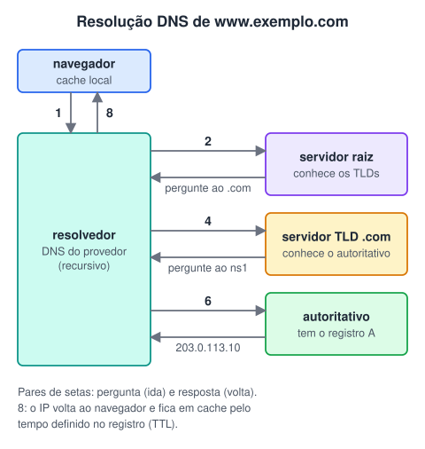
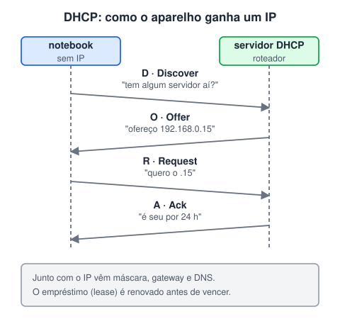
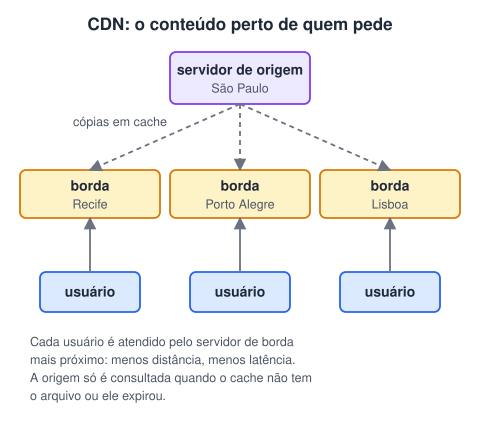

# Domínios, DNS, DHCP e latência

> 🗺️ **Nesta aula:** o que é um domínio e as partes de uma URL, como o DNS traduz nomes em IPs, como o DHCP entrega endereços automaticamente, o que é latência e como uma CDN a reduz.

## De onde paramos

Endereços IP são ótimos para máquinas, péssimos para pessoas. Ninguém decora 203.0.113.10. Esta aula mostra os serviços que deixam a rede usável: nomes (DNS), endereços automáticos (DHCP) e entrega rápida (CDN).

## Domínio

A palavra tem dois sentidos em TI:

1. **Domínio de internet**: nome único que identifica um site ou serviço, como `exemplo.com.br`. É organizado em **hierarquia**, lida da direita para a esquerda: domínio de topo (**TLD**: .com, .org, .br), domínio de segundo nível (escolhido pelo dono) e subdomínios (www, api, loja).
2. **Domínio de rede**: em empresas, um grupo de computadores e usuários administrado por um servidor central (como o Active Directory), que cuida de logins, permissões e políticas.

### Anatomia de uma URL

> 💡 No .br, o domínio de topo é o código do país, e `com.br`, `gov.br`, `org.br` são categorias embaixo dele. Os domínios .br são registrados no Registro.br, do NIC.br.

## DNS

O **DNS** (Domain Name System) é a "agenda de contatos" da internet: traduz nomes como `www.exemplo.com` em endereços IP. Ele é um banco de dados **distribuído** e **hierárquico**: nenhum servidor sabe tudo, mas cada um sabe a quem perguntar.

### Como funciona uma resolução

1. O navegador olha seu cache. Se não sabe, pergunta ao **resolvedor** (normalmente o DNS do provedor ou um público).
2. O resolvedor pergunta a um **servidor raiz**. Ele não sabe o IP, mas responde quais servidores cuidam do `.com`.
3. O resolvedor pergunta ao **servidor TLD** do `.com`, que responde qual é o servidor **autoritativo** do `exemplo.com`.
4. O resolvedor pergunta ao autoritativo, que tem os registros do domínio e responde o IP.
5. O resolvedor devolve o IP ao navegador e guarda a resposta em **cache** pelo tempo indicado no registro (o **TTL**).

> ⚠️ **Correção:** o original dizia que o servidor TLD encaminha a consulta ao "autoritativo responsável pelo .com". Na verdade, o TLD **responde** ao resolvedor dizendo qual é o autoritativo do **exemplo.com**, e é o próprio resolvedor quem faz a próxima pergunta. Cada servidor só indica o próximo passo.

### Tipos de registro

| Registro | Guarda |
| --- | --- |
| A | o endereço IPv4 do nome |
| AAAA | o endereço IPv6 |
| CNAME | um apelido que aponta para outro nome |
| MX | o servidor de e-mail do domínio |
| TXT | textos de verificação (SPF, DKIM) |
| NS | quais servidores são autoritativos |
| O DNS também faz a **resolução reversa**: dado um IP, descobrir o nome (registro PTR). |  |

## DHCP

O **DHCP** (Dynamic Host Configuration Protocol) entrega automaticamente as configurações de rede a quem se conecta: endereço IP, máscara, **gateway** (o roteador de saída) e servidores DNS. Sem ele, seria preciso configurar cada aparelho à mão.

O endereço é **emprestado** por um tempo (lease). Antes de vencer, o aparelho pede renovação; se sair da rede, o IP volta para o servidor e pode ser dado a outro.

> 💡 Servidores e impressoras costumam ter IP **fixo** (configurado à mão ou reservado no DHCP), para que os outros sempre os encontrem no mesmo endereço.

## Latência

**Latência** é o tempo que um dado leva para ir de um ponto a outro, medido em milissegundos (ms). Depende da distância, do meio, do congestionamento e do processamento em cada equipamento do caminho.

- **Ida e volta** (RTT, round-trip time): ir e voltar. É o que o `ping` mostra e a medida mais usada.
- **Transmissão**: o tempo só de ida pelo meio.
- **Processamento**: o tempo que roteadores e switches gastam para examinar e encaminhar cada pacote. Latência não é o mesmo que **largura de banda**: banda é quanto cabe por segundo (a largura da estrada); latência é quanto demora a chegar (o comprimento da viagem). Jogos e chamadas sofrem com latência alta mesmo com muita banda.

## CDN

Uma **CDN** (Content Delivery Network) é uma rede de servidores espalhados pelo mundo que guardam **cópias em cache** do conteúdo de um site: imagens, vídeos, CSS e JavaScript.

Benefícios:

1. **Desempenho**: menos distância, menos latência, páginas mais rápidas.
2. **Escalabilidade**: o tráfego se divide entre muitos servidores.
3. **Disponibilidade**: se uma região cai, outra atende.
4. **Economia**: o servidor de origem recebe muito menos pedidos.

## 🧠 Revisão rápida

**Qual registro DNS guarda o IPv4 de um nome?**

O registro A (o AAAA guarda o IPv6).

**Que informações o DHCP entrega além do IP?**

Máscara de sub-rede, gateway padrão e servidores DNS, entre outras.

**Por que uma CDN reduz a latência?**

Porque entrega o conteúdo de um servidor mais próximo do usuário.

> ➡️ **Próximo passo:** o protocolo da web, HTTP, que é a língua de todo back-end.

## 📌 Resumo

| Item | Em uma frase |
| --- | --- |
| Domínio | Nome hierárquico e único, lido da direita para a esquerda. |
| DNS | Traduz nomes em IPs consultando raiz, TLD e autoritativo. |
| DHCP | Empresta IP, máscara, gateway e DNS automaticamente. |
| Latência | Tempo de viagem dos dados, em milissegundos. |
| CDN | Cópias do conteúdo perto dos usuários. |
