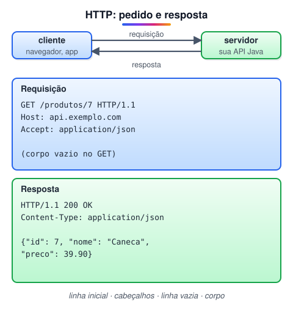

# HTTP e HTTPS (Adicionado pelo aluno para melhorar o estudo)

> 🗺️ **Nesta aula:** como funciona uma requisição e uma resposta HTTP, os métodos (GET, POST, PUT, PATCH, DELETE), os códigos de status, os cabeçalhos mais comuns e o que o HTTPS acrescenta.

## De onde paramos

O DNS achou o IP do servidor e o TCP abriu a conexão na porta 443. Agora o navegador e o servidor precisam conversar numa língua comum: o **HTTP** (HyperText Transfer Protocol), da camada de aplicação.

## Requisição e resposta

O HTTP segue o modelo cliente-servidor: o cliente envia uma **requisição** e o servidor devolve uma **resposta**. Cada par é independente: o HTTP é **sem estado** (stateless), ou seja, o servidor não lembra das requisições anteriores. Por isso logins usam cookies ou tokens enviados a cada pedido.



As duas mensagens têm a mesma estrutura: linha inicial, cabeçalhos, uma linha em branco e o corpo (opcional).

> 💡 **Analogia:** uma requisição HTTP é como um pedido por carta: o envelope (cabeçalhos) diz para quem é, de quem vem e em que formato; dentro vai o conteúdo (corpo). Como o servidor não guarda memória, cada carta precisa trazer tudo o que ele precisa saber, inclusive quem você é.

## Métodos

O **método** diz o que o cliente quer fazer com o recurso indicado no caminho.

| Método | Ação | Exemplo |
| --- | --- | --- |
| GET | ler | `GET /produtos/7` |
| POST | criar | `POST /produtos` com o produto no corpo |
| PUT | substituir por inteiro | `PUT /produtos/7` |
| PATCH | alterar uma parte | `PATCH /produtos/7` só com o preço |
| DELETE | remover | `DELETE /produtos/7` |

> 💡 GET, PUT e DELETE são **idempotentes**: repetir a mesma requisição deixa o servidor no mesmo estado. POST não é: dois POSTs iguais criam dois produtos.

## Códigos de status

A resposta começa com um número de três dígitos. O primeiro dígito diz a família:

| Família | Significado | Exemplos |
| --- | --- | --- |
| 1xx | informação | 101 troca de protocolo |
| 2xx | sucesso | 200 OK, 201 Created, 204 No Content |
| 3xx | redirecionamento | 301 movido de vez, 304 não modificado |
| 4xx | erro do cliente | 400 pedido inválido, 401 não autenticado, 403 proibido, 404 não encontrado |
| 5xx | erro do servidor | 500 erro interno, 503 indisponível |

> ⚠️ 401 e 403 confundem: **401** quer dizer "não sei quem você é" (faça login); **403** quer dizer "sei quem você é, mas você não tem permissão".

## Cabeçalhos comuns

| Cabeçalho | Para que serve |
| --- | --- |
| `Host` | qual site, no mesmo IP, deve responder |
| `Content-Type` | formato do corpo (`application/json`, `text/html`) |
| `Accept` | formatos que o cliente aceita receber |
| `Authorization` | credencial, como `Bearer <token>` |
| `Cookie` e `Set-Cookie` | guardam e reenviam dados de sessão |
| `Cache-Control` | por quanto tempo a resposta pode ficar em cache |

## Testando no terminal

O `curl` faz requisições HTTP pela linha de comando:

```bash
# GET mostrando os cabeçalhos da resposta
curl -i https://api.exemplo.com/produtos/7

# POST enviando JSON
curl -X POST https://api.exemplo.com/produtos \
  -H "Content-Type: application/json" \
  -d '{"nome": "Caneca", "preco": 39.90}'
```

## HTTPS

O **HTTPS** é o HTTP dentro de uma conexão protegida por **TLS**. Ele garante três coisas:

1. **Confidencialidade**: os dados vão criptografados; quem intercepta não lê.
2. **Integridade**: ninguém altera a mensagem no caminho sem que se perceba.
3. **Autenticidade**: o **certificado digital** do servidor, assinado por uma autoridade certificadora, prova que você está falando com o site certo.<br />O cadeado do navegador indica que o certificado foi verificado. A porta padrão do HTTPS é a 443; a do HTTP, a 80.

> 💡 Hoje quase toda a web usa HTTPS, e os navegadores marcam páginas em HTTP como "não seguras". Em produção, sua API sempre deve ficar atrás de HTTPS.

## 📝 Exercício

Qual método e qual código de status você esperaria em cada caso? (a) cadastrar um cliente novo com sucesso; (b) buscar o pedido 999, que não existe; (c) apagar um produto com sucesso, sem devolver corpo.

<details>
<summary>Ver resposta</summary>

(a) POST → 201 Created; (b) GET → 404 Not Found; (c) DELETE → 204 No Content.

</details>

## 🧠 Revisão rápida

**O que significa dizer que o HTTP é sem estado?**

Cada requisição é independente; o servidor não guarda memória das anteriores. Sessões são mantidas com cookies ou tokens.

**Qual a diferença entre PUT e PATCH?**

PUT substitui o recurso inteiro; PATCH altera só os campos enviados.

**O que o certificado digital garante no HTTPS?**

Que o servidor é mesmo quem diz ser.

> ➡️ **Próximo passo:** os comandos de terminal que ajudam a investigar problemas de rede.

## 📌 Resumo

| Item | Em uma frase |
| --- | --- |
| HTTP | Protocolo de requisição e resposta da web, sem estado. |
| Métodos | GET lê, POST cria, PUT substitui, PATCH altera, DELETE remove. |
| Status | 2xx sucesso, 3xx redirecionamento, 4xx erro do cliente, 5xx erro do servidor. |
| HTTPS | HTTP sobre TLS: dados cifrados, íntegros e servidor autenticado. |
