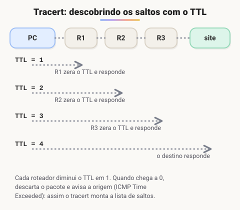

# Principais comandos de configuração

> 🗺️ **Nesta aula:** os comandos de terminal para ver a configuração de rede e investigar problemas: ipconfig, ping, nslookup, tracert, route print e netstat, com os equivalentes em Linux e macOS.

## De onde paramos

Você já conhece IP, máscara, gateway, DNS e latência. Estes comandos mostram cada um deles na prática e são a primeira coisa a usar quando "a internet não funciona" ou uma API não responde.

| Para | Windows | Linux / macOS |
| --- | --- | --- |
| ver IP, máscara, gateway | `ipconfig` | `ip addr` / `ifconfig` |
| testar se um host responde | `ping` | `ping` |
| consultar o DNS | `nslookup` | `nslookup` ou `dig` |
| ver o caminho até um host | `tracert` | `traceroute` |
| ver a tabela de rotas | `route print` | `ip route` / `netstat -rn` |
| ver conexões e portas | `netstat` | `ss` / `netstat` |

## ipconfig

Mostra a configuração de cada placa de rede: endereço IPv4 e IPv6, máscara, gateway padrão. Com `/all`, mostra também servidores DNS, endereço MAC e dados do DHCP.

```powershell
ipconfig
ipconfig /all

# devolve o IP ao DHCP e pede um novo
ipconfig /release
ipconfig /renew
```

> ⚠️ **Correção:** o original dizia que o ipconfig mostra estatísticas de tráfego (dados enviados, erros). Isso é do `netstat -e`; o ipconfig só mostra e renova a configuração.

## ipconfig /flushdns

O Windows guarda em **cache** as respostas do DNS para acessar mais rápido sites já visitados. Se um site mudou de servidor e o seu computador insiste no IP antigo, limpe o cache:

```powershell
ipconfig /flushdns
# ver o que está no cache
ipconfig /displaydns
```

## ping

Envia pacotes **ICMP** Echo Request e espera o Echo Reply. Serve para:

1. saber se um host está acessível;
2. medir a **latência** de ida e volta (o campo `tempo=`);
3. ver se há **perda de pacotes**.

```powershell
ping exemplo.com
# 10 pacotes (Windows)
ping -n 10 exemplo.com
```

> 💡 Um ping sem resposta nem sempre quer dizer que o host caiu: muitos servidores e firewalls bloqueiam ICMP de propósito. Teste também o serviço em si (por exemplo, abrir o site ou usar `curl`). No Linux e no macOS o ping não para sozinho: use `-c 4` ou Ctrl+C.

## nslookup

Consulta o DNS diretamente.

1. **Resolução**: nome → IP.
2. **Reversa**: IP → nome.
3. **Registros específicos**: MX, TXT, NS...
4. **Testar um servidor DNS** específico, informando-o no final.

```powershell
nslookup exemplo.com
# registros de e-mail
nslookup -type=MX exemplo.com
# perguntando a outro servidor DNS
nslookup exemplo.com 1.1.1.1
```

## tracert

Mostra cada roteador (**salto**) entre você e o destino, com a latência de cada um. Ajuda a ver **onde** o caminho fica lento ou quebra.



O truque está no campo **TTL** (Time to Live) do pacote IP: cada roteador diminui o TTL em 1 e, quando ele chega a zero, descarta o pacote e avisa a origem com uma mensagem ICMP "Time Exceeded". O tracert manda pacotes com TTL 1, 2, 3... e anota quem responde.

```powershell
tracert exemplo.com
```

> 💡 Linhas com `* * *` são roteadores que não respondem a esse tipo de pacote. Se os saltos seguintes aparecem, está tudo bem.

## route print

Mostra a **tabela de roteamento** do computador: para cada destino, por qual gateway e qual interface sair.

| Coluna | Significado |
| --- | --- |
| Destino de rede | rede ou faixa de destino |
| Máscara | máscara da rede de destino |
| Gateway | próximo salto; "No vínculo" (on-link) quando é a rede local |
| Interface | IP da placa por onde o pacote sai |
| Métrica | custo da rota; vence a menor |

```powershell
route print
```

Duas linhas sempre aparecem:

- `0.0.0.0` com máscara `0.0.0.0`: a **rota padrão**. Tudo o que não combina com outra rota vai para o gateway, ou seja, para a internet.
- `127.0.0.0/8`: o **loopback**, a rede da própria máquina.

## netstat

Lista as conexões de rede e as portas em uso. Muito útil para saber se a sua API está mesmo **ouvindo** (LISTENING) na porta esperada.

```powershell
# todas as conexões, em números, com o processo (PID)
netstat -ano

# estatísticas de bytes e erros
netstat -e
```

| Estado | Significado |
| --- | --- |
| LISTENING | programa esperando conexões naquela porta |
| ESTABLISHED | conexão ativa |
| TIME_WAIT | conexão encerrada, aguardando limpeza |

## 📝 Exercício

Sua API Java deveria responder em `localhost:8080`, mas o navegador dá erro de conexão. Que comando você usa para ver se algum programa está ouvindo nessa porta?

<details>
<summary>Ver resposta</summary>

`netstat -ano` e procure `:8080` com estado `LISTENING`. Se não aparecer, a aplicação não subiu ou está em outra porta. No PowerShell, dá para filtrar: `netstat -ano | findstr 8080`.

</details>

## 🧠 Revisão rápida

**Qual comando mostra o caminho até um destino?**

`tracert` no Windows (`traceroute` no Linux e no macOS).

**O que é a rota 0.0.0.0/0?**

A rota padrão: o caminho usado quando nenhuma outra rota serve, normalmente o gateway para a internet.

**Para que serve ipconfig /flushdns?**

Para limpar o cache de DNS e forçar novas consultas.

> ➡️ **Próximo passo:** proteger tudo isso: SSO, VPN e os principais ataques.

## 📌 Resumo

| Comando | Em uma frase |
| --- | --- |
| ipconfig | Mostra e renova a configuração de rede. |
| ping | Testa se o host responde e mede a latência. |
| nslookup | Consulta registros DNS. |
| tracert | Lista os saltos até o destino usando o TTL. |
| route print | Mostra a tabela de rotas. |
| netstat | Lista conexões e portas em uso. |
