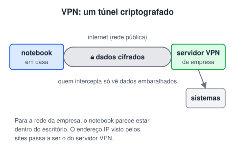
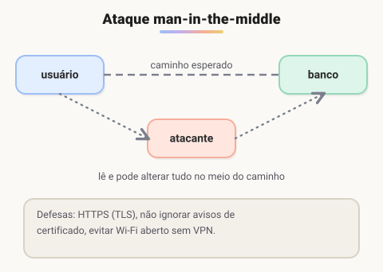

# Segurança

> 🗺️ **Nesta aula:** os três pilares da segurança, autenticação com SSO e MFA, o que é uma VPN e os ataques mais comuns, cada um com a forma de se defender.

## De onde paramos

Uma rede que funciona também precisa ser segura. Para quem programa back-end isso é parte do trabalho: a API é a porta de entrada dos dados da empresa.

## Os três pilares

Toda medida de segurança protege pelo menos um destes (a tríade **CID**):

- **Confidencialidade**: só quem tem permissão lê os dados.
- **Integridade**: os dados não são alterados sem autorização.
- **Disponibilidade**: o serviço funciona quando é preciso.

## Autenticação: SSO e MFA

**Autenticação** é provar quem você é; **autorização** é o que você pode fazer depois disso.<br />**SSO** (Single Sign-On) permite entrar uma vez e acessar vários sistemas sem digitar a senha de novo, como usar a mesma conta para e-mail, agenda e documentos da empresa.

- Um **provedor de identidade** (IdP) autentica o usuário e emite um **token**.
- Os sistemas conectados, chamados **provedores de serviço** (SP), aceitam esse token no lugar da senha.
- Protocolos comuns: **SAML**, **OAuth 2.0** (autorização) e **OpenID Connect** (autenticação sobre o OAuth).<br />Vantagens: menos senhas para lembrar (e reutilizar), controle centralizado e, ao desligar um funcionário, um único bloqueio corta o acesso a tudo.<br />**MFA** (autenticação multifator) pede mais de uma prova: algo que você **sabe** (senha), algo que você **tem** (celular, chave física) ou algo que você **é** (biometria). Mesmo que a senha vaze, o invasor não entra.

## VPN

Uma **VPN** (Virtual Private Network) cria um **túnel criptografado** sobre uma rede pública, como a internet. O funcionário em casa acessa os sistemas internos como se estivesse no escritório.



- Todo o tráfego vai cifrado entre o aparelho e o servidor VPN.
- Para os sites, o IP de origem passa a ser o do servidor VPN, o que também é usado para aparecer em outro país.

## Principais ataques

| Ataque | O que é | Defesa |
| --- | --- | --- |
| Engenharia social | manipular pessoas para obter acesso | treinamento, desconfiar de pedidos urgentes |
| Phishing | e-mail ou site falso que pede dados | conferir o endereço, MFA, filtros de e-mail |
| Força bruta | tentar senhas até acertar | senhas longas, limite de tentativas, MFA |
| DoS | um computador sobrecarrega o serviço | limite de requisições, firewall |
| DDoS | o mesmo, com milhares de máquinas (botnet) | CDN e serviços anti-DDoS |
| Malware | vírus, worms, cavalos de Troia, ransomware, spyware | antivírus, atualizações, backup |
| SQL injection | comando SQL enviado no meio de um dado | consultas parametrizadas |
| Man-in-the-middle | interceptar e alterar a comunicação | HTTPS, VPN, não ignorar alertas de certificado |

### Man-in-the-middle

O atacante se coloca entre as duas partes, por exemplo numa rede Wi-Fi aberta falsa. Ele pode **ler** tudo o que passa e até **alterar** as mensagens, sem que nenhum dos lados perceba.



> ⚠️ No original, a descrição do man-in-the-middle terminava no meio da frase. Ela foi completada acima.

### SQL injection, na prática

O erro acontece quando o programa **monta o SQL juntando textos** com o que o usuário digitou:

```java
// ERRADO: o texto digitado vira parte do SQL
String sql = "SELECT * FROM usuarios WHERE email = '"
  + email + "'";
```

Se alguém digitar `' OR '1'='1`, a condição fica sempre verdadeira e a consulta devolve todos os usuários. O certo é usar **consulta parametrizada**, em que o valor vai separado do comando:

```java
// CERTO: o ? recebe o valor, nunca vira comando
String sql = "SELECT * FROM usuarios WHERE email = ?";
PreparedStatement ps = conexao.prepareStatement(sql);
ps.setString(1, email);
ResultSet rs = ps.executeQuery();
```

> 💡 Ransomware é o malware que criptografa os arquivos e pede resgate. A melhor defesa é ter **backup** recente guardado fora da rede atacada.

## 🧠 Revisão rápida

**Qual a diferença entre DoS e DDoS?**

O DoS parte de uma única máquina; o DDoS, de muitas ao mesmo tempo (uma botnet), o que o torna bem mais difícil de bloquear.

**Como se evita SQL injection?**

Com consultas parametrizadas (PreparedStatement em Java), sem montar o SQL concatenando o que o usuário digita.

**Por que o MFA protege mesmo se a senha vazar?**

Porque o invasor também precisaria do segundo fator, como o celular do usuário.

> ➡️ **Próximo passo:** montar uma rede de verdade no simulador Packet Tracer.

## 📌 Resumo

| Item | Em uma frase |
| --- | --- |
| Tríade CID | Confidencialidade, integridade e disponibilidade. |
| SSO | Um login dá acesso a vários sistemas via tokens. |
| MFA | Mais de um fator de autenticação. |
| VPN | Túnel criptografado sobre a rede pública. |
| Ataques | Cada um tem defesa: HTTPS, MFA, parametrização, backup. |
