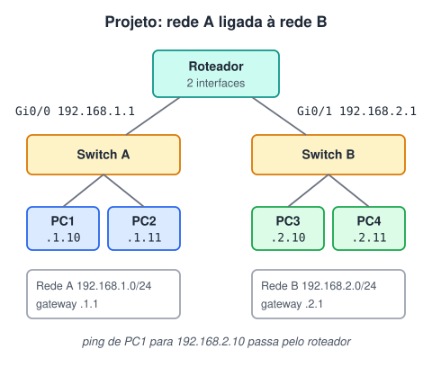

# Simulando redes com packet tracer

> 🗺️ **Nesta aula:** o simulador Cisco Packet Tracer e um projeto passo a passo que liga duas redes locais por um roteador, testado com ping.

## De onde paramos

Até aqui foi teoria: IP, máscara, gateway, switch, roteador. No simulador dá para montar uma rede, errar e testar sem comprar nenhum equipamento.

## O Packet Tracer

O **Cisco Packet Tracer** é um simulador gratuito de redes, usado em cursos de redes. Você arrasta computadores, switches e roteadores para a área de trabalho, liga com cabos virtuais, configura os endereços e vê os pacotes passando no modo de simulação.<br />Ele é baixado pelo site da Cisco Networking Academy, com cadastro gratuito, para Windows, Linux e macOS.

## Projeto: rede A ligada à rede B



O arquivo do projeto (`.pkt`) feito no curso fica nas anotações pessoais; abaixo está o passo a passo para montá-lo do zero.

> 💡 Os endereços abaixo são um exemplo de plano de endereçamento para montar o projeto do zero. O arquivo do curso pode usar outros números; a lógica é a mesma.

### Passo 1: montar a topologia

1. Coloque 1 roteador (por exemplo, o modelo 2911), 2 switches (2960) e 4 PCs.
2. Ligue PC1 e PC2 ao Switch A, e PC3 e PC4 ao Switch B, com cabo direto (Copper Straight-Through).
3. Ligue o Switch A à interface Gi0/0 do roteador e o Switch B à Gi0/1.

### Passo 2: plano de endereços

| Dispositivo | IP | Máscara | Gateway |
| --- | --- | --- | --- |
| Roteador Gi0/0 | 192.168.1.1 | 255.255.255.0 | — |
| Roteador Gi0/1 | 192.168.2.1 | 255.255.255.0 | — |
| PC1 / PC2 | 192.168.1.10 / .11 | 255.255.255.0 | 192.168.1.1 |
| PC3 / PC4 | 192.168.2.10 / .11 | 255.255.255.0 | 192.168.2.1 |

### Passo 3: configurar o roteador

Na aba CLI do roteador:

```
enable
configure terminal
interface gigabitEthernet 0/0
 ip address 192.168.1.1 255.255.255.0
 no shutdown
exit
interface gigabitEthernet 0/1
 ip address 192.168.2.1 255.255.255.0
 no shutdown
end
write memory
```

> ⚠️ As interfaces dos roteadores Cisco vêm **desligadas**. Sem o `no shutdown`, a luz do cabo fica vermelha e nada passa.

### Passo 4: configurar os PCs

Em cada PC: Desktop → IP Configuration → preencha IP, máscara e gateway da tabela.

### Passo 5: testar

No PC1: Desktop → Command Prompt.

```
ping 192.168.1.11
ping 192.168.2.10
tracert 192.168.2.10
```

O primeiro ping fica dentro da rede A e passa só pelo switch. O segundo atravessa o roteador: o `tracert` mostra o salto 192.168.1.1 antes de chegar.

> 💡 É normal o primeiro pacote do ping falhar: o PC ainda está descobrindo o endereço MAC do gateway (protocolo ARP). Os seguintes passam.

## 📝 Exercício

Se o PC3 estiver configurado com gateway 192.168.1.1, o que acontece no ping do PC1 para o PC3?

<details>
<summary>Ver resposta</summary>

O pedido chega ao PC3, mas a resposta não volta. O gateway 192.168.1.1 não está na rede do PC3 (192.168.2.0/24), então ele não consegue enviar nada para fora da própria rede. O gateway precisa ser o IP do roteador **na mesma rede** do PC: 192.168.2.1.

</details>

## 🧠 Revisão rápida

**Por que o PC precisa de um gateway?**

Para alcançar endereços fora da própria rede: tudo o que não é local vai para o gateway (o roteador).

**O que faz o comando no shutdown?**

Liga a interface do roteador, que vem desligada de fábrica.

> ➡️ **Próximo passo:** fechar o módulo de redes com a segunda lista de exercícios.

## 📌 Resumo

| Item | Em uma frase |
| --- | --- |
| Packet Tracer | Simulador gratuito de redes da Cisco. |
| Roteador | Uma interface (e um IP) em cada rede. |
| Gateway | IP do roteador na rede do PC. |
| Teste | ping na mesma rede e na outra; tracert mostra o salto. |
