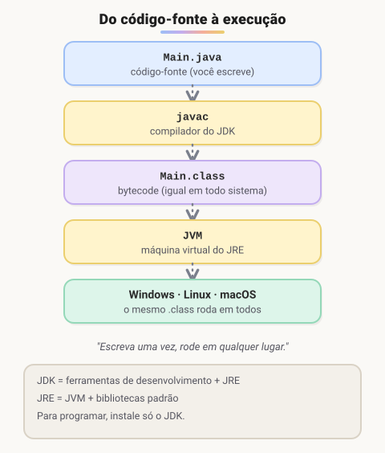

# Setup

> 🗺️ **Nesta aula:** o que são JDK, JRE e JVM, como instalar o Java e configurar as variáveis de ambiente, a IDE IntelliJ e o primeiro programa compilado e executado.

## De onde paramos

Os algoritmos do primeiro módulo foram escritos em pseudocódigo. Agora vamos escrevê-los numa linguagem de verdade: **Java**, muito usada em back-end, especialmente em bancos e grandes empresas.

## JDK, JRE e JVM



- **JVM** (Java Virtual Machine): executa o bytecode. Existe uma JVM para cada sistema, e é por isso que o mesmo programa roda em Windows, Linux e macOS.
- **JRE** (Java Runtime Environment): JVM + bibliotecas padrão. Basta para **rodar** programas.
- **JDK** (Java Development Kit): JRE + ferramentas de desenvolvimento, como o compilador `javac`. É o que você precisa para **programar**.

## Instalando o JDK

Use uma versão **LTS** (Long-Term Support), que recebe atualizações por anos. Hoje a LTS mais recente é a **25**; a 21 e a 17 ainda são muito usadas em empresas.

> ⚠️ **Atualização:** o original recomendava o JDK 17. Ele continua funcionando, mas para quem está começando agora a escolha natural é a LTS mais nova (25). Todo o código deste curso roda em qualquer versão a partir da 17.

Uma distribuição gratuita do OpenJDK, como a Azul Zulu:

🔗 [Azul Downloads](https://www.azul.com/downloads/#downloads-table-zulu)

O instalador `.msi` (Windows) ou `.pkg` (macOS) já configura tudo. Se baixar o `.zip`, configure as variáveis à mão, como no passo a passo abaixo.

> 💡 O JRE avulso do java.com só serve para rodar programas prontos. Como o JDK já traz o necessário para rodar, quem programa não precisa instalá-lo.

🔗 [https://www.java.com/pt-BR/download/manual.jsp](https://www.java.com/pt-BR/download/manual.jsp)

**Configurar as variáveis de ambiente no Windows (passo a passo)**

1. Descompacte o JDK e dê à pasta um nome sem espaços, como `jdk-25`.
2. Mova a pasta para `C:\Program Files\Java`.
3. Abra o menu Iniciar, busque "variáveis de ambiente" e clique em **Variáveis de Ambiente**.
4. Em **Variáveis do sistema**, clique em **Novo**. Nome: `JAVA_HOME` (tudo em maiúsculas). Valor: `C:\Program Files\Java\jdk-25`.
5. Clique em OK.
6. Selecione a variável `Path` e clique duas vezes nela.
7. Clique em **Novo** e adicione `%JAVA_HOME%\bin`.
8. Confirme tudo com OK e abra um terminal **novo** (os já abertos não veem a mudança).

**Vídeo: configurando o JDK nas variáveis de ambiente**

🔗 [https://www.youtube.com/watch?v=QekeJBShCy4&ab_channel=DevSuperior](https://www.youtube.com/watch?v=QekeJBShCy4&ab_channel=DevSuperior)

## Conferindo a instalação

```powershell
# versão do Java e do compilador
java --version
javac --version

# o JShell executa Java linha a linha
jshell
jshell> System.out.println("Hello world!");
jshell> /exit
```

> ⚠️ O comando é `jshell`; o original tinha `jshelll`, com um L a mais. Se `java` não for reconhecido, o `Path` não foi configurado ou o terminal foi aberto antes da mudança.

## IDE: IntelliJ IDEA

A **IDE** é o editor com superpoderes: completa código, aponta erros enquanto você digita, compila e executa com um clique. A mais usada para Java é o **IntelliJ IDEA**; a edição gratuita (Community) basta para o curso. VS Code e Eclipse também servem.<br />Instale pela JetBrains Toolbox, que gerencia as IDEs da JetBrains e suas atualizações:

🔗 [https://www.jetbrains.com/toolbox-app/](https://www.jetbrains.com/toolbox-app/)

Ou baixe o IntelliJ direto:

🔗 [IntelliJ IDEA](https://www.jetbrains.com/pt-br/idea/download/#section=windows)

## Primeiro programa

Crie o arquivo `Main.java`:

```java
public class Main {
  public static void main(String[] args) {
    System.out.println("Olá, Java!");
  }
}
```

Compile e execute pelo terminal, na pasta do arquivo:

```powershell
# gera Main.class
javac Main.java
# executa (sem o .class)
java Main
```

- Todo código Java fica dentro de uma **classe**; o nome do arquivo deve ser igual ao da classe pública (`Main` → `Main.java`).
- O programa começa pelo método `main`.
- Cada instrução termina com `;` e os blocos ficam entre `{ }`.

## 🧠 Revisão rápida

**Qual a diferença entre JDK e JRE?**

O JRE só roda programas; o JDK inclui o JRE e as ferramentas para desenvolver, como o compilador javac.

**O que o javac gera?**

Um arquivo .class com bytecode, que a JVM executa.

> ➡️ **Próximo passo:** variáveis, tipos e operadores em Java.

## 📌 Resumo

| Item | Em uma frase |
| --- | --- |
| JVM | Executa o bytecode em qualquer sistema. |
| JDK | Kit de desenvolvimento: compilador + JRE. |
| JAVA_HOME e Path | Variáveis que deixam o terminal achar o Java. |
| javac e java | Compilam e executam o programa. |
