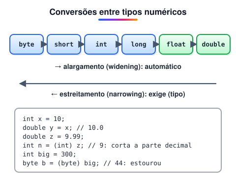

# Variáveis

> 🗺️ **Nesta aula:** tipagem em Java, os 8 tipos primitivos, tipos de referência (String, arrays, classes, listas), constantes, operadores aritméticos e de atribuição, conversão de tipos (casting) e leitura do teclado com Scanner.

## De onde paramos

O JDK está instalado e o primeiro programa rodou. Agora vamos guardar e manipular dados, como fizemos no pseudocódigo com `var nome: tipo`.<br />Documentação oficial (tutoriais da Oracle):

🔗 [https://docs.oracle.com/javase/tutorial/](https://docs.oracle.com/javase/tutorial/)

## Java tem tipagem estática e forte

- **Estática**: o tipo de cada variável é definido no código e verificado na **compilação**. Um erro de tipo nem deixa o programa compilar.
- **Forte**: a linguagem não converte tipos de forma perigosa sem você pedir. Atribuir um `double` a um `int` exige conversão explícita.

```java
int idade = 25;
String nome = "Ana";
// erro de compilação: texto não cabe em int
// int x = "10";
```

> 💡 Desde o Java 10 existe o `var`, que deixa o compilador deduzir o tipo pelo valor: `var total = 10;` cria um `int`. O tipo continua fixo; só não precisa ser escrito.

Convenções de nomes: variáveis e métodos em **camelCase** (`precoTotal`), classes em **PascalCase** (`ContaCorrente`), constantes em **MAIÚSCULAS** (`TAXA_JUROS`).

## Tipos primitivos

Guardam o valor diretamente, sem ser objetos. São oito:

| Tipo | Tamanho | Guarda | Exemplo |
| --- | --- | --- | --- |
| `byte` | 8 bits | inteiros de −128 a 127 | `byte b = 100;` |
| `short` | 16 bits | inteiros de −32.768 a 32.767 | `short s = 5000;` |
| `int` | 32 bits | inteiros até ±2,1 bilhões | `int pop = 1000000;` |
| `long` | 64 bits | inteiros até ±9,2 × 10¹⁸ | `long l = 15000000000L;` |
| `float` | 32 bits | real, precisão simples | `float f = 1.75f;` |
| `double` | 64 bits | real, precisão dupla | `double d = 19.99;` |
| `char` | 16 bits | um caractere Unicode | `char c = 'A';` |
| `boolean` | — | `true` ou `false` | `boolean ok = true;` |

> 💡 Use `int` para inteiros e `double` para reais no dia a dia. O sufixo `L` marca um `long` e o `f` marca um `float`; sem eles, o número é lido como `int` ou `double`.

> ⚠️ `double` e `float` guardam aproximações em binário: `0.1 + 0.2` dá `0.30000000000000004`. Para dinheiro, use `BigDecimal` ou trabalhe em centavos com `long`.

## Tipos de referência

A variável guarda uma **referência** (um endereço) para um objeto na memória, não o valor em si.<br />**String**: sequência de caracteres. É uma classe, mas pode ser criada só com aspas.

```java
String nome = "Maria";
String sobrenome = "Silva";
String completo = nome + " " + sobrenome;
// Maria Silva
System.out.println(completo);
```

**Arrays**: vários valores do mesmo tipo, acessados por índice (aula própria mais adiante).

```java
int[] numeros = {1, 2, 3, 4, 5};
// 3
System.out.println(numeros[2]);
```

**Classes**: tipos criados por você, com dados e comportamentos (tema do módulo de POO).

```java
class Pessoa {
  private String nome;
  private int idade;

  Pessoa(String nome, int idade) {
    this.nome = nome;
    this.idade = idade;
  }

  String getNome() {
    return nome;
  }
}

Pessoa p = new Pessoa("Ana", 30);
// Ana
System.out.println(p.getNome());
```

**Coleções da biblioteca**: `ArrayList`, `HashSet`, `HashMap` e outras estruturas prontas.

```java
import java.util.ArrayList;

ArrayList<String> nomes = new ArrayList<>();
nomes.add("Ana");
nomes.add("Carlos");
// 2
System.out.println(nomes.size());
// Carlos
System.out.println(nomes.get(1));
```

**Interfaces**: contratos de métodos que as classes prometem cumprir. Também são vistas no módulo de POO.

> 💡 Cada primitivo tem uma classe "embrulho" (**wrapper**): `Integer`, `Double`, `Boolean`... Elas são usadas em coleções (`ArrayList<Integer>`) e trazem utilidades, como `Integer.parseInt("42")`, que converte texto em número.

## Constantes

A palavra `final` impede que o valor mude depois de definido:

```java
final double TAXA_JUROS = 0.05;
// erro de compilação
// TAXA_JUROS = 0.06;
```

## Operadores aritméticos

| Operador | Operação | Exemplo | Resultado |
| --- | --- | --- | --- |
| `+` | soma | `7 + 2` | 9 |
| `-` | subtração | `7 - 2` | 5 |
| `*` | multiplicação | `7 * 2` | 14 |
| `/` | divisão | `7 / 2` | 3 (entre inteiros) |
| `%` | resto | `7 % 2` | 1 |

> ⚠️ Divisão entre dois `int` descarta a parte decimal: `7 / 2` dá 3. Para obter 3.5, pelo menos um lado precisa ser real: `7 / 2.0` ou `(double) 7 / 2`.

Incremento e decremento: `x++` soma 1 e `x--` subtrai 1.

## Operadores de atribuição

| Operador | Equivale a |
| --- | --- |
| `x = 5` | atribui 5 |
| `x += 3` | `x = x + 3` |
| `x -= 4` | `x = x - 4` |
| `x *= 2` | `x = x * 2` |
| `x /= 5` | `x = x / 5` |
| `x %= 3` | `x = x % 3` |
| Há também os operadores de deslocamento de bits, raros no dia a dia de back-end: |  |

```java
int x = 5;
// desloca 2 bits à esquerda: 20 (multiplica por 4)
x <<= 2;

int y = -10;
// à direita mantendo o sinal: -3
y >>= 2;

int z = -10;
// à direita preenchendo com zeros: 1073741821
z >>>= 2;
```

> ⚠️ **Correções:** no original, o operador de multiplicação aparecia como `=`; o certo é `*=`. E o `>>>=` era descrito como deslocamento "com preenchimento de sinal", que é o `>>`. O `>>>` preenche com **zeros** e ignora o sinal, por isso −10 vira um número positivo enorme.

## Casting (conversão de tipo)



1. **Implícito (widening)**: de um tipo menor para um maior. Não há perda, então é automático.
2. **Explícito (narrowing)**: de um tipo maior para um menor. Pode perder informação, então você precisa escrever o tipo entre parênteses.

```java
int x = 10;
// implícito: 10.0
double y = x;

double preco = 10.9;
// explícito: 10 (corta, não arredonda)
int inteiro = (int) preco;
```

> 💡 Para arredondar em vez de cortar, use `Math.round(10.9)`, que dá 11. Para converter texto em número não existe casting: use `Integer.parseInt("10")` ou `Double.parseDouble("10.5")`.

## Lendo do teclado com Scanner

```java
import java.util.Scanner;

public class Main {
  public static void main(String[] args) {
    Scanner entrada = new Scanner(System.in);

    System.out.print("Seu nome: ");
    String nome = entrada.nextLine();
    System.out.print("Sua idade: ");
    int idade = entrada.nextInt();

    System.out.println(nome + " tem " + idade);
    entrada.close();
  }
}
```

Métodos úteis: `nextLine()` (linha inteira), `next()` (uma palavra), `nextInt()`, `nextDouble()`.

> ⚠️ Depois de `nextInt()`, o Enter fica no buffer. Se o próximo for `nextLine()`, ele lê uma linha vazia. Chame um `nextLine()` extra para descartar, como no caixa eletrônico do módulo de algoritmos.

## 📝 Exercício

Leia dois números inteiros e mostre a soma, a divisão com casas decimais e o resto.

<details>
<summary>Ver resposta</summary>

```java
import java.util.Scanner;

public class Main {
  public static void main(String[] args) {
    Scanner in = new Scanner(System.in);
    int a = in.nextInt();
    int b = in.nextInt();

    System.out.println("Soma: " + (a + b));
    System.out.println("Divisão: " + (double) a / b);
    System.out.println("Resto: " + a % b);
  }
}
```

Com 7 e 2: soma 9, divisão 3.5, resto 1.

</details>

## 🧠 Revisão rápida

**Quanto vale 9 / 2 em Java? E 9 / 2.0?**

4 (divisão inteira) e 4.5.

**Qual a diferença entre um primitivo e um tipo de referência?**

O primitivo guarda o valor; o de referência guarda o endereço de um objeto.

**Quando o casting precisa ser explícito?**

Quando se converte para um tipo menor, com risco de perder dados (narrowing).

> ➡️ **Próximo passo:** operadores lógicos e tabela verdade.

## 📌 Resumo

| Item | Em uma frase |
| --- | --- |
| Tipagem estática | O tipo é declarado e verificado na compilação. |
| Primitivos | byte, short, int, long, float, double, char, boolean. |
| Referência | String, arrays, classes e coleções. |
| Divisão inteira | int / int descarta a parte decimal. |
| Casting | Automático para tipos maiores; (tipo) para menores. |
