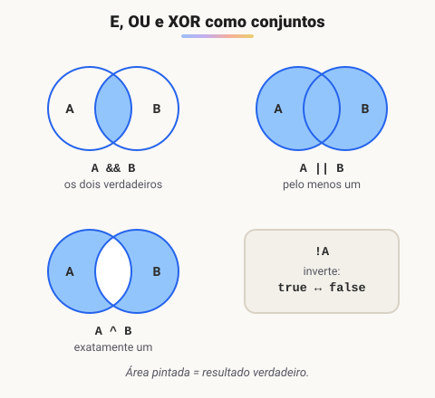
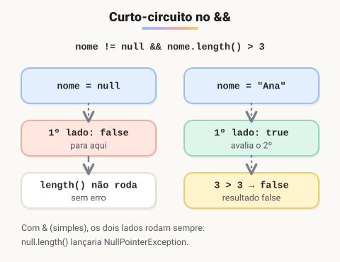

# Tabela verdade

> 🗺️ **Nesta aula:** os operadores relacionais e lógicos do Java, as tabelas verdade de E, OU, NÃO e XOR, o curto-circuito e o operador ternário, cada um com um exemplo em código.

## De onde paramos

No pseudocódigo usamos `e`, `ou` e `não` para combinar condições. Em Java eles têm símbolos próprios, e a **tabela verdade** mostra o resultado de cada combinação.

## Os operadores em Java

```java
// relacionais: comparam e devolvem boolean
a == b  // igual
a != b  // diferente
a > b    a < b    a >= b    a <= b

// lógicos: combinam booleans
a && b  // E (AND)
a || b  // OU (OR)
!a  // NÃO (NOT)
a ^ b  // OU EXCLUSIVO (XOR)
```

## Tabelas verdade



**E (**`&&`**)**: verdadeiro só quando os dois são verdadeiros.

| A | B | A && B |
| --- | --- | --- |
| false | false | false |
| false | true | false |
| true | false | false |
| true | true | true |

**OU**: verdadeiro quando pelo menos um é verdadeiro.

| A | B | A OU B |
| --- | --- | --- |
| false | false | false |
| false | true | true |
| true | false | true |
| true | true | true |

**NÃO (**`!`**)**: inverte o valor.

| A | !A |
| --- | --- |
| false | true |
| true | false |

**XOR (**`^`**)**: verdadeiro quando os dois são **diferentes**; um ou outro, mas não os dois.

| A | B | A ^ B |
| --- | --- | --- |
| false | false | false |
| false | true | true |
| true | false | true |
| true | true | false |

## Exemplos em código

### E: ir à praia

Só vamos à praia se for fim de semana **e** fizer sol.

```java
public class Main {
  public static void main(String[] args) {
    boolean fimDeSemana = true;
    boolean fazSol = false;

    boolean vamosAPraia = fimDeSemana && fazSol;
    // false
    System.out.println("Vamos à praia? " + vamosAPraia);
  }
}
```

> 💡 O original escrevia `if ((fimDeSemana == true) && (fazSol == true))` para depois atribuir true ou false. Como a própria expressão já é um boolean, basta `fimDeSemana && fazSol`. Comparar boolean com `== true` também é redundante.

### OU: acesso de administrador

O acesso é liberado se o usuário for administrador **ou** tiver uma permissão especial.

```java
boolean isAdmin = false;
boolean temPermissaoEspecial = true;

boolean acesso = isAdmin || temPermissaoEspecial;
// true
System.out.println("Acesso permitido? " + acesso);
```

### NÃO: conta bloqueada

```java
boolean bloqueada = false;

if (!bloqueada) {
  System.out.println("Pode operar");
}
```

> ⚠️ **Correção:** o original chamava `!=` de operador NÃO. O `!=` é o relacional "diferente"; o NÃO lógico é o `!` sozinho, que inverte um boolean. `valor != 0` equivale a `!(valor == 0)`.

### XOR: um desconto ou outro

Uma loja dá desconto para quem tem cupom **ou** cartão fidelidade, mas os dois descontos não se somam: com os dois ao mesmo tempo, o sistema pede para escolher.

```java
boolean temCupom = true;
boolean temFidelidade = true;

if (temCupom ^ temFidelidade) {
  System.out.println("Desconto aplicado");
} else if (temCupom && temFidelidade) {
  System.out.println("Escolha um dos descontos");
} else {
  System.out.println("Sem desconto");
}
```

> ⚠️ **Correção:** o exemplo original de votação usava `maiorDe18 ^ idoso`. Uma pessoa de 70 anos tem as duas condições verdadeiras, e o XOR dá **false**: o programa a impediria de votar. O XOR só serve quando os dois ao mesmo tempo devem ser rejeitados. Para "maior de 18 ou idoso" o operador certo seria o OU.

## Curto-circuito



O `&&` para de avaliar assim que encontra um false, e o OU para no primeiro true: o resultado já está decidido. Isso evita erros:

```java
String nome = null;
// seguro: se nome for null, length() nem é chamado
if (nome != null && nome.length() > 3) {
  System.out.println("Nome longo");
}
```

> 💡 `&` e `|` simples também funcionam com booleans, mas avaliam os dois lados sempre. No exemplo acima, `&` causaria um `NullPointerException`.

## Operador ternário

Um if/else que devolve um valor, numa linha: `condição ? valorSeVerdadeiro : valorSeFalso`.

```java
int idade = 20;
String faixa = idade >= 18 ? "maior" : "menor";
// maior
System.out.println(faixa);
```

> ⚠️ O exemplo original de login fazia `(usuarioValido || senhaCorreta) ? true : false`. Há dois problemas: o `? true : false` é redundante (a expressão já é boolean) e, pior, com OU um usuário válido com senha **errada** entraria. O certo é exigir os dois: `usuarioValido && senhaCorreta`.

## 📝 Exercício

Um ano é bissexto se for divisível por 4 e não por 100, ou se for divisível por 400. Escreva a expressão e teste com 2024, 1900 e 2000.

<details>
<summary>Ver resposta</summary>

```java
int ano = 1900;
boolean bissexto =
  (ano % 4 == 0 && ano % 100 != 0)
  || ano % 400 == 0;
System.out.println(bissexto);
```

2024 → true; 1900 → false (divisível por 100, não por 400); 2000 → true.

</details>

## 🧠 Revisão rápida

**Quanto vale true ^ true?**

false: o XOR só é verdadeiro quando os valores são diferentes.

**O que é avaliação em curto-circuito?**

Parar de avaliar a expressão assim que o resultado está decidido: o && para no primeiro false e o OU no primeiro true.

> ➡️ **Próximo passo:** usar essas condições em if, else e switch.

## 📌 Resumo

| Operador | Em uma frase |
| --- | --- |
| && (E) | Verdadeiro só se os dois forem. |
| OU | Verdadeiro se pelo menos um for. |
| ! (NÃO) | Inverte o valor. |
| ^ (XOR) | Verdadeiro se forem diferentes. |
| ternário | `cond ? a : b` escolhe entre dois valores. |
