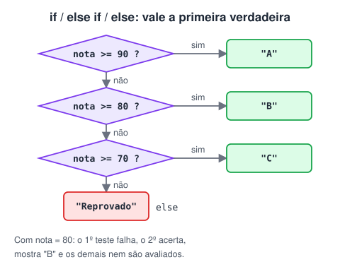
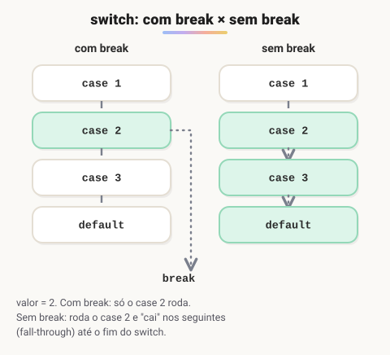

# Estruturas condicionais

> 🗺️ **Nesta aula:** if, if-else e if-else if-else em Java, o switch clássico com break, o efeito "fall-through" e o switch moderno com setas.

## De onde paramos

As estruturas de decisão do pseudocódigo (`se`, `senão`, `escolha`) existem em Java com outros nomes. A condição é sempre uma expressão boolean, montada com os operadores da aula anterior.

## if

Executa o bloco só se a condição for verdadeira.

```java
// idade usada na comparação
int idade = 20;

// o bloco só roda se a condição for verdadeira
if (idade >= 18) {
  System.out.println("Você é maior de idade.");
}
```

## if-else

Um bloco para verdadeiro e outro para falso.

```java
int idade = 15;

// if escolhe um dos dois caminhos
if (idade >= 18) {
  System.out.println("Maior de idade.");
// else roda quando a condição do if é falsa
} else {
  System.out.println("Menor de idade.");
}
```

## if-else if-else



> 💡 **Analogia:** é a triagem de um pronto-socorro. A enfermeira confere os critérios de cima para baixo, encaixa o paciente na primeira categoria que se aplica e não olha as seguintes.

Testa as condições em ordem e executa só a primeira verdadeira.

```java
int nota = 80;

// as faixas são testadas de cima para baixo;
// a primeira verdadeira decide o resultado
if (nota >= 90) {
  System.out.println("Aprovado com A");
} else if (nota >= 80) {
  System.out.println("Aprovado com B");
} else if (nota >= 70) {
  System.out.println("Aprovado com C");
} else {
  // nenhuma faixa acima foi atingida
  System.out.println("Reprovado");
}
```

> ⚠️ Sempre use chaves, mesmo com uma linha só. Sem elas, só a primeira instrução fica dentro do if, e uma linha acrescentada depois roda sempre, mesmo parecendo estar dentro do bloco.

## switch clássico

Compara **uma** expressão com valores exatos. Aceita `int`, `char`, `String` e enums.

```java
// número lido do dia da semana (1 = domingo)
int diaDaSemana = 3;
String nomeDia;

// o switch escolhe o case que bate com o valor
switch (diaDaSemana) {
  case 1:
    nomeDia = "Domingo";
    // o break impede a execução de cair no próximo case
    break;
  case 2:
    nomeDia = "Segunda-feira";
    break;
  case 3:
    nomeDia = "Terça-feira";
    break;
  case 4:
    nomeDia = "Quarta-feira";
    break;
  case 5:
    nomeDia = "Quinta-feira";
    break;
  case 6:
    nomeDia = "Sexta-feira";
    break;
  case 7:
    nomeDia = "Sábado";
    break;
  default:
    // nenhum case bateu: valor fora de 1 a 7
    nomeDia = "Dia inválido";
}

System.out.println("Dia: " + nomeDia);
```

### Por que o break é necessário



> 💡 **Analogia:** Como um trem expresso que não para: sem break, ele passa pela estação seguinte e segue até encontrar uma parada marcada, que é o break.

Sem `break`, a execução "cai" (fall-through) para o próximo case e continua até achar um `break` ou o fim do switch. Às vezes isso é usado de propósito, para vários casos com o mesmo resultado:

```java
// cases 1 e 7 não têm break: a execução cai no mesmo bloco
switch (diaDaSemana) {
  case 1:
  case 7:
    System.out.println("Fim de semana");
    break;
  default:
    System.out.println("Dia útil");
}
```

> 💡 **Analogia:** o switch clássico é um prédio em que você entra pelo andar certo, mas, sem o break, desce a escada passando por todos os andares de baixo. O break é a porta de saída daquele andar.

## switch moderno (Java 14+)

Com a seta `->` não existe fall-through, vários valores cabem no mesmo case e o switch pode **devolver um valor**:

```java
int dia = 3;

String tipo = switch (dia) {
  case 1, 7 -> "Fim de semana";
  case 2, 3, 4, 5, 6 -> "Dia útil";
  default -> "Inválido";
};

// Dia útil
System.out.println(tipo);
```

> 💡 Prefira a forma com seta em código novo: é mais curta e elimina o risco de esquecer um break.

## 📝 Exercício

Leia o valor de uma compra e aplique: até R$ 100, sem desconto; de R$ 100,01 a R$ 500, 5%; acima de R$ 500, 10%. Mostre o total.

<details>
<summary>Ver resposta</summary>

```java
// importa a classe que lê o teclado
import java.util.Scanner;

public class Main {
  public static void main(String[] args) {
    // lê o valor da compra
    Scanner in = new Scanner(System.in);
    double valor = in.nextDouble();
    double desconto;

    // a faixa mais alta é testada primeiro
    if (valor > 500) {
      desconto = 0.10;
    } else if (valor > 100) {
      desconto = 0.05;
    } else {
      desconto = 0;
    }

    // 1 - desconto: 10% de desconto vira fator 0,90
    double total = valor * (1 - desconto);
    // %.2f mostra o total com duas casas decimais
    System.out.printf("Total: R$ %.2f%n", total);
  }
}
```

Com 300: total R$ 285,00 (o separador decimal segue a configuração do sistema).

</details>

## 🧠 Revisão rápida

**O que acontece se faltar o break num case do switch clássico?**

A execução continua nos cases seguintes (fall-through) até achar um break ou o fim.

**Que tipos o switch aceita?**

int (e os menores: byte, short, char), String, enums e as classes wrapper deles.

> ➡️ **Próximo passo:** trabalhar com textos e datas.

## 📌 Resumo

| Item | Em uma frase |
| --- | --- |
| if / else | Executa um bloco conforme uma condição boolean. |
| else if | Testa várias condições; vale a primeira verdadeira. |
| switch clássico | Compara com valores exatos; precisa de break. |
| switch com -> | Sem fall-through e pode devolver valor. |
