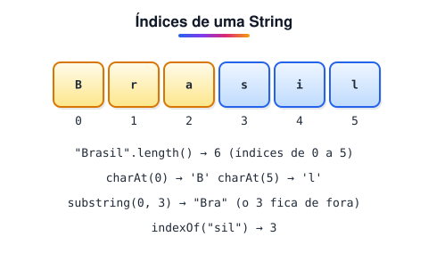
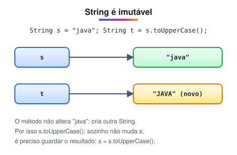

# Manipulando Strings e datas

> 🗺️ **Nesta aula:** os principais métodos de String, por que comparar textos com equals e não com ==, StringBuilder, datas e horas com java.time, formatação de datas e a diferença entre print, println e printf.

## De onde paramos

Já sabemos declarar variáveis e decidir caminhos. Quase todo programa, porém, mexe com **textos** (nomes, e-mails, mensagens) e **datas** (vencimentos, prazos, registros).

## Strings



Uma `String` é uma sequência de caracteres. Ela é **imutável**: os métodos não alteram o texto original, sempre devolvem uma String nova.

| Método | O que faz | Exemplo → resultado |
| --- | --- | --- |
| `toUpperCase()` | tudo em maiúsculas | `"Olá".toUpperCase()` → `"OLÁ"` |
| `toLowerCase()` | tudo em minúsculas | `"Olá".toLowerCase()` → `"olá"` |
| `length()` | quantidade de caracteres | `"Olá".length()` → 3 |
| `trim()` | tira espaços das pontas | `"  oi ".trim()` → `"oi"` |
| `substring(i, f)` | pedaço do índice i até f − 1 | `"Brasil".substring(0, 3)` → `"Bra"` |
| `contains(x)` | se contém o trecho | `"Brasil".contains("sil")` → true |
| `replace(a, b)` | troca trechos | `"a-b".replace("-", "+")` → `"a+b"` |
| `split(sep)` | divide em array | `"a;b;c".split(";")` → 3 partes |
| `charAt(i)` | caractere na posição i | `"Java".charAt(0)` → `'J'` |

> ⚠️ **Correção:** o original escrevia `.length`, sem parênteses. Em String, `length()` é um **método**; já em arrays, `length` é um **atributo**, sem parênteses (`numeros.length`).

```java
String texto = "Olá, mundo!";

// OLÁ, MUNDO!
System.out.println(texto.toUpperCase());
// olá, mundo!
System.out.println(texto.toLowerCase());
// 11
System.out.println(texto.length());
```



> 💡 **Analogia:** uma String é como uma frase gravada em pedra. Para "mudar" a frase, o escultor faz uma pedra nova com o texto alterado; a pedra antiga continua igual.

### Comparando textos

```java
String a = "Hello";
String b = "hello";

// false: diferencia maiúsculas
System.out.println(a.equals(b));
// true: ignora maiúsculas e minúsculas
System.out.println(a.equalsIgnoreCase(b));
```

> ⚠️ Não compare Strings com `==`. Ele compara se as duas variáveis apontam para o **mesmo objeto**, não se o texto é igual. `"Java" == new String("Java")` dá false, enquanto `equals` dá true.

### StringBuilder

Juntar Strings com `+` dentro de um laço cria um objeto novo a cada volta. Para montar textos grandes, use `StringBuilder`, que é mutável:

```java
StringBuilder sb = new StringBuilder();
for (int i = 1; i <= 3; i++) {
  sb.append(i).append(",");
}
// 1,2,3,
System.out.println(sb.toString());
```

## Datas e horas (java.time)

O pacote `java.time` (Java 8+) tem classes **imutáveis** e fáceis de usar:

| Classe | Representa | Exemplo |
| --- | --- | --- |
| `LocalDate` | só a data | 2026-12-31 |
| `LocalTime` | só a hora | 23:59:59 |
| `LocalDateTime` | data e hora, sem fuso | 2026-12-31T23:59:59 |
| `ZonedDateTime` | data e hora com fuso | ...-03:00[America/Sao_Paulo] |

### LocalDate

```java
import java.time.LocalDate;

public class Main {
  public static void main(String[] args) {
    // data de hoje
    LocalDate hoje = LocalDate.now();
    System.out.println("Hoje: " + hoje);

    // data específica
    LocalDate fimDoAno = LocalDate.of(2026, 12, 31);
    System.out.println("Fim do ano: " + fimDoAno);

    // partes da data
    System.out.println("Ano: " + hoje.getYear());
    System.out.println("Mês: " + hoje.getMonthValue());
    System.out.println("Dia: " + hoje.getDayOfMonth());
  }
}
```

> ⚠️ **Correção:** o original dizia que o padrão ISO 8601 é "Ano-Dia-Mês". É **ano-mês-dia**: `2026-12-31`.

### LocalDateTime

```java
import java.time.LocalDateTime;

LocalDateTime agora = LocalDateTime.now();
LocalDateTime prazo =
  LocalDateTime.of(2026, 12, 31, 23, 59, 59);

System.out.println(agora.getHour());
System.out.println(agora.getMinute());
```

### Somar, comparar e formatar

```java
import java.time.LocalDate;
import java.time.format.DateTimeFormatter;
import java.time.temporal.ChronoUnit;

LocalDate inicio = LocalDate.of(2026, 3, 10);
LocalDate fim = inicio.plusDays(45);

DateTimeFormatter br =
  DateTimeFormatter.ofPattern("dd/MM/yyyy");

// 24/04/2026
System.out.println(fim.format(br));
// 45
System.out.println(ChronoUnit.DAYS.between(inicio, fim));
// texto → data
LocalDate natal = LocalDate.parse("25/12/2026", br);
```

> 💡 No padrão de formatação, `MM` é mês e `mm` é minuto. Trocar um pelo outro é um erro clássico.

## print, println e printf

Os três são métodos de `System.out` (um `PrintStream`):

- `print`: escreve sem pular linha.
- `println`: escreve e pula linha.
- `printf`: escreve um texto **formatado**, com marcadores que são trocados pelos valores.

```java
System.out.print("Olá, ");
System.out.print("mundo!");
System.out.println();

int idade = 30;
double altura = 1.75;
String nome = "Ana";
System.out.printf(
  "Nome: %s, Idade: %d, Altura: %.2f%n",
  nome, idade, altura);
```

| Marcador | Para |
| --- | --- |
| `%s` | texto |
| `%d` | inteiro |
| `%.2f` | real com 2 casas |
| `%n` | quebra de linha |

## Exemplo: saudação com dia da semana

O programa mostra o nome, o dia da semana em português e uma saudação conforme a hora.

```java
import java.time.LocalDate;
import java.time.LocalTime;
import java.time.format.TextStyle;
import java.util.Locale;

public class Saudacao {
  public static void main(String[] args) {
    String nome = "Ana";
    Locale brasil = Locale.forLanguageTag("pt-BR");

    String diaDaSemana = LocalDate.now()
        .getDayOfWeek()
        .getDisplayName(TextStyle.FULL, brasil);

    int hora = LocalTime.now().getHour();
    String saudacao;
    if (hora < 5) {
      saudacao = "Boa madrugada!";
    } else if (hora < 12) {
      saudacao = "Bom dia!";
    } else if (hora < 18) {
      saudacao = "Boa tarde!";
    } else {
      saudacao = "Boa noite!";
    }

    System.out.printf("Olá, %s! Hoje é %s. %s%n",
        nome, diaDaSemana, saudacao.toUpperCase());
  }
}
```

Saída de exemplo: `Olá, Ana! Hoje é quinta-feira. BOA NOITE!`

> ⚠️ **Correções:**
>
> 1. No original, as faixas iam de 0 a 12, 12 a 18 e 18 a 24, cobrindo todas as horas; o "Boa madrugada!" do último else nunca aparecia. Agora a madrugada é de 0 a 4h.
> 2. `new Locale("pt", "br")` está obsoleto desde o Java 19. Use `Locale.forLanguageTag("pt-BR")` (ou `Locale.of("pt", "BR")`).

## 📝 Exercício

Leia um nome completo e mostre: o primeiro nome, a quantidade de letras sem espaços e o nome todo em maiúsculas.

<details>
<summary>Ver resposta</summary>

```java
import java.util.Scanner;

public class Main {
  public static void main(String[] args) {
    Scanner in = new Scanner(System.in);
    String nome = in.nextLine().trim();

    String primeiro = nome.split(" ")[0];
    int letras = nome.replace(" ", "").length();

    System.out.println(primeiro);
    System.out.println(letras);
    System.out.println(nome.toUpperCase());
  }
}
```

Com "Ana Souza": Ana, 8, ANA SOUZA.

</details>

## 🧠 Revisão rápida

**Por que não usar == para comparar Strings?**

Porque ele compara referências (se é o mesmo objeto), não o conteúdo. Use equals.

**Qual classe representa só uma data, sem hora?**

LocalDate.

**Qual a diferença entre print e println?**

O println pula linha no final; o print não.

> ➡️ **Próximo passo:** repetir blocos com while, do-while e for.

## 📌 Resumo

| Item | Em uma frase |
| --- | --- |
| String | Texto imutável; métodos devolvem uma String nova. |
| equals | Compara o conteúdo de dois textos. |
| StringBuilder | Monta textos grandes sem criar vários objetos. |
| java.time | LocalDate, LocalTime e LocalDateTime para datas. |
| printf | Escreve texto formatado com %s, %d, %.2f e %n. |
