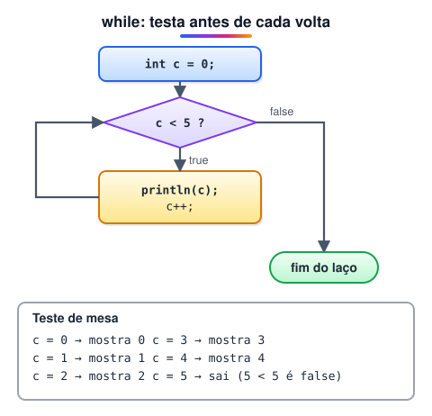
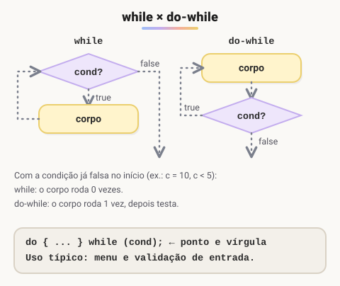
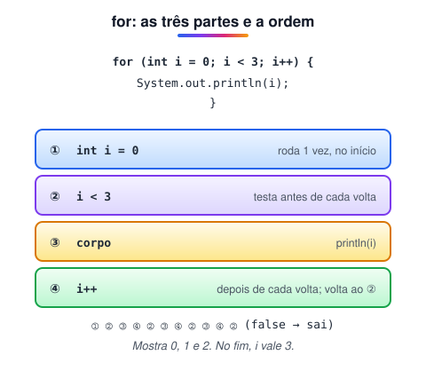
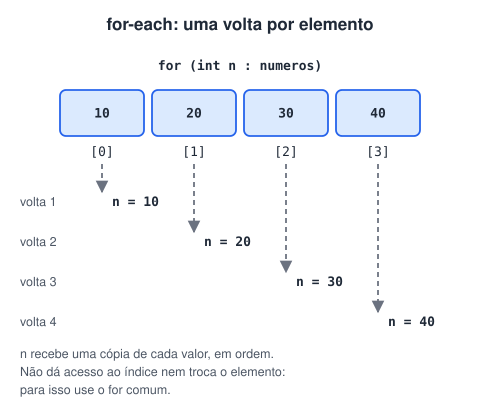
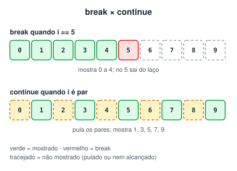
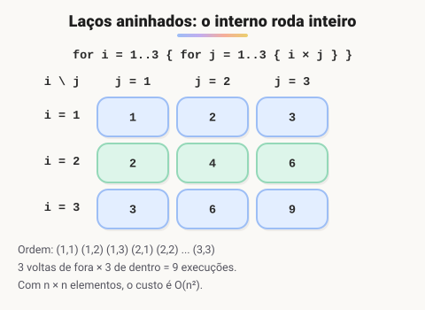

# Laços de repetição

> 🗺️ **Nesta aula:** os quatro laços do Java (while, do-while, for e for-each), como cada um executa passo a passo, contador e acumulador, break e continue (inclusive com rótulo), laços aninhados e como escolher o laço certo.

## De onde paramos

Os laços `enquanto`, `faça-enquanto` e `para` do pseudocódigo viram `while`, `do-while` e `for` em Java. A lógica é a mesma; muda a sintaxe. Todo laço tem três ingredientes: um **estado inicial**, uma **condição** que decide se continua e algo que **muda** a cada volta (senão ele nunca termina).

## while

Testa a condição **antes** de cada volta. Se ela já começar falsa, o corpo não roda nenhuma vez.



```java
int c = 0;
while (c < 5) {
  System.out.println("Contador: " + c);
  c++;
}
// mostra 0, 1, 2, 3 e 4; no fim, c vale 5
```

Use quando **não se sabe quantas voltas** serão necessárias, como "enquanto houver linhas no arquivo" ou "enquanto o saldo for positivo".

## do-while

Testa **depois**: o corpo roda pelo menos uma vez. Repare no `;` depois do `while`.



```java
int c = 0;
do {
  System.out.println("Contador: " + c);
  c++;
} while (c < 5);
```

Com `c = 0` os dois laços mostram a mesma coisa. A diferença aparece quando a condição já começa falsa: com `c = 10`, o while não mostra nada e o do-while mostra "Contador: 10" uma vez.<br />Uso típico: menus e validação de entrada, em que é preciso ler antes de decidir.

```java
Scanner in = new Scanner(System.in);
int nota;
do {
  System.out.print("Nota de 0 a 10: ");
  nota = in.nextInt();
} while (nota < 0 || nota > 10);
```

> 💡 **Analogia:** o while é o porteiro que confere o convite antes de você entrar; o do-while é a degustação no supermercado: você prova primeiro e só depois decide se quer mais.

## for

Junta inicialização, condição e atualização numa linha. Ideal quando se sabe quantas voltas dar.



```java
for (int i = 0; i < 3; i++) {
  System.out.println("i = " + i);
}
```

A atualização pode ser qualquer passo, inclusive para trás:

```java
// de 10 até 0, de 2 em 2: 10 8 6 4 2 0
for (int i = 10; i >= 0; i -= 2) {
  System.out.print(i + " ");
}
```

> 💡 A variável `i` declarada no `for` só existe dentro do laço. Tentar usá-la depois dá erro de compilação. Todo `for` pode ser reescrito como `while`: a inicialização vai antes, a condição no `while` e a atualização no fim do corpo.

## for-each

Percorre todos os elementos de um array ou coleção, sem índice.



```java
int[] numeros = {10, 20, 30, 40};
for (int n : numeros) {
  System.out.println(n);
}
```

Leia como "para cada `n` em `numeros`". Ele não dá acesso à posição nem permite trocar o elemento do array; para isso use o `for` comum, com `numeros[i]`.

## Contador e acumulador

Os mesmos padrões do pseudocódigo: o **contador** soma 1 a cada volta e o **acumulador** junta um resultado.

```java
int[] notas = {7, 9, 4, 10};
int soma = 0;
int qtd = 0;

for (int n : notas) {
  // acumulador
  soma += n;
  // contador
  qtd++;
}

// 30, 4 e 7.5
System.out.println(soma + " " + qtd);
System.out.println((double) soma / qtd);
```

## break e continue

- `break`: sai do laço imediatamente.
- `continue`: pula o resto desta volta e vai para a próxima.



```java
for (int i = 0; i < 10; i++) {
  // para tudo quando i chega a 5
  if (i == 5) {
    break;
  }
  System.out.println(i);
}
// mostra 0 a 4
```

```java
for (int i = 0; i < 10; i++) {
  // pula os pares
  if (i % 2 == 0) {
    continue;
  }
  System.out.println(i);
}
// mostra 1, 3, 5, 7 e 9
```

Um padrão comum é o laço "infinito" de propósito, que só termina pelo `break`:

```java
while (true) {
  String cmd = in.nextLine();
  if (cmd.equals("sair")) {
    break;
  }
  System.out.println("Você digitou " + cmd);
}
```

## Laços aninhados

Um laço dentro do outro: para **cada** volta do externo, o interno roda **inteiro**.



Exemplo: a tabuada de 1 a 10.

```java
public class Main {
  public static void main(String[] args) {
    // números de 1 a 10
    for (int i = 1; i <= 10; i++) {
      System.out.println("Tabuada do " + i + ":");

      // multiplicadores de 1 a 10
      for (int j = 1; j <= 10; j++) {
        System.out.println(i + " x " + j + " = " + i * j);
      }

      // linha em branco entre as tabuadas
      System.out.println();
    }
  }
}
```

São 10 × 10 = 100 linhas de conta: laços aninhados sobre n elementos custam O(n²), como vimos em desempenho de algoritmos.

> ⚠️ Num laço aninhado, o `break` só sai do laço **mais interno**. Para sair dos dois de uma vez, use um **rótulo**:

```java
externo:
for (int i = 1; i <= 3; i++) {
  for (int j = 1; j <= 3; j++) {
    if (i * j == 4) {
      // sai dos dois laços
      break externo;
    }
    System.out.print(i + "x" + j + " ");
  }
}
// 1x1 1x2 1x3 2x1
```

## Erros comuns

- **Laço infinito**: esquecer o `c++` do while, ou atualizar a variável errada.
- **Um a mais ou um a menos**: `i <= numeros.length` passa do último índice; o certo é `i < numeros.length`.
- `;` **depois do for**: `for (int i = 0; i < 3; i++);` executa um laço vazio, e o bloco seguinte roda só uma vez.

## Qual laço usar

| Situação | Laço |
| --- | --- |
| quantidade de voltas conhecida | `for` |
| percorrer todos os elementos, sem índice | for-each |
| repetir enquanto algo for verdade | `while` |
| executar ao menos uma vez (menu, validação) | `do-while` |

## 📝 Exercício

Peça números ao usuário até ele digitar 0 e mostre a soma e a quantidade de números digitados (sem contar o 0).

<details>
<summary>Ver resposta</summary>

```java
import java.util.Scanner;

public class Main {
  public static void main(String[] args) {
    Scanner in = new Scanner(System.in);
    int soma = 0;
    int quantidade = 0;
    int n;

    do {
      System.out.print("Número (0 para sair): ");
      n = in.nextInt();
      if (n != 0) {
        soma += n;
        quantidade++;
      }
    } while (n != 0);

    System.out.println("Soma: " + soma);
    System.out.println("Quantidade: " + quantidade);
  }
}
```

O do-while é a escolha natural: é preciso ler pelo menos um número antes de testar.

</details>

## 🧠 Revisão rápida

**Qual laço garante pelo menos uma execução?**

O do-while.

**Em que ordem rodam as partes de `for (A; B; C) { D }`?**

A uma vez; depois B, D, C, B, D, C... até B ser falso.

**O que o continue faz?**

Pula o restante da volta atual e segue para a próxima.

**Como sair de dois laços aninhados de uma vez?**

Com um rótulo no laço externo e break rotulo.

> ➡️ **Próximo passo:** guardar muitos valores com arrays e matrizes.

## 📌 Resumo

| Item | Em uma frase |
| --- | --- |
| while | Testa antes; pode não executar. |
| do-while | Testa depois; executa ao menos uma vez. |
| for | Laço com contador: início, condição e passo numa linha. |
| for-each | Percorre todos os elementos sem índice. |
| break / continue | Sai do laço / pula para a próxima volta. |
