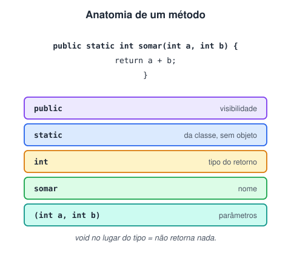

# Funções

> 🗺️ **Nesta aula:** como declarar e chamar métodos em Java, retorno e void, sobrecarga, passagem de parâmetros por valor e recursão.

## De onde paramos

No pseudocódigo, `funcao` e `procedimento` organizavam o algoritmo em partes reutilizáveis. Em Java, toda função fica dentro de uma classe e se chama **método**.

## Anatomia de um método



```java
public class Main {
  public static void main(String[] args) {
    // chamando o método com os argumentos 5 e 3
    int resultado = somar(5, 3);
    System.out.println("Soma: " + resultado);
  }

  // método com 2 parâmetros que devolve um int
  public static int somar(int a, int b) {
    return a + b;
  }
}
```

- `return` devolve o valor e **encerra** o método na hora.
- O valor devolvido precisa ser do tipo declarado (`int` aqui).
- Por enquanto todos os métodos são `static`: pertencem à classe e são chamados sem criar objeto. No módulo de POO aparecem os métodos de instância.

## void: métodos sem retorno

Quando o método só executa uma ação (o "procedimento" do pseudocódigo), o tipo de retorno é `void`:

```java
public static void mostrarMenu() {
  System.out.println("[1] Saldo");
  System.out.println("[2] Depositar");
  System.out.println("[3] Sair");
}
```

## Sobrecarga

Vários métodos podem ter o **mesmo nome** se os parâmetros forem diferentes (em tipo ou quantidade). O Java escolhe qual chamar pelos argumentos:

```java
static int somar(int a, int b) {
  return a + b;
}

static double somar(double a, double b) {
  return a + b;
}

// chama a versão int: 5
somar(2, 3);
// chama a versão double: 3.0
somar(2.5, 0.5);
```

## Passagem por valor

Java sempre passa **uma cópia** do argumento. Para primitivos, mudar o parâmetro não afeta a variável original:

```java
static void dobrar(int x) {
  x = x * 2;
}

int n = 10;
dobrar(n);
// continua 10
System.out.println(n);
```

Para arrays e objetos, a cópia é da **referência**: o método enxerga o mesmo objeto e pode alterar o conteúdo dele.

```java
static void dobrarTodos(int[] v) {
  for (int i = 0; i < v.length; i++) {
    v[i] *= 2;
  }
}

int[] valores = {1, 2, 3};
dobrarTodos(valores);
// [2, 4, 6]
System.out.println(Arrays.toString(valores));
```

## Recursão

Um método que chama a si mesmo, com um caso base para parar:

```java
static long fatorial(int n) {
  // caso base
  if (n <= 1) {
    return 1;
  }
  return n * fatorial(n - 1);
}

// 120
System.out.println(fatorial(5));
```

> ⚠️ Sem caso base, ou com um caso base que nunca é alcançado, o programa termina com `StackOverflowError`: cada chamada ocupa espaço na pilha até ela acabar.

## Boas práticas

- Um método, **uma** responsabilidade.
- Nome com verbo, em camelCase: `calcularMedia`, `validarCpf`.
- Prefira receber dados por parâmetro e devolver com return a ler e alterar variáveis de fora.

## 📝 Exercício

Escreva `ehPrimo(int n)`, que devolve true se n for primo, e use-o para mostrar os primos de 1 a 30.

<details>
<summary>Ver resposta</summary>

```java
public class Main {
  static boolean ehPrimo(int n) {
    if (n < 2) {
      return false;
    }
    // basta testar até a raiz quadrada
    for (int d = 2; d * d <= n; d++) {
      if (n % d == 0) {
        return false;
      }
    }
    return true;
  }

  public static void main(String[] args) {
    for (int i = 1; i <= 30; i++) {
      if (ehPrimo(i)) {
        System.out.print(i + " ");
      }
    }
  }
}
```

Saída: 2 3 5 7 11 13 17 19 23 29

</details>

## 🧠 Revisão rápida

**O que significa void?**

Que o método não devolve valor.

**O que é sobrecarga?**

Métodos com o mesmo nome e parâmetros diferentes.

**Um método pode alterar uma variável int de quem o chamou?**

Não: recebe uma cópia do valor. Ele só consegue alterar o conteúdo de objetos e arrays recebidos.

> ➡️ **Próximo passo:** começar o módulo de programação orientada a objetos.

## 📌 Resumo

| Item | Em uma frase |
| --- | --- |
| Método | Função dentro de uma classe, com tipo de retorno e parâmetros. |
| void | Método que não devolve valor. |
| Sobrecarga | Mesmo nome, parâmetros diferentes. |
| Por valor | O método recebe cópias; em objetos, cópia da referência. |
| Recursão | Método que chama a si mesmo até o caso base. |
