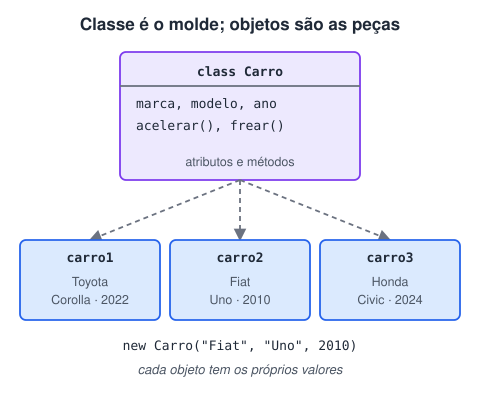

# Classe e objeto

> 🗺️ **Nesta aula:** o que é programação orientada a objetos, seus quatro pilares, e a diferença entre classe e objeto, com o exemplo de um carro.

## De onde paramos

Até agora o código era uma sequência de métodos `static` soltos dentro de `Main`. Em sistemas grandes isso vira bagunça. A **programação orientada a objetos** (POO) organiza o código em torno das "coisas" do problema: clientes, contas, pedidos.

## Os quatro pilares

| Pilar | Ideia | Aula |
| --- | --- | --- |
| Abstração | representar só o que importa do mundo real | esta |
| Encapsulamento | esconder os dados e expor métodos controlados | modificadores e encapsulamento |
| Herança | criar classes a partir de outras ("é um") | herança |
| Polimorfismo | a mesma chamada com comportamentos diferentes | polimorfismo |

## Classe

Uma **classe** é um **molde**: descreve quais dados (**atributos**) e quais ações (**métodos**) um tipo de objeto terá. Ela não é o carro; é a planta do carro.

- Declarada com a palavra `class`, com o nome em PascalCase.
- Contém atributos, construtores e métodos.
- Fica num arquivo com o mesmo nome (`Carro.java`) e pode ser organizada em **pacotes**.

```java
public class Carro {
  // atributos
  String marca;
  String modelo;
  int ano;

  // construtor: prepara o objeto ao ser criado
  public Carro(String marca, String modelo, int ano) {
    this.marca = marca;
    this.modelo = modelo;
    this.ano = ano;
  }

  // métodos
  public void acelerar() {
    System.out.println("O carro está acelerando!");
  }

  public void frear() {
    System.out.println("O carro está freando!");
  }
}
```

## Objeto

Um **objeto** é uma **instância** da classe: um carro concreto, com os próprios valores. Ele é criado com `new`.



```java
public class Main {
  public static void main(String[] args) {
    // criando um objeto da classe Carro
    Carro meuCarro = new Carro("Toyota", "Corolla", 2022);

    // lendo os atributos
    System.out.println("Marca: " + meuCarro.marca);
    System.out.println("Ano: " + meuCarro.ano);

    // chamando os métodos
    meuCarro.acelerar();
    meuCarro.frear();
  }
}
```

- Cada objeto tem sua **própria cópia** dos atributos: mudar o ano de um carro não muda o de outro.
- A variável `meuCarro` guarda uma **referência** ao objeto, não o objeto em si (como vimos em tipos de referência).

> 💡 **Abstração** na prática: o `Carro` do sistema de uma locadora precisa de placa e quilometragem; o de um jogo precisa de velocidade e cor. A classe modela só o que o seu problema usa.

> ⚠️ Aqui os atributos estão sem modificador e são acessados direto (`meuCarro.marca`). Funciona, mas não é a forma recomendada: na aula de encapsulamento eles viram `private` com getters.

## 📝 Exercício

Crie a classe `Livro` com título, autor e páginas, um construtor e o método `descrever()`, que mostra "Título, de Autor (N páginas)". Crie dois livros e descreva os dois.

<details>
<summary>Ver resposta</summary>

```java
public class Livro {
  String titulo;
  String autor;
  int paginas;

  Livro(String titulo, String autor, int paginas) {
    this.titulo = titulo;
    this.autor = autor;
    this.paginas = paginas;
  }

  void descrever() {
    System.out.println(titulo + ", de " + autor
        + " (" + paginas + " páginas)");
  }
}
```

```java
public class Main {
  public static void main(String[] args) {
    Livro a = new Livro("Dom Casmurro", "Machado de Assis", 256);
    Livro b = new Livro("Vidas Secas", "Graciliano Ramos", 176);
    a.descrever();
    b.descrever();
  }
}
```

</details>

## 🧠 Revisão rápida

**Qual a diferença entre classe e objeto?**

A classe é o molde, que define atributos e métodos; o objeto é uma instância concreta, criada com new, com seus próprios valores.

**O que o this.marca = marca faz no construtor?**

Copia o parâmetro marca para o atributo marca do objeto. O this diferencia o atributo do parâmetro de mesmo nome.

> ➡️ **Próximo passo:** atributos e métodos em detalhe.

## 📌 Resumo

| Item | Em uma frase |
| --- | --- |
| POO | Organiza o código em objetos com dados e comportamentos. |
| Classe | Molde que define atributos e métodos. |
| Objeto | Instância concreta da classe, criada com new. |
| Pilares | Abstração, encapsulamento, herança e polimorfismo. |
