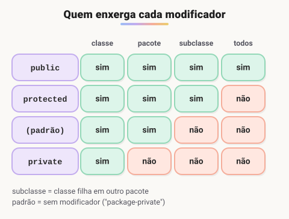

# Modificadores de acesso, construtor, getters e setters e encapsulamento

> 🗺️ **Nesta aula:** os quatro modificadores de acesso, construtores (incluindo sobrecarga e this(...)), getters e setters, e o encapsulamento com validação, num exemplo de conta bancária.

## De onde paramos

Na aula anterior, qualquer código podia fazer `p.idade = -50`. Nada impedia um estado inválido. Esta aula mostra como a classe protege os próprios dados.

## Modificadores de acesso

São palavras que definem **quem pode ver e usar** uma classe, atributo, método ou construtor.



1. `public`: visível de qualquer lugar, em qualquer pacote.
2. `protected`: visível na própria classe, no mesmo pacote e nas subclasses, mesmo em outros pacotes.
3. **padrão** (sem palavra nenhuma, também chamado de "package-private"): visível só dentro do mesmo pacote; subclasses de outros pacotes não enxergam.
4. `private`: visível só dentro da própria classe.

> 💡 Regra prática: atributos `private`, métodos que os outros usam `public`, e métodos auxiliares internos `private`. Abra o acesso só quando houver motivo.

## Construtor

É um bloco especial que roda quando o objeto é criado com `new`, para deixá-lo num estado válido desde o início.

- Tem o **mesmo nome da classe** e **não tem tipo de retorno**, nem `void`.
- Pode ser **sobrecarregado**: vários construtores com parâmetros diferentes.
- Um construtor pode chamar outro da mesma classe com `this(...)`, na primeira linha.

```java
public class Pessoa {
  private String nome;
  private int idade;

  // construtor completo
  public Pessoa(String nome, int idade) {
    this.nome = nome;
    this.idade = idade;
  }

  // construtor só com nome: reaproveita o outro
  public Pessoa(String nome) {
    this(nome, 0);
  }

  public String getNome() {
    return nome;
  }

  public int getIdade() {
    return idade;
  }
}
```

```java
Pessoa p1 = new Pessoa("Ana", 25);
Pessoa p2 = new Pessoa("Beto");
```

> ⚠️ Se a classe não declara nenhum construtor, o Java cria um **construtor padrão** vazio. Mas, assim que você escreve um construtor com parâmetros, esse padrão deixa de existir: `new Pessoa()` passa a dar erro de compilação, a menos que você declare também um construtor sem parâmetros.

## Getters e setters

São métodos públicos que dão acesso **controlado** a atributos privados. Seguem a convenção JavaBeans:

- **getter** (acessor): `getNome()` devolve o valor; para boolean, o padrão é `isAtivo()`.
- **setter** (modificador): `setNome(String nome)` altera o valor, podendo **validar** antes.<br />Nem todo atributo precisa de setter. Se um valor não deve mudar depois da criação, como o CPF, ofereça só o getter.

## Encapsulamento

**Encapsular** é esconder os detalhes internos e expor só operações seguras. Quem usa a classe não mexe nos dados diretamente: pede para a classe fazer, e ela garante as regras.

> 💡 **Analogia:** o caixa eletrônico é encapsulado. Você não abre o cofre e pega o dinheiro: aperta "sacar", e a máquina confere a senha e o saldo antes de entregar as notas.

```java
public class ContaBancaria {
  private final String titular;
  private double saldo;

  public ContaBancaria(String titular) {
    this.titular = titular;
  }

  public void depositar(double valor) {
    if (valor <= 0) {
      throw new IllegalArgumentException("Valor inválido");
    }
    saldo += valor;
  }

  public void sacar(double valor) {
    if (valor > saldo) {
      throw new IllegalStateException("Saldo insuficiente");
    }
    saldo -= valor;
  }

  // só leitura: não existe setSaldo
  public double getSaldo() {
    return saldo;
  }

  public String getTitular() {
    return titular;
  }
}
```

```java
ContaBancaria c = new ContaBancaria("Ana");
c.depositar(100);
c.sacar(30);
// 70.0
System.out.println(c.getSaldo());
// erro de compilação: saldo é private
// c.saldo = 1000000;
```

> 💡 Repare que não existe `setSaldo`. O saldo só muda por `depositar` e `sacar`, que aplicam as regras. Um setter que só copia o valor, sem nenhuma regra, protege pouco: o encapsulamento está nas operações com significado. O `throw` lança uma exceção, assunto da aula de exceções.

## 📝 Exercício

Encapsule a classe `Produto` com nome e preço privados. O preço não pode ser negativo: o setter deve lançar `IllegalArgumentException` nesse caso.

<details>
<summary>Ver resposta</summary>

```java
public class Produto {
  private String nome;
  private double preco;

  public Produto(String nome, double preco) {
    this.nome = nome;
    setPreco(preco);
  }

  public String getNome() {
    return nome;
  }

  public double getPreco() {
    return preco;
  }

  public void setPreco(double preco) {
    if (preco < 0) {
      throw new IllegalArgumentException(
          "Preço não pode ser negativo");
    }
    this.preco = preco;
  }
}
```

O construtor chama o setter para que a regra valha também na criação.

</details>

## 🧠 Revisão rápida

**Qual a diferença entre protected e o acesso padrão?**

Os dois liberam o mesmo pacote, mas o protected também libera subclasses de outros pacotes.

**Construtor tem tipo de retorno?**

Não, nem void.

**Por que deixar os atributos private?**

Para que só a própria classe altere o estado, garantindo as regras de negócio (encapsulamento).

> ➡️ **Próximo passo:** praticar com a primeira lista de exercícios de POO.

## 📌 Resumo

| Item | Em uma frase |
| --- | --- |
| Modificadores | public, protected, padrão e private controlam a visibilidade. |
| Construtor | Inicializa o objeto; mesmo nome da classe, sem retorno. |
| Getter e setter | Acesso controlado a atributos privados. |
| Encapsulamento | Dados privados, operações públicas com regras. |
