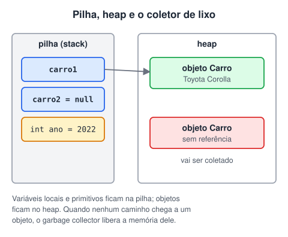

# Modelagem orientada a objetos

> 🗺️ **Nesta aula:** como o Java gerencia a memória (pilha, heap e garbage collector), a sobrescrita de toString e os modificadores de membros final, static e abstract.

## De onde paramos

Já sabemos criar classes encapsuladas. Agora, três ferramentas para modelá-las bem: o que acontece com os objetos na memória, como descrevê-los em texto e os modificadores que mudam o comportamento dos membros.

## Memória e garbage collector



Os objetos criados com `new` ficam numa área chamada **heap**. Quando nenhuma variável aponta mais para um objeto, ele vira "lixo", e o **garbage collector** (coletor de lixo) da JVM libera essa memória automaticamente. Em C, por exemplo, o programador precisa liberar a memória à mão.

```java
Carro c1 = new Carro("Fiat", "Uno", 2010);
// o objeto perde a única referência
c1 = null;
// a partir daqui ele pode ser coletado a qualquer momento
```

> ⚠️ **Correção:** o exemplo original sobrescrevia `finalize()` para ver o coletor agir e chamava `System.gc()`. O `finalize()` está **obsoleto** desde o Java 9 e marcado para remoção; não há garantia de quando, nem se, ele roda. E `System.gc()` é só uma **sugestão** à JVM, que pode ignorá-la. Para liberar recursos como arquivos e conexões, use try-with-resources (aula de exceções).

## Sobrescrevendo toString

Todo objeto herda de `Object` o método `toString()`, chamado automaticamente quando o objeto é concatenado com texto ou passado ao `println`. A versão padrão devolve algo como `Pessoa@1b6d3586` (classe + código hexadecimal), que não diz nada. Sobrescrevendo, você escolhe o texto. Para isso:

1. Declare o método `toString()` dentro da classe que deseja sobrescrever.
2. Anote o método com a anotação `@Override`, para indicar que está sobrescrevendo um método da superclasse.
3. Implemente a lógica para retornar a representação desejada do objeto como uma string.

**Exemplo:**

```java
public class Pessoa {
  private String nome;
  private int idade;

  public Pessoa(String nome, int idade) {
    this.nome = nome;
    this.idade = idade;
  }

  @Override
  public String toString() {
    return "Pessoa{nome='" + nome + "', idade=" + idade + "}";
  }
}
```

```java
Pessoa p = new Pessoa("Alice", 25);
// o println chama p.toString() sozinho:
// Pessoa{nome='Alice', idade=25}
System.out.println(p);
```

> ⚠️ No original, a classe do exemplo não fechava a última chave e o comentário dizia "chamada implícita" num código que chamava `person.toString()` explicitamente. A chamada implícita é a do exemplo acima: `println(p)`.

> 💡 `@Override` é uma **anotação**: avisa o compilador que o método sobrescreve outro. Se você errar o nome (por exemplo, `tostring`), o compilador acusa o erro em vez de criar um método novo sem querer.

## Modificadores de membros

### Modificadores de acesso

`public`, `protected`, padrão e `private`, vistos na aula anterior. São **quatro** níveis.

> ⚠️ **Ajuste:** o original dizia "existem três tipos de modificadores de acesso" e listava quatro. Contando o padrão (sem palavra), são quatro.

### final

Impede mudanças:

- em uma **variável ou atributo**: o valor não pode ser trocado depois de atribuído;
- em um **método**: as subclasses não podem sobrescrevê-lo;
- em uma **classe**: ninguém pode herdar dela (`String` é final).

```java
public class Config {
  // constante da classe: static + final
  public static final int LIMITE_TENTATIVAS = 3;

  public final void metodoFinal() {
    // nenhuma subclasse pode sobrescrever
  }
}
```

### static

O membro pertence à **classe**, não aos objetos.

- **Atributo static**: uma única cópia, compartilhada por todos os objetos. Serve para contadores e constantes.
- **Método static**: chamado pela classe, sem criar objeto (`Math.max(a, b)`, `Integer.parseInt(s)`). Ótimo para utilitários.
- Um método static **não** enxerga atributos e métodos de instância diretamente: não há objeto para usar.
- Acesse sempre pela classe (`Conta.getTotalContas()`), não por um objeto, para deixar claro que é compartilhado.

```java
public class Conta {
  // compartilhado por todas as contas
  private static int totalContas = 0;
  private final String titular;

  public Conta(String titular) {
    this.titular = titular;
    totalContas++;
  }

  public static int getTotalContas() {
    return totalContas;
  }
}
```

> ⚠️ No original, a frase sobre static terminava no meio ("Cada objeto criado a partir desse atributo recebe ele como"). A ideia completa: todos os objetos **compartilham** o mesmo atributo static; nenhum recebe uma cópia própria.

### abstract

- **Classe abstrata**: não pode ser instanciada com `new`; serve de base para outras.
- **Método abstrato**: só a assinatura, sem corpo. Toda subclasse concreta é obrigada a implementá-lo.

```java
public abstract class Forma {
  public abstract double area();
}
```

Detalhes na aula de polimorfismo.

## 📝 Exercício

Sobrescreva o `toString` da classe `Livro` (título, autor e páginas) para devolver `"Dom Casmurro (Machado de Assis, 256 p.)"`.

<details>
<summary>Ver resposta</summary>

```java
@Override
public String toString() {
  return titulo + " (" + autor + ", " + paginas + " p.)";
}
```

</details>

## 🧠 Revisão rápida

**Quando um objeto pode ser coletado pelo garbage collector?**

Quando nenhuma referência alcança mais ele.

**O que static final indica num atributo?**

Uma constante da classe: uma única cópia que não pode ser alterada.

**Para que serve o @Override?**

Para o compilador conferir que o método realmente sobrescreve outro da superclasse.

> ➡️ **Próximo passo:** reaproveitar classes com herança.

## 📌 Resumo

| Item | Em uma frase |
| --- | --- |
| Garbage collector | Libera objetos sem referência; não chame finalize. |
| toString | Texto que representa o objeto; sobrescreva com @Override. |
| final | Valor, método ou classe que não pode mudar ou ser estendido. |
| static | Membro da classe, compartilhado por todos os objetos. |
| abstract | Classe que não se instancia; método sem corpo. |
