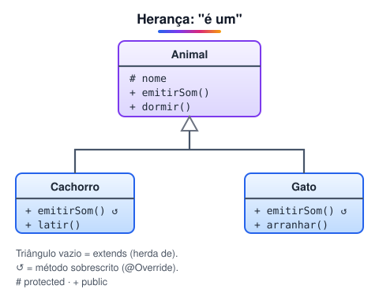

# Herança

> 🗺️ **Nesta aula:** como criar uma classe a partir de outra com extends, o papel do super, a sobrescrita de métodos com @Override e a diferença entre sobrescrita e sobrecarga.

## De onde paramos

Imagine as classes `Cachorro` e `Gato`: as duas têm nome e dormem. Repetir esse código em cada uma é desperdício e fonte de erro. A **herança** coloca o que é comum numa classe base.

## O que é herança

Uma classe **filha** (subclasse) herda os atributos e métodos de uma classe **pai** (superclasse) e pode acrescentar os seus ou modificar os herdados. A relação é de **"é um"**: um cachorro **é um** animal.



> 💡 **Analogia:** é como a receita de bolo da família. A receita base (superclasse) passa de geração em geração; cada filho usa a mesma base e acrescenta o seu toque, como cobertura de chocolate ou recheio de frutas (os métodos novos e sobrescritos).

- Em Java usa-se `extends`.
- Cada classe tem **uma única** superclasse (não há herança múltipla de classes).
- Toda classe herda, direta ou indiretamente, de `Object`; é de lá que vêm `toString()` e `equals()`.
- Membros `private` da superclasse existem no objeto, mas a subclasse não os acessa diretamente; `protected` e `public` ela acessa.

```java
// classe base
class Animal {
  protected String nome;

  public Animal(String nome) {
    this.nome = nome;
  }

  public void emitirSom() {
    System.out.println("O animal emite um som.");
  }
}
```

```java
// Cachorro é um Animal: herda nome e emitirSom
class Cachorro extends Animal {
  private String raca;

  public Cachorro(String nome, String raca) {
    // chama o construtor de Animal
    super(nome);
    this.raca = raca;
  }

  public void latir() {
    System.out.println(nome + " (" + raca
        + ") está latindo.");
  }
}
```

```java
public class Main {
  public static void main(String[] args) {
    Cachorro c = new Cachorro("Max", "Labrador");

    // herdado de Animal
    System.out.println(c.nome);
    c.emitirSom();

    // próprio de Cachorro
    c.latir();
  }
}
```

## A palavra super

- `super(...)`: chama o construtor da superclasse. Precisa ser a **primeira linha** do construtor da filha. Se a superclasse não tem construtor sem parâmetros, a chamada é obrigatória.
- `super.metodo()`: chama a versão da superclasse de um método, útil para estender em vez de substituir.

## Sobrescrita (@Override)

A subclasse pode dar **sua própria versão** de um método herdado, com o mesmo nome e os mesmos parâmetros.

```java
class Animal {
  public void emitirSom() {
    System.out.println("O animal emite um som.");
  }
}

class Cachorro extends Animal {
  @Override
  public void emitirSom() {
    System.out.println("O cachorro late: Au au!");
  }
}
```

```java
// O animal emite um som.
new Animal().emitirSom();
// O cachorro late: Au au!
new Cachorro().emitirSom();
```

> 💡 O original chamava o recurso de "método override". O nome do conceito é **sobrescrita** (override); `@Override` é só a anotação que pede ao compilador para conferir se ela está correta.

Para aproveitar o comportamento do pai e acrescentar algo:

```java
@Override
public void emitirSom() {
  super.emitirSom();
  System.out.println("...e abana o rabo.");
}
```

> ⚠️ Não confunda **sobrescrita** (override: mesma assinatura, numa subclasse, decidida em tempo de execução) com **sobrecarga** (overload: mesmo nome, parâmetros diferentes, na mesma classe, decidida na compilação).

## 📝 Exercício

Crie `Funcionario` (nome, salário e o método `calcularBonus()` = 10% do salário) e `Gerente extends Funcionario`, cujo bônus é 20%. Mostre o bônus de um de cada, com salário de 5.000.

<details>
<summary>Ver resposta</summary>

```java
class Funcionario {
  protected String nome;
  protected double salario;

  Funcionario(String nome, double salario) {
    this.nome = nome;
    this.salario = salario;
  }

  double calcularBonus() {
    return salario * 0.10;
  }
}

class Gerente extends Funcionario {
  Gerente(String nome, double salario) {
    super(nome, salario);
  }

  @Override
  double calcularBonus() {
    return salario * 0.20;
  }
}
```

```java
Funcionario f = new Funcionario("Ana", 5000);
Funcionario g = new Gerente("Beto", 5000);
// 500.0
System.out.println(f.calcularBonus());
// 1000.0
System.out.println(g.calcularBonus());
```

</details>

## 🧠 Revisão rápida

**Uma classe Java pode ter duas superclasses?**

Não. Cada classe estende uma única classe; para combinar contratos, usam-se interfaces.

**Onde deve ficar a chamada super(...)?**

Na primeira linha do construtor da subclasse.

**Qual a diferença entre sobrescrita e sobrecarga?**

Sobrescrita redefine um método herdado com a mesma assinatura; sobrecarga cria métodos com o mesmo nome e parâmetros diferentes.

> ➡️ **Próximo passo:** polimorfismo, classes abstratas e interfaces.

## 📌 Resumo

| Item | Em uma frase |
| --- | --- |
| Herança | Subclasse herda atributos e métodos da superclasse (extends). |
| super | Chama o construtor ou um método da superclasse. |
| Sobrescrita | A subclasse redefine um método herdado (@Override). |
| Object | Superclasse de todas as classes Java. |
