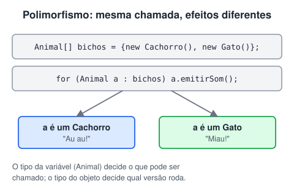

# Polimorfismo

> 🗺️ **Nesta aula:** polimorfismo com uma referência do tipo da superclasse, classes abstratas, interfaces e quando usar cada uma.

## De onde paramos

Com herança e sobrescrita, `Cachorro` e `Gato` têm cada um o seu `emitirSom()`. O **polimorfismo** ("muitas formas") permite tratar os dois simplesmente como `Animal` e, ainda assim, cada um responder do seu jeito.

## Polimorfismo

Uma variável do tipo da **superclasse** pode guardar um objeto de qualquer **subclasse**. Ao chamar um método sobrescrito, roda a versão do **objeto real**, decidida em tempo de execução.



```java
class Animal {
  public void emitirSom() {
    System.out.println("O animal emite um som.");
  }

  public void dizAnimal() {
    System.out.println("Eu sou um animal!");
  }
}

class Cachorro extends Animal {
  @Override
  public void emitirSom() {
    System.out.println("O cachorro late: Au au!");
  }
}

class Gato extends Animal {
  @Override
  public void emitirSom() {
    System.out.println("O gato mia: Miau!");
  }
}
```

```java
public class Main {
  public static void main(String[] args) {
    Animal[] bichos = { new Cachorro(), new Gato() };

    for (Animal a : bichos) {
      // cada objeto usa a própria versão
      a.emitirSom();
      // sem sobrescrita: vale a da classe pai
      a.dizAnimal();
    }
  }
}
```

Saída: Au au!, Eu sou um animal!, Miau!, Eu sou um animal!<br />O ganho: o laço não precisa de `if (é cachorro) ... else if (é gato)`. Ao criar uma classe `Vaca`, o laço continua igual.

> ⚠️ Pela variável `Animal a` só dá para chamar métodos que existem em `Animal`. Se `Cachorro` tem `latir()`, `a.latir()` não compila. Para isso é preciso testar e converter: `if (a instanceof Cachorro c) { c.latir(); }` (Java 16+).

## Classe abstrata

Às vezes a classe base é só um conceito: não existe "um animal" genérico. Uma classe **abstrata**:

1. não pode ser instanciada com `new`;
2. pode ter métodos **abstratos** (sem corpo), que toda subclasse concreta é **obrigada** a implementar;
3. pode ter também métodos **concretos**, atributos e construtores, que são herdados normalmente.

```java
abstract class Animal {
  // sem corpo: cada subclasse implementa
  public abstract void emitirSom();

  // concreto: herdado por todos
  public void dormir() {
    System.out.println("O animal está dormindo.");
  }
}

class Cachorro extends Animal {
  @Override
  public void emitirSom() {
    System.out.println("Au au!");
  }
}
```

```java
Animal a = new Cachorro();
a.emitirSom();
a.dormir();
// erro de compilação: Animal é abstrata
// Animal x = new Animal();
```

Benefícios: reaproveita código comum, define um **contrato** (os métodos abstratos) e funciona com polimorfismo. Se uma subclasse não implementar todos os métodos abstratos, ela também precisa ser declarada `abstract`.

## Interfaces

Uma **interface** é um contrato puro: diz **o que** uma classe sabe fazer, sem dizer como. A classe usa `implements` e precisa implementar todos os métodos.

```java
interface Pagavel {
  double calcularValor();
}

class Boleto implements Pagavel {
  private final double valor;

  Boleto(double valor) {
    this.valor = valor;
  }

  public double calcularValor() {
    return valor;
  }
}

class Pix implements Pagavel {
  private final double valor;

  Pix(double valor) {
    this.valor = valor;
  }

  // 2% de desconto no Pix
  public double calcularValor() {
    return valor * 0.98;
  }
}
```

```java
Pagavel[] pagamentos = { new Boleto(100), new Pix(100) };
for (Pagavel p : pagamentos) {
  // 100.0 e 98.0
  System.out.println(p.calcularValor());
}
```

- Uma classe pode implementar **várias** interfaces (`class A implements X, Y`), mas estender uma só classe.
- Desde o Java 8, interfaces podem ter métodos `default` (com corpo) e `static`.
- Exemplos da própria biblioteca: `List`, `Comparable`, `Runnable`.

## Abstrata ou interface?

|  | Classe abstrata | Interface |
| --- | --- | --- |
| Relação | "é um" | "sabe fazer" |
| Quantas por classe | uma (extends) | várias (implements) |
| Atributos de instância | sim | não (só constantes) |
| Construtor | sim | não |
| Quando usar | base comum com código e estado | contrato entre partes que não são da mesma família |

## 📝 Exercício

Crie a classe abstrata `Forma` com o método abstrato `area()` e as subclasses `Retangulo(base, altura)` e `Circulo(raio)`. Some as áreas de um retângulo 3 × 4 e de um círculo de raio 1.

<details>
<summary>Ver resposta</summary>

```java
abstract class Forma {
  abstract double area();
}

class Retangulo extends Forma {
  private final double base, altura;

  Retangulo(double base, double altura) {
    this.base = base;
    this.altura = altura;
  }

  double area() {
    return base * altura;
  }
}

class Circulo extends Forma {
  private final double raio;

  Circulo(double raio) {
    this.raio = raio;
  }

  double area() {
    return Math.PI * raio * raio;
  }
}
```

```java
Forma[] formas = { new Retangulo(3, 4), new Circulo(1) };
double total = 0;
for (Forma f : formas) {
  total += f.area();
}
// 15.14
System.out.printf("%.2f%n", total);
```

12 + π ≈ 15,14.

</details>

## 🧠 Revisão rápida

**O que decide qual versão de um método sobrescrito vai rodar?**

O tipo do objeto real, em tempo de execução, e não o tipo da variável.

**Dá para criar um objeto de uma classe abstrata?**

Não com new; só de suas subclasses concretas.

**Quantas interfaces uma classe pode implementar?**

Quantas quiser.

> ➡️ **Próximo passo:** quando a herança atrapalha: acoplamento e composição.

## 📌 Resumo

| Item | Em uma frase |
| --- | --- |
| Polimorfismo | Variável do tipo pai, comportamento do objeto filho. |
| Classe abstrata | Base que não se instancia, com métodos abstratos obrigatórios. |
| Interface | Contrato de métodos; uma classe pode ter várias. |
| instanceof | Testa o tipo real antes de converter. |
