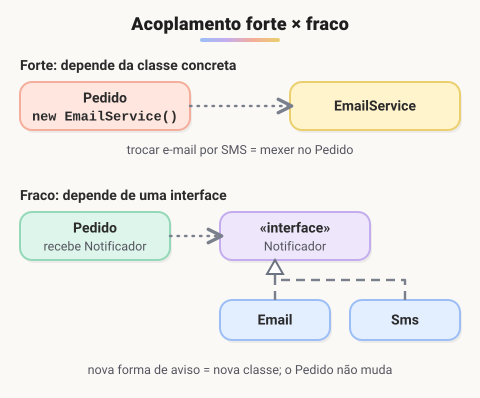

# Herança, composição e acoplamento

> 🗺️ **Nesta aula:** o que é acoplamento, por que a herança cria acoplamento forte, como a composição e as interfaces reduzem a dependência entre classes, e a regra "prefira composição a herança".

## De onde paramos

Herança e polimorfismo são poderosos, mas usados sem critério deixam o sistema rígido: mudar uma classe quebra outras. Esta aula mostra como medir essa dependência e diminuí-la.

## Herança, em resumo

- Uma subclasse herda atributos e métodos da superclasse e pode sobrescrevê-los.
- Ela promove reaproveitamento, mas só faz sentido quando existe uma relação verdadeira de **"é um"**.

**Exemplo de herança adequada**

```java
class Animal {
  protected String nome;

  public Animal(String nome) {
    this.nome = nome;
  }

  public void emitirSom() {
    System.out.println("O animal emite um som.");
  }
}

class Cachorro extends Animal {
  public Cachorro(String nome) {
    super(nome);
  }

  @Override
  public void emitirSom() {
    System.out.println("O cachorro late.");
  }
}

class Gato extends Animal {
  public Gato(String nome) {
    super(nome);
  }

  @Override
  public void emitirSom() {
    System.out.println("O gato mia.");
  }
}
```

Um cachorro **é** um animal: a herança descreve o mundo real.

## Acoplamento

**Acoplamento** é o quanto uma classe depende de outra.

- **Forte**: a classe conhece detalhes internos ou a implementação concreta da outra. Qualquer mudança lá exige mudança aqui.
- **Fraco**: a classe depende só de um contrato público (uma interface). As implementações podem mudar ou ser trocadas livremente.<br />Acoplamento fraco deixa o sistema mais flexível, mais fácil de testar e de manter.



> 💡 **Analogia:** um aparelho soldado direto na fiação da casa é acoplamento forte: para trocá-lo, chama o eletricista. Um aparelho com plugue na tomada é acoplamento fraco: a tomada é o contrato (a interface), e qualquer aparelho com o plugue certo funciona.

### Exemplo: acoplamento forte

```java
class EmailService {
  void enviar(String msg) {
    System.out.println("E-mail: " + msg);
  }
}

class Pedido {
  // Pedido cria e conhece a classe concreta
  private EmailService email = new EmailService();

  void finalizar() {
    email.enviar("Pedido finalizado");
  }
}
```

Para avisar por SMS, ou para testar o `Pedido` sem mandar e-mails de verdade, é preciso alterar o código do `Pedido`.

### Exemplo: acoplamento fraco

```java
interface Notificador {
  void enviar(String msg);
}

class EmailNotificador implements Notificador {
  public void enviar(String msg) {
    System.out.println("E-mail: " + msg);
  }
}

class SmsNotificador implements Notificador {
  public void enviar(String msg) {
    System.out.println("SMS: " + msg);
  }
}

class Pedido {
  private final Notificador notificador;

  // quem cria o Pedido escolhe o notificador
  Pedido(Notificador notificador) {
    this.notificador = notificador;
  }

  void finalizar() {
    notificador.enviar("Pedido finalizado");
  }
}
```

```java
new Pedido(new EmailNotificador()).finalizar();
new Pedido(new SmsNotificador()).finalizar();
```

O `Pedido` só conhece a interface. Entregar a dependência pronta pelo construtor, em vez de criá-la lá dentro, se chama **injeção de dependência**, e é a base de frameworks como o Spring.

> ⚠️ **Ajuste:** o exemplo original se chamava "uso excessivo de herança", mas não tinha herança nenhuma, e a interface `Notificavel` era implementada pelo `Cliente` sem nunca ser usada pelo `Pedido`. Por isso ele não mostrava a diferença entre forte e fraco. Os dois exemplos acima separam os casos.

## Herança também acopla

A subclasse depende de detalhes da superclasse: se o pai muda, os filhos podem quebrar. Pior ainda quando a herança é usada só para reaproveitar código, sem relação "é um":

```java
// RUIM: uma pilha NÃO é uma lista
class Pilha extends ArrayList<Integer> {
  void empilhar(int x) {
    add(x);
  }
}
```

Essa `Pilha` herda `add(0, x)`, `remove(0)`, `get(5)`... e qualquer um pode bagunçar a ordem. Com **composição**, a pilha **tem** uma lista e expõe só o que faz sentido:

```java
import java.util.ArrayList;
import java.util.List;

// BOM: a pilha TEM uma lista
class Pilha {
  private final List<Integer> itens = new ArrayList<>();

  void empilhar(int x) {
    itens.add(x);
  }

  int desempilhar() {
    return itens.remove(itens.size() - 1);
  }

  boolean vazia() {
    return itens.isEmpty();
  }
}
```

> 💡 Regra prática: **prefira composição a herança**. Use herança quando a frase "X é um Y" for verdadeira em todos os casos; quando for "X tem um Y" ou "X usa um Y", use composição.

## 📝 Exercício

Um `Relatorio` hoje faz `new ImpressoraPdf()` dentro de si para gerar arquivos. Como reduzir esse acoplamento para que ele também gere HTML sem ser modificado?

<details>
<summary>Ver resposta</summary>

Criar uma interface `Exportador` com o método `exportar(String conteudo)`, implementada por `ExportadorPdf` e `ExportadorHtml`. O `Relatorio` recebe um `Exportador` no construtor e chama `exportador.exportar(...)`. Para um novo formato basta criar outra implementação; o `Relatorio` não muda.

</details>

## 🧠 Revisão rápida

**O que é acoplamento fraco?**

Depender só de um contrato público (interface), sem conhecer a implementação concreta.

**Quando a herança é a escolha errada?**

Quando não existe uma relação verdadeira de "é um" e ela é usada só para reaproveitar código.

> ➡️ **Próximo passo:** as coleções do Java: List, Set e Map.

## 📌 Resumo

| Item | Em uma frase |
| --- | --- |
| Acoplamento | Grau de dependência entre classes; quanto menor, melhor. |
| Interface | Permite depender do contrato, não da implementação. |
| Injeção de dependência | Receber a dependência pronta, em vez de criá-la. |
| Composição | "Tem um": usar outro objeto em vez de herdar dele. |
