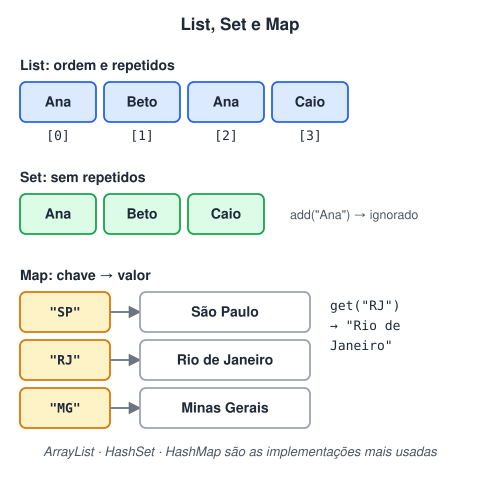

# Coleções: List, Set e Map (Adicionado pelo aluno para melhorar o estudo)

> 🗺️ **Nesta aula:** as três famílias de coleções do Java (List, Set e Map), suas implementações mais usadas, os métodos principais e quando escolher cada uma.

## De onde paramos

Arrays têm tamanho fixo. Na prática, quase nunca sabemos quantos clientes, pedidos ou produtos virão. As **coleções** do pacote `java.util` crescem sozinhas e já trazem as operações prontas. Elas também são um ótimo exemplo de interfaces: `List`, `Set` e `Map` são interfaces, e `ArrayList`, `HashSet` e `HashMap` são implementações.



> 💡 **Analogia:** a List é uma fila de banco (cada um tem sua posição, e a mesma pessoa pode voltar à fila); o Set é a lista de convidados de uma festa (cada nome aparece uma vez só); o Map é a agenda de contatos (você procura pelo nome e encontra o telefone).

## List: sequência com ordem

Guarda elementos **na ordem** em que entram, aceita **repetidos** e permite acesso por índice.

```java
import java.util.ArrayList;
import java.util.Collections;
import java.util.List;

List<String> nomes = new ArrayList<>();
nomes.add("Ana");
nomes.add("Beto");
nomes.add("Ana");
// insere na posição 1
nomes.add(1, "Caio");

// [Ana, Caio, Beto, Ana]
System.out.println(nomes);
// Caio
System.out.println(nomes.get(1));
// true
System.out.println(nomes.contains("Beto"));

// remove a primeira "Ana": [Caio, Beto, Ana]
nomes.remove("Ana");
// ordena: [Ana, Beto, Caio]
Collections.sort(nomes);
```

| Método | Faz |
| --- | --- |
| `add(x)` / `add(i, x)` | acrescenta no fim / na posição i |
| `get(i)` | elemento da posição i |
| `set(i, x)` | troca o elemento da posição i |
| `remove(i)` ou `remove(x)` | remove por posição ou por valor |
| `size()` / `isEmpty()` | tamanho / se está vazia |
| `contains(x)` / `indexOf(x)` | se contém / em que posição |

> 💡 Declare a variável pelo tipo da **interface** (`List<String> nomes = new ArrayList<>()`). Assim dá para trocar a implementação depois sem mexer no resto do código: é o acoplamento fraco da aula anterior.

> ⚠️ Coleções guardam **objetos**, não primitivos: use `List<Integer>`, e não `List<int>`. O Java converte `int` em `Integer` sozinho (autoboxing). E `List.of(...)` cria uma lista **imutável**: chamar `add` nela lança `UnsupportedOperationException`.

## Set: sem repetidos

Um conjunto ignora elementos repetidos. Ótimo para "quais valores diferentes apareceram?" e para testar se algo existe, de forma muito rápida.

```java
import java.util.HashSet;
import java.util.Set;
import java.util.TreeSet;

Set<String> unicos = new HashSet<>();
unicos.add("Ana");
unicos.add("Beto");
// devolve false: já existia
unicos.add("Ana");
// 2
System.out.println(unicos.size());

// TreeSet mantém em ordem: [Ana, Beto, Caio]
Set<String> ordenado =
    new TreeSet<>(List.of("Caio", "Ana", "Beto"));
```

## Map: chave → valor

Associa cada **chave** (única) a um **valor**, como um dicionário. Próprio para buscar algo por um identificador.

```java
import java.util.HashMap;
import java.util.Map;

Map<String, Integer> estoque = new HashMap<>();
estoque.put("caneta", 10);
estoque.put("lápis", 5);
// a chave já existe: troca o valor
estoque.put("caneta", 12);

// 12
System.out.println(estoque.get("caneta"));
// 0 (valor padrão para chave ausente)
System.out.println(estoque.getOrDefault("borracha", 0));
// true
System.out.println(estoque.containsKey("lápis"));

// percorrendo chave e valor
for (Map.Entry<String, Integer> e : estoque.entrySet()) {
  System.out.println(e.getKey() + " = " + e.getValue());
}
```

## Qual escolher

| Preciso de... | Use |
| --- | --- |
| ordem e acesso por posição | `ArrayList` |
| valores sem repetição | `HashSet` (ou `TreeSet`, ordenado) |
| buscar por uma chave | `HashMap` (ou `TreeMap`, ordenado pela chave) |
| fila (primeiro a entrar, primeiro a sair) | `ArrayDeque` ou `LinkedList` |

> 💡 `HashSet` e `HashMap` não garantem ordem nenhuma ao percorrer. Se a ordem importa, use `LinkedHashMap` (ordem de inserção) ou `TreeMap` (ordem das chaves).

## 📝 Exercício

Conte quantas vezes cada palavra aparece em `"a b a c b a"` e mostre o resultado em ordem alfabética.

<details>
<summary>Ver resposta</summary>

```java
import java.util.Map;
import java.util.TreeMap;

String texto = "a b a c b a";
Map<String, Integer> contagem = new TreeMap<>();

for (String p : texto.split(" ")) {
  contagem.put(p, contagem.getOrDefault(p, 0) + 1);
}

// {a=3, b=2, c=1}
System.out.println(contagem);
```

</details>

## 🧠 Revisão rápida

**Qual coleção descarta valores repetidos?**

O Set.

**O que acontece ao dar put numa chave que já existe no Map?**

O valor antigo é substituído pelo novo.

**Por que `List<int>` não compila?**

Porque coleções guardam objetos; usa-se a classe wrapper Integer.

> ➡️ **Próximo passo:** tratar erros com exceções.

## 📌 Resumo

| Coleção | Em uma frase |
| --- | --- |
| List (ArrayList) | Ordem de inserção, aceita repetidos, acesso por índice. |
| Set (HashSet) | Sem repetidos, teste de existência rápido. |
| Map (HashMap) | Chave única associada a um valor. |
| Interface na variável | `List<String> x = new ArrayList<>()` facilita trocar a implementação. |
