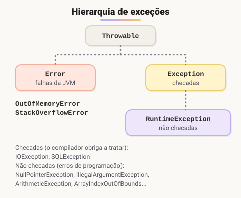

# Exceções (Adicionado pelo aluno para melhorar o estudo)

> 🗺️ **Nesta aula:** o que é uma exceção, try, catch e finally, exceções checadas e não checadas, como lançar com throw e declarar com throws, exceções próprias e try-with-resources.

## De onde paramos

Na conta bancária, `sacar` lançava `IllegalStateException` quando faltava saldo. Se ninguém tratar, o programa para com uma mensagem de erro. Esta aula mostra como reagir a esses problemas.

## O que é uma exceção

Uma **exceção** é um objeto que representa um erro durante a execução: dividir por zero, ler um arquivo que não existe, converter `"abc"` em número. Ao acontecer, o fluxo normal é interrompido e a exceção "sobe" pelos métodos até alguém tratá-la. Se ninguém tratar, o programa termina e mostra o **stack trace**, a lista de métodos por onde ela passou.



> 💡 **Analogia:** o try/catch funciona como a rede de proteção de um trapezista. O número (o código do try) segue normalmente; se ele cair (a exceção), a rede (o catch) segura e o espetáculo continua, em vez de terminar ali.

## try, catch e finally

```java
try {
  // código que pode falhar
  int r = 10 / 0;
  System.out.println(r);
} catch (ArithmeticException e) {
  // só roda se a exceção acontecer
  System.out.println("Erro: " + e.getMessage());
} finally {
  // roda sempre, com ou sem erro
  System.out.println("fim");
}
```

Saída: `Erro: / by zero` e depois `fim`.

- Pode haver vários `catch`, do mais específico para o mais genérico.
- Um catch pode pegar vários tipos com `|`: `catch (NumberFormatException | NullPointerException e)`.
- `e.getMessage()` traz a descrição do erro.

> ⚠️ Nunca deixe um catch vazio. Engolir a exceção esconde o problema e torna o bug muito difícil de achar. No mínimo, registre a mensagem.

## Checadas × não checadas

- **Checadas** (filhas de `Exception`, exceto `RuntimeException`): problemas externos previsíveis, como arquivo ausente ou banco fora do ar (`IOException`, `SQLException`). O compilador **obriga** a tratar com try/catch ou a declarar com `throws`.
- **Não checadas** (filhas de `RuntimeException`): em geral erros de programação, como `NullPointerException` e `ArrayIndexOutOfBoundsException`. O compilador não obriga a tratar; o certo é corrigir o código.
- `Error` (`OutOfMemoryError`, `StackOverflowError`): falhas graves da JVM, que normalmente não se tratam.

## Lançando: throw e throws

`throw` lança uma exceção; `throws`, na assinatura, avisa que o método pode lançar uma checada e passa a responsabilidade para quem chama.

```java
public void depositar(double valor) {
  if (valor <= 0) {
    throw new IllegalArgumentException("Valor inválido");
  }
  saldo += valor;
}
```

## Exceções próprias

Para erros de negócio, crie uma classe que estende `Exception` (checada) ou `RuntimeException` (não checada):

```java
public class SaldoInsuficienteException extends Exception {
  public SaldoInsuficienteException(String mensagem) {
    super(mensagem);
  }
}
```

```java
public void sacar(double valor)
    throws SaldoInsuficienteException {
  if (valor > saldo) {
    throw new SaldoInsuficienteException(
        "Saldo de " + saldo + " não cobre " + valor);
  }
  saldo -= valor;
}
```

```java
try {
  conta.sacar(500);
} catch (SaldoInsuficienteException e) {
  // Saldo de 100.0 não cobre 500.0
  System.out.println(e.getMessage());
}
```

## try-with-resources

Recursos como arquivos e conexões precisam ser **fechados** mesmo se der erro. Declarados entre parênteses no `try`, eles são fechados automaticamente ao final:

```java
import java.io.BufferedReader;
import java.io.FileReader;
import java.io.IOException;

try (BufferedReader leitor =
         new BufferedReader(new FileReader("dados.txt"))) {
  System.out.println(leitor.readLine());
} catch (IOException e) {
  System.out.println("Falha ao ler: " + e.getMessage());
}
```

> 💡 É assim que se usa uma conexão com o banco de dados (JDBC) em Java: `try (Connection c = ...)`. Substitui o antigo `finally` com `close()`, e é o jeito certo de liberar recursos, no lugar do obsoleto `finalize()`.

## 📝 Exercício

Leia um texto do usuário e converta em inteiro com `Integer.parseInt`. Se o texto não for um número, mostre "Digite apenas números" e peça de novo, até dar certo.

<details>
<summary>Ver resposta</summary>

```java
import java.util.Scanner;

public class Main {
  public static void main(String[] args) {
    Scanner in = new Scanner(System.in);
    Integer numero = null;

    while (numero == null) {
      System.out.print("Número: ");
      String texto = in.nextLine();
      try {
        numero = Integer.parseInt(texto);
      } catch (NumberFormatException e) {
        System.out.println("Digite apenas números");
      }
    }

    System.out.println("Você digitou " + numero);
  }
}
```

</details>

## 🧠 Revisão rápida

**Quando o bloco finally roda?**

Sempre: com ou sem exceção.

**Qual a diferença entre exceção checada e não checada?**

A checada precisa ser tratada ou declarada com throws (o compilador obriga); a não checada, filha de RuntimeException, não.

**Qual a diferença entre throw e throws?**

throw lança a exceção; throws, na assinatura, declara que o método pode lançá-la.

> ➡️ **Próximo passo:** fechar o módulo de POO com a segunda lista de exercícios.

## 📌 Resumo

| Item | Em uma frase |
| --- | --- |
| try / catch | Tenta o código e trata o erro se ele acontecer. |
| finally | Bloco que roda sempre. |
| Checada | O compilador obriga a tratar ou declarar (throws). |
| throw | Lança uma exceção. |
| try-with-resources | Fecha arquivos e conexões automaticamente. |
