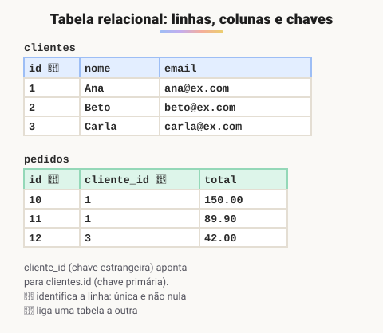
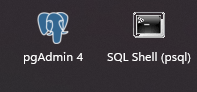

# Baixar e instalar o PostgreSQL

> 🗺️ **Nesta aula:** o que é um banco de dados relacional e um SGBD, o que é SQL, como instalar o PostgreSQL e os primeiros comandos no pgAdmin e no psql.

## De onde paramos

Os objetos Java vivem na memória e somem quando o programa termina. Para guardar clientes, pedidos e saldos de forma permanente, o back-end usa um **banco de dados**.

## Banco de dados, SGBD e SQL

- **Banco de dados**: conjunto organizado de dados guardados de forma permanente.
- **SGBD** (Sistema Gerenciador de Banco de Dados): o programa que guarda, protege e consulta esses dados. PostgreSQL, MySQL, Oracle e SQL Server são SGBDs.
- **Relacional**: os dados ficam em **tabelas** (linhas e colunas) ligadas entre si por **chaves**.
- **SQL** (Structured Query Language): a linguagem padrão para criar tabelas e ler e gravar dados em bancos relacionais.



> 💡 **Analogia:** o banco de dados é um arquivo de escritório cheio de pastas (as tabelas); o SGBD é o arquivista que guarda, protege e encontra os papéis; o SQL é a língua em que você faz os pedidos ao arquivista.

## Instalando o PostgreSQL

O **PostgreSQL** (ou Postgres) é um SGBD relacional gratuito, de código aberto e muito usado em empresas.

🔗 [PostgreSQL: Downloads](https://www.postgresql.org/download/)

> ⚠️ **Atualização:** o original mandava escolher a versão 14. Ela deixa de receber correções em novembro de 2026. Instale a versão estável mais recente (18 ou mais nova); tudo o que o curso usa funciona nela.

No Windows, o instalador (da EDB) instala junto:

- o **servidor** PostgreSQL, que roda em segundo plano na porta **5432**;
- o **pgAdmin**, interface gráfica para criar bancos e rodar consultas;
- o **SQL Shell (psql)**, cliente de linha de comando.<br />Durante a instalação, defina e guarde a senha do usuário administrador `postgres`.<br />Ícones dos programas instalados:



## Primeiros comandos

No pgAdmin: clique com o botão direito no banco → **Query Tool**. No psql:

```sql
-- cria um banco novo
CREATE DATABASE escola;

-- (psql) conecta nele
\c escola

-- (psql) lista as tabelas
\dt

-- (psql) sai
\q
```

> 💡 Os comandos que começam com `\` são do psql, não do SQL. Comandos SQL terminam com `;`. Por convenção, palavras-chave do SQL vão em MAIÚSCULAS e nomes de tabelas e colunas em minúsculas com `_`, mas o Postgres aceita as duas formas.

## 🧠 Revisão rápida

**Qual a diferença entre banco de dados e SGBD?**

O banco é o conjunto de dados; o SGBD é o programa que os gerencia (como o PostgreSQL).

**Em que porta o PostgreSQL atende por padrão?**

Na porta 5432.

> ➡️ **Próximo passo:** os tipos de dados do PostgreSQL e quanto espaço cada um ocupa.

## 📌 Resumo

| Item | Em uma frase |
| --- | --- |
| SGBD | Programa que gerencia o banco de dados. |
| Relacional | Dados em tabelas ligadas por chaves. |
| SQL | Linguagem para criar tabelas e consultar dados. |
| pgAdmin e psql | Clientes gráfico e de terminal do PostgreSQL. |
