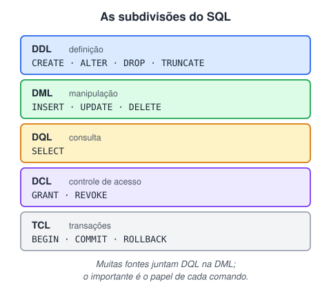

# Tipos de dados e custo de armazenamento

> 🗺️ **Nesta aula:** as categorias de comandos SQL, os tipos de dados do PostgreSQL com o espaço que cada um ocupa, restrições de coluna (NOT NULL, DEFAULT, CHECK, UNIQUE) e como criar e preencher tabelas.

## De onde paramos

O PostgreSQL está instalado. Antes de criar tabelas, é preciso escolher o **tipo** de cada coluna, como fazíamos com as variáveis em Java. A escolha afeta o que pode ser guardado e quanto espaço ocupa.

**Documentação oficial: tipos de dados**

🔗 [https://www.postgresql.org/docs/current/datatype.html](https://www.postgresql.org/docs/current/datatype.html)

## As categorias de comandos SQL



## Tipos de dados e custo de armazenamento

### Numéricos

| Tipo | Bytes | Uso |
| --- | --- | --- |
| `smallint` | 2 | inteiros até ±32.767 |
| `integer` | 4 | inteiros até ±2,1 bilhões (o padrão) |
| `bigint` | 8 | inteiros enormes, como ids de transações |
| `numeric(p, s)` | variável | decimais **exatos**: dinheiro |
| `real` | 4 | ponto flutuante simples (aproximado) |
| `double precision` | 8 | ponto flutuante duplo (aproximado) |

> ⚠️ Para valores em dinheiro, use `numeric(10, 2)`: 10 dígitos no total, 2 depois da vírgula. `real` e `double precision` guardam aproximações e geram erros de centavos, como o `0.1 + 0.2` do Java.

### Texto

| Tipo | Guarda |
| --- | --- |
| `varchar(n)` | texto de até n caracteres |
| `char(n)` | texto de exatamente n caracteres (completa com espaços) |
| `text` | texto sem limite |

No PostgreSQL os três têm o mesmo desempenho; o espaço é o tamanho do texto mais 1 byte de cabeçalho (para textos curtos). Use `varchar(n)` quando o limite for uma regra de negócio, e `text` nos demais casos.

### Data e hora

| Tipo | Bytes | Guarda |
| --- | --- | --- |
| `date` | 4 | só a data: `2026-05-30` |
| `time` | 8 | só a hora: `10:00:00` |
| `timestamp` | 8 | data e hora, sem fuso |
| `timestamptz` | 8 | data e hora **com fuso** (recomendado) |
| `interval` | 16 | uma duração: `'3 days'` |

> 💡 O `timestamptz` guarda o instante em UTC e converte para o fuso de quem consulta. Para registrar quando algo aconteceu (uma transação, um login), ele é a escolha mais segura.

### Outros

| Tipo | Bytes | Guarda |
| --- | --- | --- |
| `boolean` | 1 | true, false ou null |
| `uuid` | 16 | identificador único universal |
| `bytea` | variável | dados binários |
| `json` / `jsonb` | variável | documentos JSON (o jsonb é binário e indexável) |
| `tipo[]` | variável | arrays, como `integer[]` |
| `enum` | 4 | lista fixa de valores, criada com `CREATE TYPE` |

> ⚠️ **Correção:** o original dizia que o `enum` é definido "durante a criação da tabela". Ele é um **tipo** criado antes, à parte: `CREATE TYPE status AS ENUM ('aberto', 'pago');` e depois usado na coluna.

## Restrições de coluna

Além do tipo, cada coluna pode ter regras que o banco garante sozinho:

| Restrição | Garante que |
| --- | --- |
| `PRIMARY KEY` | o valor identifica a linha: único e não nulo |
| `NOT NULL` | a coluna nunca fica vazia |
| `UNIQUE` | não há valores repetidos |
| `DEFAULT valor` | um valor padrão se nada for informado |
| `CHECK (condição)` | o valor obedece à regra |
| `REFERENCES tabela` | o valor existe em outra tabela (chave estrangeira) |

## Exemplo: tabela de produtos

```sql
CREATE TABLE produtos (
  id integer GENERATED ALWAYS AS IDENTITY
    PRIMARY KEY,
  nome varchar(100) NOT NULL,
  preco numeric(10, 2) NOT NULL CHECK (preco >= 0),
  categoria varchar(30),
  ativo boolean DEFAULT true,
  criado_em timestamptz DEFAULT now()
);

-- vários registros num só INSERT
INSERT INTO produtos (nome, preco, categoria)
VALUES ('Caneca', 39.90, 'cozinha'),
       ('Caderno', 18.50, 'papelaria');

SELECT * FROM produtos;
```

O `id`, o `ativo` e o `criado_em` se preenchem sozinhos.

> 💡 `GENERATED ALWAYS AS IDENTITY` é a forma padrão do SQL para ids automáticos. O `serial`, usado nos exemplos originais, ainda funciona, mas é um atalho antigo do PostgreSQL.

### Datas e horas

```sql
CREATE TABLE eventos (
  id serial PRIMARY KEY,
  nome_evento varchar(100),
  data_evento date,
  horario_evento time,
  data_hora_evento timestamptz
);

INSERT INTO eventos
  (nome_evento, data_evento, horario_evento, data_hora_evento)
VALUES ('Conferência', '2026-05-30', '10:00:00',
        '2026-05-30 10:00:00-03');
```

> ⚠️ O original repetia duas vezes o mesmo exemplo da tabela `pessoas`; a cópia foi removida.

## 📝 Exercício

Escolha os tipos para uma tabela `clientes`: nome, CPF, data de nascimento, saldo e se aceita receber e-mails.

<details>
<summary>Ver resposta</summary>

```sql
CREATE TABLE clientes (
  id integer GENERATED ALWAYS AS IDENTITY
    PRIMARY KEY,
  nome varchar(100) NOT NULL,
  -- texto: tem zeros à esquerda e não entra em contas
  cpf char(11) NOT NULL UNIQUE,
  nascimento date,
  saldo numeric(12, 2) DEFAULT 0,
  aceita_email boolean DEFAULT false
);
```

</details>

## 🧠 Revisão rápida

**Qual tipo usar para valores em dinheiro?**

numeric (por exemplo, numeric(10, 2)), que é exato.

**Quantos bytes ocupam um integer e um bigint?**

4 e 8.

**O que a restrição CHECK faz?**

Impede gravar valores que não obedecem a uma condição, como preço negativo.

> ➡️ **Próximo passo:** desenhar as tabelas e seus relacionamentos num diagrama.

## 📌 Resumo

| Item | Em uma frase |
| --- | --- |
| integer / bigint | Inteiros de 4 e 8 bytes. |
| numeric | Decimal exato, para dinheiro. |
| varchar / text | Texto com ou sem limite. |
| timestamptz | Data e hora com fuso. |
| Restrições | NOT NULL, UNIQUE, CHECK, DEFAULT e chaves. |
