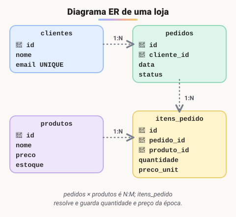
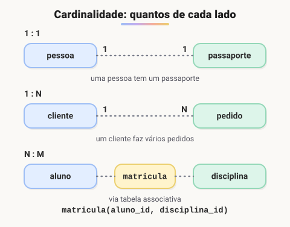

# Modelagem de entidade

> 🗺️ **Nesta aula:** o diagrama de entidade e relacionamento (DER), seus componentes, chaves primárias e estrangeiras, cardinalidade (1:1, 1:N e N:M) e como um DER vira tabelas.

## De onde paramos

Já sabemos os tipos de dados. Mas, antes de sair criando tabelas, é preciso **planejar**: quais tabelas existem, o que cada uma guarda e como se ligam. Esse planejamento é desenhado num DER.

**Ferramenta para desenhar DER: Visual Paradigm Online**

🔗 [https://online.visual-paradigm.com/drive/#infoart:proj=0&dashboard](https://online.visual-paradigm.com/drive/#infoart:proj=0&dashboard)

## O que é um DER

O **diagrama de entidade e relacionamento** (DER, ou ERD em inglês) representa a estrutura lógica de um banco de dados: as coisas que o sistema guarda e como elas se relacionam. Ele é feito na fase de projeto, antes do código.



> 💡 **Analogia:** o DER é a planta baixa de uma casa. Ninguém começa a levantar paredes sem saber onde ficam os cômodos (as tabelas) e as portas entre eles (os relacionamentos).

## Componentes

- **Entidades**: objetos ou conceitos do mundo real que o sistema precisa guardar. Numa biblioteca: Livro, Autor, Usuário. Viram **tabelas**.
- **Atributos**: as características de cada entidade. Um livro tem título, ISBN, ano de publicação. Viram **colunas**.
- **Relacionamentos**: as ligações entre entidades, como "Livro é escrito por Autor". Viram **chaves estrangeiras** (ou tabelas associativas).

## Chaves

- **Chave primária** (PK): coluna que identifica cada linha de forma única e nunca é nula. Ex.: `id` do cliente.
- **Chave estrangeira** (FK): coluna que guarda a chave primária de **outra** tabela, criando o vínculo. Ex.: `cliente_id` em pedidos. O banco recusa uma FK que aponte para algo que não existe.

## Cardinalidade

Diz **quantos** de cada lado participam do relacionamento.



| Tipo | Exemplo | Como vira tabela |
| --- | --- | --- |
| 1:1 | pessoa e passaporte | FK com UNIQUE num dos lados |
| 1:N | cliente e pedidos | FK no lado N (`pedidos.cliente_id`) |
| N:M | alunos e disciplinas | tabela associativa com as duas FKs |

> 💡 Regra para lembrar: no 1:N a chave estrangeira fica **sempre do lado do "muitos"**. Cada pedido aponta para seu cliente; o cliente não guarda a lista de pedidos.

## Do DER para o SQL

```sql
CREATE TABLE clientes (
  id integer GENERATED ALWAYS AS IDENTITY
    PRIMARY KEY,
  nome varchar(100) NOT NULL,
  email varchar(100) UNIQUE
);

CREATE TABLE pedidos (
  id integer GENERATED ALWAYS AS IDENTITY
    PRIMARY KEY,
  cliente_id integer NOT NULL
    REFERENCES clientes (id),
  data timestamptz DEFAULT now()
);
```

## 📝 Exercício

Num sistema de cursos, cada aluno pode se matricular em vários cursos e cada curso tem vários alunos. Que cardinalidade é essa e quais tabelas são necessárias?

<details>
<summary>Ver resposta</summary>

**N:M.** São três tabelas: `alunos`, `cursos` e a associativa `matriculas (aluno_id, curso_id)`, com uma FK para cada lado. A matrícula também pode ter atributos próprios, como a data de matrícula e a nota final.

</details>

## 🧠 Revisão rápida

**Em que viram as entidades e os atributos do DER?**

Em tabelas e colunas.

**Num relacionamento 1:N, onde fica a chave estrangeira?**

Na tabela do lado N.

> ➡️ **Próximo passo:** evitar dados repetidos com normalização.

## 📌 Resumo

| Item | Em uma frase |
| --- | --- |
| DER | Desenho das entidades, atributos e relacionamentos. |
| Chave primária | Identifica cada linha: única e não nula. |
| Chave estrangeira | Aponta para a chave primária de outra tabela. |
| Cardinalidade | 1:1, 1:N (FK no lado N) ou N:M (tabela associativa). |
