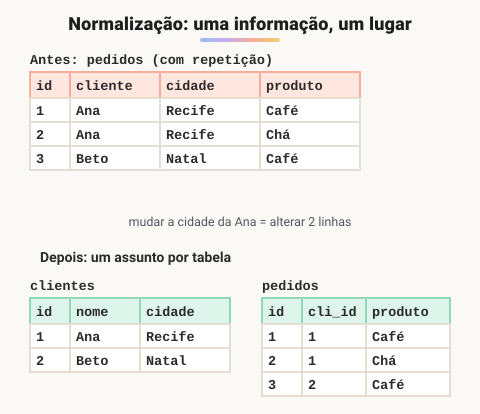

# Normalização dos dados

> 🗺️ **Nesta aula:** o que é normalização, as anomalias que ela evita e as três primeiras formas normais (1FN, 2FN e 3FN), cada uma com um exemplo de antes e depois.

## De onde paramos

Com o DER pronto, falta conferir se as tabelas não guardam a mesma informação em vários lugares. Esse é o papel da **normalização**.

## O que é normalização

É um conjunto de regras (as **formas normais**) para organizar as tabelas de modo que cada informação fique guardada em **um único lugar**. Assim se evitam redundância e inconsistência.



> 💡 **Analogia:** é como a agenda de contatos do celular. Em vez de anotar o telefone da Ana em cada mensagem, você salva o contato uma vez e as mensagens só apontam para ele. Se o número mudar, você corrige num lugar só.

Sem normalização aparecem as **anomalias**:

- **de atualização**: a Ana mudou de cidade e é preciso alterar várias linhas; se uma escapar, o banco fica contraditório;
- **de inserção**: não dá para cadastrar um cliente que ainda não fez pedido, porque o cliente só existe dentro da tabela de pedidos;
- **de exclusão**: apagar o último pedido da Ana apaga também os dados dela.

## 1ª forma normal (1FN)

**Cada coluna guarda um único valor** (atômico): nada de listas dentro de uma célula.<br />Antes: `clientes (id, nome, telefones)` com `telefones = '1111-1111, 2222-2222'`.<br />Depois:

```sql
CREATE TABLE clientes (
  id integer PRIMARY KEY,
  nome varchar(100)
);

CREATE TABLE telefones (
  cliente_id integer REFERENCES clientes (id),
  numero varchar(15),
  PRIMARY KEY (cliente_id, numero)
);
```

## 2ª forma normal (2FN)

Estar na 1FN e **toda coluna que não é chave depender da chave inteira**. O problema só aparece com chave composta.<br />Antes: `itens_pedido (pedido_id, produto_id, quantidade, nome_produto)`, com chave `(pedido_id, produto_id)`. O `nome_produto` depende só de `produto_id`, uma **parte** da chave: é uma dependência parcial.<br />Depois: `nome_produto` vai para a tabela `produtos (id, nome)` e `itens_pedido` fica com `(pedido_id, produto_id, quantidade)`.

## 3ª forma normal (3FN)

Estar na 2FN e **nenhuma coluna não chave depender de outra coluna não chave** (sem dependência transitiva).<br />Antes: `pedidos (id, cliente_id, cidade_cliente, data)`. A cidade depende do cliente, que depende do pedido: id → cliente_id → cidade.<br />Depois: a cidade vai para `clientes (id, nome, cidade)` e o pedido guarda só o `cliente_id`.

> 💡 Resumo das três: "a chave, a chave inteira e nada além da chave". Cada coluna deve depender da chave (1FN), da chave inteira (2FN) e só da chave (3FN).

## Até onde normalizar

Existem formas normais além da terceira (Boyce-Codd, 4FN, 5FN) para casos raros. Na prática, chegar à **3FN** é o objetivo da maioria dos sistemas.<br />Às vezes, por desempenho, se aceita alguma redundância de propósito (**desnormalização**), por exemplo guardar o total do pedido para não recalcular sempre. Isso deve ser uma decisão consciente, não um acidente.

> ⚠️ **Ajuste:** o original dizia que normalizar "melhora o desempenho das consultas". Ela melhora a **integridade** e economiza espaço, mas costuma exigir mais JOINs, que podem deixar algumas leituras mais lentas. Por isso a desnormalização existe.

## 📝 Exercício

A tabela `matriculas (aluno_id, curso_id, nome_aluno, nome_curso, nota)` tem chave `(aluno_id, curso_id)`. Qual forma normal ela viola e como corrigir?

<details>
<summary>Ver resposta</summary>

Viola a **2FN**: `nome_aluno` depende só de `aluno_id` e `nome_curso` só de `curso_id`, partes da chave. Correção: `alunos (id, nome)`, `cursos (id, nome)` e `matriculas (aluno_id, curso_id, nota)`; a nota depende da chave inteira, então fica.

</details>

## 🧠 Revisão rápida

**O que exige a 1FN?**

Valores atômicos: uma informação por célula, sem listas.

**O que é uma dependência transitiva?**

Uma coluna não chave depender de outra não chave (id → cliente_id → cidade), o que viola a 3FN.

> ➡️ **Próximo passo:** consultar os dados com SELECT, filtros, agregações e JOIN.

## 📌 Resumo

| Forma normal | Em uma frase |
| --- | --- |
| 1FN | Um valor por célula. |
| 2FN | Depender da chave inteira (sem dependência parcial). |
| 3FN | Depender só da chave (sem dependência transitiva). |
| Desnormalização | Redundância proposital, por desempenho. |
