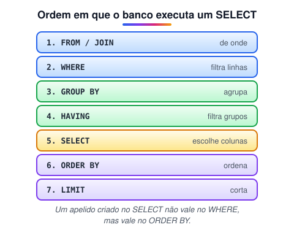
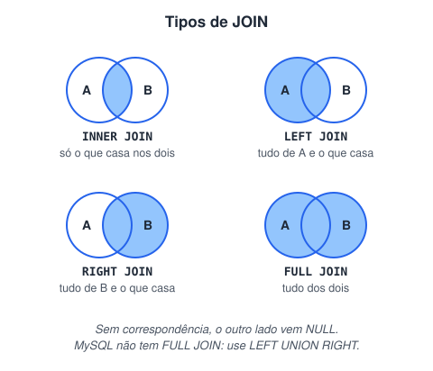

# Consultas SQL: SELECT, filtros, agregações e JOIN (Adicionado pelo aluno para melhorar o estudo)

> 🗺️ **Nesta aula:** SELECT com WHERE, operadores de filtro, ORDER BY e LIMIT, funções de agregação com GROUP BY e HAVING, e os tipos de JOIN para combinar tabelas.

## De onde paramos

As tabelas estão normalizadas: cada informação num lugar só. Agora é preciso **buscar** os dados, filtrando o que interessa e juntando de novo o que a normalização separou.<br />Os exemplos usam a tabela `produtos` da aula de tipos de dados, com cinco produtos: Caneca (39,90, cozinha), Prato (25,00, cozinha), Caderno (18,50, papelaria), Caneta (3,20, papelaria) e Mochila (150,00, acessórios).

## SELECT e WHERE

```sql
-- colunas específicas, em vez de *
SELECT nome, preco
FROM produtos
WHERE preco BETWEEN 10 AND 50
ORDER BY preco DESC;
-- Caneca 39.90, Prato 25.00, Caderno 18.50
```

| Operador | Exemplo |
| --- | --- |
| `=`, `<>`, `>`, `<`, `>=`, `<=` | `preco > 20` |
| `AND`, `OR`, `NOT` | `categoria = 'cozinha' AND preco > 30` |
| `BETWEEN a AND b` | `preco BETWEEN 10 AND 50` (inclui os extremos) |
| `IN (...)` | `categoria IN ('cozinha', 'papelaria')` |
| `LIKE` / `ILIKE` | `nome ILIKE 'ca%'` (começa com "ca") |
| `IS NULL` | `categoria IS NULL` |

> ⚠️ Para testar valor vazio use `IS NULL`, nunca `= NULL`: qualquer comparação com NULL dá "desconhecido" e não retorna nada. No `LIKE`, `%` vale qualquer sequência e `_` vale um caractere; o `ILIKE` ignora maiúsculas e minúsculas.

## ORDER BY e LIMIT

```sql
-- os 2 produtos mais caros
SELECT nome, preco
FROM produtos
ORDER BY preco DESC
LIMIT 2;
-- Mochila 150.00, Caneca 39.90
```

`ASC` (padrão) ordena do menor para o maior; `DESC`, ao contrário. Sem ORDER BY, o banco não garante ordem nenhuma.

## Agregações: GROUP BY e HAVING

Funções de agregação resumem várias linhas num valor: `COUNT`, `SUM`, `AVG`, `MIN`, `MAX`. Com `GROUP BY`, o resumo é feito por grupo.

> 💡 **Analogia:** o GROUP BY é separar as compras do mercado em sacolas por setor (cozinha, papelaria...) e depois contar ou somar o conteúdo de cada sacola. O HAVING é descartar as sacolas que não interessam depois de prontas.

```sql
SELECT categoria,
       COUNT(*) AS qtd,
       ROUND(AVG(preco), 2) AS media,
       MAX(preco) AS mais_caro
FROM produtos
GROUP BY categoria
ORDER BY categoria;
```

| categoria | qtd | media | mais_caro |
| --- | --- | --- | --- |
| acessórios | 1 | 150.00 | 150.00 |
| cozinha | 2 | 32.45 | 39.90 |
| papelaria | 2 | 10.85 | 18.50 |

`WHERE` filtra **linhas** antes de agrupar; `HAVING` filtra **grupos** depois:

```sql
-- só categorias com média acima de 20
SELECT categoria, AVG(preco)
FROM produtos
GROUP BY categoria
HAVING AVG(preco) > 20;
```



> 💡 Essa ordem explica dois erros comuns: não dá para usar `AVG(...)` no WHERE (os grupos ainda não existem) nem o apelido do SELECT no WHERE (o SELECT roda depois).

## JOIN: juntando tabelas

O JOIN combina linhas de duas tabelas usando a chave estrangeira. Com as tabelas do projeto escola (disciplinas e professores):

```sql
SELECT p.nome AS professor,
       d.nome AS disciplina
FROM professores p
INNER JOIN disciplinas d
  ON d.id_disciplina = p.id_disciplina
ORDER BY d.nome, p.nome;
```

`p` e `d` são **apelidos** das tabelas, para escrever menos.



| JOIN | Devolve |
| --- | --- |
| `INNER JOIN` | só as linhas com correspondência nas duas tabelas |
| `LEFT JOIN` | todas da esquerda; as sem par vêm com NULL |
| `RIGHT JOIN` | todas da direita |
| `FULL JOIN` | todas das duas |

O LEFT JOIN é o jeito de incluir quem não tem correspondência, como uma disciplina ainda sem professor:

```sql
SELECT d.nome, COUNT(p.id_professor) AS qtd
FROM disciplinas d
LEFT JOIN professores p
  ON p.id_disciplina = d.id_disciplina
GROUP BY d.nome
ORDER BY qtd DESC;
-- a disciplina sem professor aparece com 0
```

> ⚠️ Use `COUNT(p.id_professor)`, e não `COUNT(*)`, num LEFT JOIN: o `COUNT(*)` contaria a linha com NULL e mostraria 1 para a disciplina sem professor.

## 📝 Exercício

Mostre o nome e o preço dos produtos da categoria papelaria que custam mais de 5 reais, do mais barato para o mais caro. Depois mostre quantos produtos há por categoria, só para categorias com 2 ou mais produtos.

<details>
<summary>Ver resposta</summary>

```sql
SELECT nome, preco
FROM produtos
WHERE categoria = 'papelaria'
  AND preco > 5
ORDER BY preco;
-- Caderno 18.50

SELECT categoria, COUNT(*) AS qtd
FROM produtos
GROUP BY categoria
HAVING COUNT(*) >= 2;
-- cozinha 2, papelaria 2
```

</details>

## 🧠 Revisão rápida

**Qual a diferença entre WHERE e HAVING?**

WHERE filtra linhas antes do agrupamento; HAVING filtra os grupos depois.

**Quando usar LEFT JOIN em vez de INNER JOIN?**

Quando as linhas da tabela da esquerda sem correspondência também precisam aparecer.

**Como buscar nomes que começam com "Ca", sem diferenciar maiúsculas?**

`WHERE nome ILIKE 'ca%'`.

> ➡️ **Próximo passo:** deixar essas consultas rápidas com índices.

## 📌 Resumo

| Item | Em uma frase |
| --- | --- |
| WHERE | Filtra linhas com condições. |
| ORDER BY / LIMIT | Ordena e limita o resultado. |
| GROUP BY | Agrupa para calcular COUNT, SUM, AVG, MIN e MAX. |
| HAVING | Filtra grupos. |
| JOIN | Combina tabelas pela chave estrangeira. |
