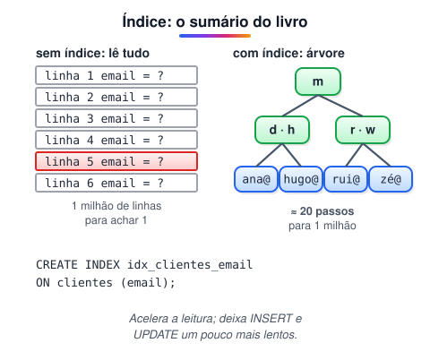

# Índices

> 🗺️ **Nesta aula:** o que é um índice, como a árvore B acelera as buscas, quando criar e quando não criar, o custo nas escritas e como conferir o uso com EXPLAIN.

## De onde paramos

As consultas da aula anterior funcionam, mas numa tabela com milhões de linhas um `WHERE email = ...` pode levar segundos. O **índice** resolve isso, do mesmo jeito que o índice remissivo de um livro evita ler todas as páginas.

## O que é um índice

É uma estrutura de dados **separada da tabela**, criada sobre uma ou mais colunas, que guarda os valores dessas colunas em ordem e aponta para as linhas correspondentes.



- Sem índice, o banco faz uma **leitura sequencial** (seq scan): olha linha por linha, O(n).
- Com índice, ele desce pela árvore até o valor, em O(log n), como na busca binária do módulo de algoritmos.<br />O tipo padrão no PostgreSQL é a **árvore B** (B-tree), que serve para `=`, `<`, `>`, `BETWEEN` e `ORDER BY`. Há outros tipos para casos específicos: hash (só igualdade), GIN (arrays, jsonb, busca em texto) e GiST (dados geográficos).

> ⚠️ A árvore B não é uma árvore **binária**: cada nó tem muitos filhos, não só dois. Isso deixa a árvore bem baixa, com poucos acessos ao disco mesmo em tabelas enormes.

## Exemplo: buscar cliente pelo e-mail

```sql
CREATE TABLE clientes (
  id serial PRIMARY KEY,
  nome varchar(100),
  email varchar(100),
  telefone varchar(20)
);

INSERT INTO clientes (nome, email, telefone)
VALUES ('Ana', 'ana@exemplo.com', '1234567890'),
       ('Beto', 'beto@exemplo.com', '9876543210'),
       ('Carla', 'carla@exemplo.com', '5555555555');

-- cria o índice na coluna buscada
CREATE INDEX idx_clientes_email ON clientes (email);

-- o banco decide sozinho se usa o índice
SELECT * FROM clientes
WHERE email = 'ana@exemplo.com';
```

> 💡 O PostgreSQL já cria um índice automaticamente para toda `PRIMARY KEY` e toda coluna `UNIQUE`. Chaves estrangeiras **não** ganham índice sozinhas, e costumam precisar de um, porque são muito usadas em JOINs.

## Conferindo com EXPLAIN

O `EXPLAIN` mostra o plano que o banco escolheu:

```sql
EXPLAIN SELECT * FROM clientes
WHERE email = 'ana@exemplo.com';
```

- `Seq Scan`: leu a tabela inteira.
- `Index Scan` ou `Bitmap Index Scan`: usou o índice.<br />Em tabelas pequenas é normal aparecer `Seq Scan` mesmo com índice: ler tudo é mais barato que consultar a árvore.

## O custo do índice

Índices aceleram a **leitura**, mas cobram nas **escritas**: a cada INSERT, UPDATE ou DELETE, todos os índices da tabela precisam ser atualizados. Eles também ocupam espaço em disco.

> 💡 **Analogia:** é como manter o índice remissivo de um livro que ainda está sendo escrito. Cada página nova obriga a atualizar o índice no fim; quanto mais índices (por autor, por tema, por data), mais trabalho a cada página escrita.

> ⚠️ **Correção:** o original dizia que, com índice, "a velocidade de inserção do próximo dado aumenta". O que aumenta é o **tempo** de cada inserção: a inserção fica mais lenta. E o banco não "refaz o cálculo do índice" inteiro; ele só encaixa o novo valor na árvore.

Quando vale criar:

- colunas muito usadas em `WHERE`, `JOIN` e `ORDER BY`;
- tabelas grandes;
- colunas com muitos valores diferentes (e-mail, CPF), e não com poucos (sim/não).

## 📝 Exercício

A consulta abaixo roda o tempo todo numa tabela com 10 milhões de pedidos. Que índice você criaria?

```sql
SELECT * FROM pedidos
WHERE cliente_id = 42
ORDER BY data DESC;
```

<details>
<summary>Ver resposta</summary>

Um índice composto, na ordem da busca: primeiro o filtro, depois a ordenação.

```sql
CREATE INDEX idx_pedidos_cliente_data
  ON pedidos (cliente_id, data DESC);
```

Ele acha os pedidos do cliente 42 e já os entrega ordenados por data.

</details>

## 🧠 Revisão rápida

**Por que índices deixam as escritas mais lentas?**

Porque cada INSERT, UPDATE ou DELETE também precisa atualizar os índices.

**Qual o tipo de índice padrão no PostgreSQL?**

A árvore B (B-tree).

**Por que um índice numa tabela de 100 linhas quase não muda o tempo?**

Porque ler 100 linhas já é rápido; o ganho do índice aparece em tabelas grandes.

> ➡️ **Próximo passo:** juntar tudo no projeto da escola.

## 📌 Resumo

| Item | Em uma frase |
| --- | --- |
| Índice | Estrutura ordenada que evita ler a tabela inteira. |
| B-tree | Tipo padrão; serve para igualdade, faixas e ordenação. |
| Custo | Leitura mais rápida, escrita mais lenta e mais espaço. |
| EXPLAIN | Mostra se a consulta usou o índice. |
