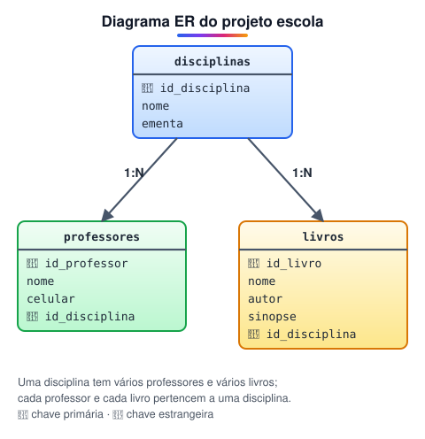

# Projeto: banco de dados de uma escola

> 🗺️ **Nesta aula:** um projeto completo de banco para uma escola: do DER às tabelas com chaves estrangeiras, e o CRUD (inserir, consultar, atualizar e apagar), incluindo importação de CSV.

## De onde paramos

Você já sabe tipos, DER, normalização, consultas e índices. Agora tudo se junta num banco pequeno, com disciplinas, professores e livros.

## Objetivo do projeto

Criar o modelo de entidade e relacionamento e implementá-lo em tabelas do PostgreSQL.



O arquivo do modelo (`.vpd`), feito no Visual Paradigm, fica nas anotações pessoais; o diagrama acima mostra o mesmo modelo.

## Criando as tabelas

A tabela referenciada (`disciplinas`) precisa existir antes das que apontam para ela.

```sql
CREATE TABLE disciplinas (
  id_disciplina integer NOT NULL,
  nome varchar(40) NOT NULL,
  ementa text,
  PRIMARY KEY (id_disciplina)
);
```

> ⚠️ **Correção:** o original abria e fechava a tabela `disciplinas` com chaves `{ }`, o que é erro de sintaxe. SQL usa parênteses. Também faltava o `;` no fim dos comandos, necessário quando se roda mais de um de uma vez.

```sql
CREATE TABLE professores (
  id_professor integer,
  nome varchar(60),
  celular varchar(15),
  id_disciplina integer,
  PRIMARY KEY (id_professor),
  FOREIGN KEY (id_disciplina)
    REFERENCES disciplinas (id_disciplina)
);
```

```sql
CREATE TABLE livros (
  id_livro integer,
  nome varchar(100),
  autor varchar(60),
  sinopse varchar(500),
  id_disciplina integer,
  PRIMARY KEY (id_livro),
  FOREIGN KEY (id_disciplina)
    REFERENCES disciplinas (id_disciplina)
);
```

> 💡 O original limitava o nome do livro a `varchar(15)`, o que corta títulos como "Gramática Básica da Língua Portuguesa". Aumentamos para 100. Pense no maior valor real que a coluna vai receber.

## CRUD

**CRUD** são as quatro operações básicas: **C**reate (INSERT), **R**ead (SELECT), **U**pdate (UPDATE) e **D**elete (DELETE).

### Inserir

```sql
INSERT INTO disciplinas (id_disciplina, nome, ementa)
VALUES (1, 'português', 'literatura e gramática'),
       (2, 'matemática', 'álgebra e geometria');

INSERT INTO professores
  (id_professor, nome, celular, id_disciplina)
VALUES (1, 'Ana Souza', '(11) 90000-0001', 1);
```

> 💡 Liste as colunas no INSERT. Sem a lista, os valores precisam vir exatamente na ordem das colunas da tabela, e o comando quebra se alguém acrescentar uma coluna.

Se tentar inserir um professor numa disciplina que não existe, o banco recusa:

```
ERROR: insert or update on table "professores"
violates foreign key constraint
DETAIL: Key (id_disciplina)=(99) is not present
in table "disciplinas".
```

### Consultar

```sql
SELECT * FROM disciplinas;

-- professores com o nome da disciplina
SELECT p.nome, d.nome AS disciplina
FROM professores p
JOIN disciplinas d
  ON d.id_disciplina = p.id_disciplina;
```

### Importar de um CSV

```sql
COPY disciplinas (id_disciplina, nome, ementa)
FROM 'C:\dados\disciplinas.csv'
DELIMITER ','
CSV HEADER;
```

`CSV HEADER` avisa que a primeira linha do arquivo tem os nomes das colunas e deve ser ignorada.

> ⚠️ O `COPY` lê o arquivo do computador do **servidor** e exige permissão especial. Se o banco estiver em outra máquina, ou der erro de permissão, use no psql o `\copy`, com a mesma sintaxe, que lê o arquivo do seu computador.

### Atualizar

```sql
UPDATE disciplinas
SET nome = 'biologia'
WHERE id_disciplina = 7;
```

### Apagar

```sql
DELETE FROM disciplinas
WHERE id_disciplina = 8;
```

> ⚠️ UPDATE e DELETE sem `WHERE` alteram ou apagam **todas** as linhas da tabela. Antes de rodar, teste o filtro com um `SELECT ... WHERE` igual. E o banco não deixa apagar uma disciplina que ainda tenha professores ligados a ela, por causa da chave estrangeira.

> 💡 No original os títulos diziam "editando atributos" e "deletando atributo". UPDATE e DELETE agem sobre **linhas** (registros); atributos são as colunas.

## 📝 Exercício

Acrescente a tabela `alunos (id_aluno, nome, email)` e a matrícula de alunos em disciplinas, sabendo que cada aluno cursa várias disciplinas.

<details>
<summary>Ver resposta</summary>

```sql
CREATE TABLE alunos (
  id_aluno integer PRIMARY KEY,
  nome varchar(60) NOT NULL,
  email varchar(100) UNIQUE
);

-- N:M precisa de tabela associativa
CREATE TABLE matriculas (
  id_aluno integer REFERENCES alunos (id_aluno),
  id_disciplina integer
    REFERENCES disciplinas (id_disciplina),
  data_matricula date DEFAULT current_date,
  PRIMARY KEY (id_aluno, id_disciplina)
);
```

</details>

> ➡️ **Próximo passo:** as listas de exercícios de banco de dados.

## 📌 Resumo

| Item | Em uma frase |
| --- | --- |
| Ordem de criação | Primeiro a tabela referenciada, depois as que têm FK. |
| CRUD | INSERT, SELECT, UPDATE e DELETE. |
| COPY / \copy | Importam CSV do servidor ou do seu computador. |
| WHERE | Obrigatório na prática em UPDATE e DELETE. |
