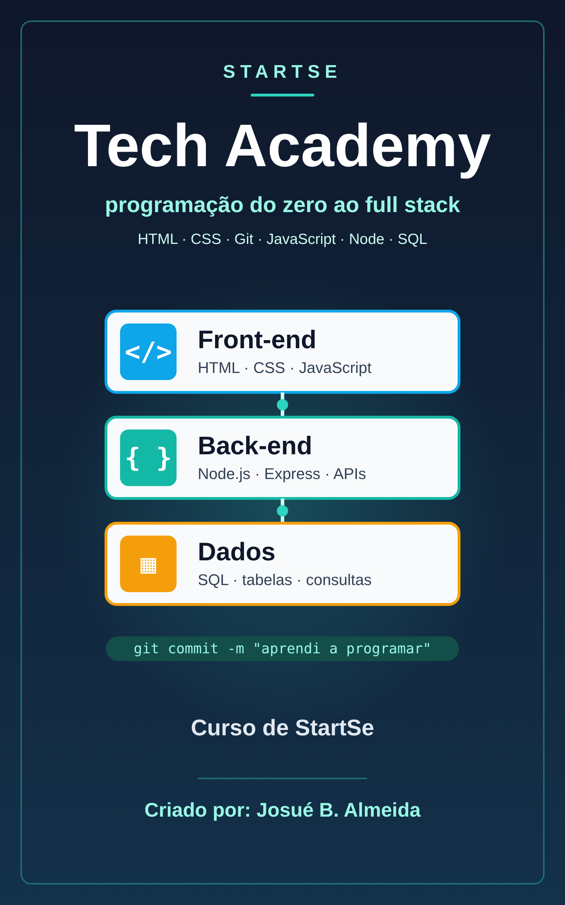

# StartSe: Tech Academy - StartSe

📥 **[Baixar o EPUB](https://github.com/Joshpcbrrj/biblioteca-de-estudos/releases/download/epubs/startse-tech-academy.epub)**

Formação de programação do zero ao full stack: fundamentos de computação e web, lógica, HTML, CSS, Git, JavaScript, orientação a objetos, Node.js com Express e SQL. Cada aula segue o mesmo roteiro (Nesta aula → De onde paramos → conteúdo → Exercício → Revisão rápida → Próximo passo → Resumo), e as respostas dos exercícios ficam recolhidas em **Ver resposta**.

- [Sobre o curso](aulas/000-sobre-o-curso.md)

## 🖥️ Módulo I · Introdução, sistemas e aplicações

- [Introdução a programação](aulas/001-introducao-a-programacao.md)
- [Como funciona a Web](aulas/002-como-funciona-a-web.md)
- [Hardware, software e estrutura do computador](aulas/003-hardware-software-e-estrutura-do-computador.md)
- [Sistemas operacionais](aulas/004-sistemas-operacionais.md)
- [Terminal e linha de comando](aulas/005-terminal-e-linha-de-comando.md)
- [Surgimento da internet e aplicações Web](aulas/006-surgimento-da-internet-e-aplicacoes-web.md)
- [Engenharia de software e boas práticas](aulas/007-engenharia-de-software-e-boas-praticas.md)

## 🧩 Módulo II · Linguagens de programação

- [Como as linguagens de programação funcionam](aulas/008-como-as-linguagens-de-programacao-funcionam.md)
- [Tipos de linguagens](aulas/009-tipos-de-linguagens.md)
- [Configurando o ambiente de desenvolvimento](aulas/010-configurando-o-ambiente-de-desenvolvimento.md)
- [Como tirar dúvidas de programação no Google e no Stack Overflow](aulas/011-como-tirar-duvidas-de-programacao-no-google-e.md)
- [Lógica de programação e algoritmos](aulas/012-logica-de-programacao-e-algoritmos.md)

## 🏷️ Módulo III · HTML e principais elementos

- [História de criação do HTML](aulas/013-historia-de-criacao-do-html.md)
- [Principais fontes de documentação sobre HTML e boas práticas de como escrever](aulas/014-principais-fontes-de-documentacao-sobre-html-e.md)
- [Criação de documento HTML e principais tags](aulas/015-criacao-de-documento-html-e-principais-tags.md)
- [Estudo aprofundado de algumas tags importantes](aulas/016-estudo-aprofundado-de-algumas-tags-importantes.md)
- [Tags de separação de conteúdo da página](aulas/017-tags-de-separacao-de-conteudo-da-pagina.md)
- [Tabelas em HTML](aulas/018-tabelas-em-html.md)
- [Formulários em HTML](aulas/019-formularios-em-html.md)
- [Estudo de URL](aulas/020-estudo-de-url.md)
- [Acessibilidade na web](aulas/021-acessibilidade-na-web.md)
- [Projeto teste - Criando a estrutura de uma página com HTML](aulas/022-projeto-teste-criando-a-estrutura-de-uma-pagina.md)
- [Projeto teste - Tabela com efeito zebra](aulas/023-projeto-teste-tabela-com-efeito-zebra.md)

## 🎨 Módulo IV · CSS

- [História de criação do CSS](aulas/024-historia-de-criacao-do-css.md)
- [Como aplicar o CSS no nosso HTML](aulas/025-como-aplicar-o-css-no-nosso-html.md)
- [Testando as propriedades de estilização com um teste prático](aulas/026-testando-as-propriedades-de-estilizacao-com-um.md)
- [Seletores e especificidade do CSS](aulas/027-seletores-e-especificidade-do-css.md)
- [Pseudo-classes e pseudo-elementos](aulas/028-pseudo-classes-e-pseudo-elementos.md)
- [Links com desafios CSS](aulas/029-links-com-desafios-css.md)
- [Herança de características no CSS](aulas/030-heranca-de-caracteristicas-no-css.md)
- [Unidades de medidas usadas no CSS](aulas/031-unidades-de-medidas-usadas-no-css.md)
- [Box model](aulas/032-box-model.md)
- [Propriedade Margin e padding/ Bordas](aulas/033-propriedade-margin-e-padding-bordas.md)
- [Usando cores no CSS](aulas/034-usando-cores-no-css.md)
- [Background (Fundo da página)](aulas/035-background-fundo-da-pagina.md)
- [Variáveis CSS, transições e animações](aulas/036-variaveis-css-transicoes-e-animacoes.md)

## 📐 Módulo V · Elementos de página

- [Media queries](aulas/037-media-queries.md)
- [Atributo Display](aulas/038-atributo-display.md)
- [Posicionamento de elementos](aulas/039-posicionamento-de-elementos.md)
- [Tamanho de caixa (mexendo no box)](aulas/040-tamanho-de-caixa-mexendo-no-box.md)
- [Montagem de Layout da página](aulas/041-montagem-de-layout-da-pagina.md)
- [Layout com Flexbox](aulas/042-layout-com-flexbox.md)
- [Layout com Grid](aulas/043-layout-com-grid.md)
- [Ordem de pilha de elementos](aulas/044-ordem-de-pilha-de-elementos.md)
- [Fontes](aulas/045-fontes.md)
- [Alinhamento de Texto](aulas/046-alinhamento-de-texto.md)
- [Formatação de listas](aulas/047-formatacao-de-listas.md)
- [Projeto exemplo de criação de formulários](aulas/048-projeto-exemplo-de-criacao-de-formularios.md)

## 🌿 Módulo VI · Git

- [Introdução](aulas/049-introducao.md)
- [Ciclo de vida dos commits e branches](aulas/050-ciclo-de-vida-dos-commits-e-branches.md)
- [Diff e reset](aulas/051-diff-e-reset.md)
- [Push e pull](aulas/052-push-e-pull.md)
- [GitHub, pull requests e boas mensagens de commit](aulas/053-github-pull-requests-e-boas-mensagens-de-commit.md)
- [Merge e rebase](aulas/054-merge-e-rebase.md)
- [Stash](aulas/055-stash.md)
- [Gitignore](aulas/056-gitignore.md)
- [Git revert](aulas/057-git-revert.md)
- [Resolvendo conflitos na prática](aulas/058-resolvendo-conflitos-na-pratica.md)

## ⚡ Módulo VII · JavaScript

- [Js em projetos web](aulas/059-js-em-projetos-web.md)
- [Variáveis e constantes](aulas/060-variaveis-e-constantes.md)
- [Operadores](aulas/061-operadores.md)
- [Principais tipos de dados do JS](aulas/062-principais-tipos-de-dados-do-js.md)
- [Estrutura condicional (If-else/ switch case)](aulas/063-estrutura-condicional-if-else-switch-case.md)
- [Blocos de repetição (While, do while e for)](aulas/064-blocos-de-repeticao-while-do-while-e-for.md)
- [Array](aulas/065-array.md)
- [Métodos de array](aulas/066-metodos-de-array.md)
- [Funções e arrow functions](aulas/067-funcoes-e-arrow-functions.md)
- [Escopo, closures e this](aulas/068-escopo-closures-e-this.md)
- [Objetos](aulas/069-objetos.md)
- [Tratamento de erros (try/catch)](aulas/070-tratamento-de-erros-try-catch.md)
- [Módulos: import e export](aulas/071-modulos-import-e-export.md)
- [DOM](aulas/072-dom.md)
- [Conceitos importantes de DOM com exemplos 1](aulas/073-conceitos-importantes-de-dom-com-exemplos-1.md)
- [Conceitos importantes de DOM com exemplos 2](aulas/074-conceitos-importantes-de-dom-com-exemplos-2.md)
- [Seletores](aulas/075-seletores.md)
- [JSON e fetch: consumindo APIs](aulas/076-json-e-fetch-consumindo-apis.md)
- [Alguns projetos teste](aulas/077-alguns-projetos-teste.md)
- [Projeto: simulador de financiamento com HTML, CSS e JS](aulas/078-projeto-simulador-de-financiamento-com-html-css.md)

## 🏛️ Módulo VIII · HTML semântico e container

- [Principais benefícios de uso de tags semânticas](aulas/079-principais-beneficios-de-uso-de-tags-semanticas.md)
- [Principais tags semânticas do HTML](aulas/080-principais-tags-semanticas-do-html.md)
- [Flexbox](aulas/081-flexbox.md)
- [Grid](aulas/082-grid.md)
- [Bootstrap](aulas/083-bootstrap.md)
- [Alguns projetos teste](aulas/084-alguns-projetos-teste.md)

## 🧱 Módulo IX · POO em JavaScript

- [Paradigma estrutural (PE) vs POO](aulas/085-paradigma-estrutural-pe-vs-poo.md)
- [Principais pilares de programação orientada a objetos em JavaScript](aulas/086-principais-pilares-de-programacao-orientada-a.md)
- [Modo estrito no JavaScript](aulas/087-modo-estrito-no-javascript.md)
- [Classes](aulas/088-classes.md)
- [Atributo estático da classe](aulas/089-atributo-estatico-da-classe.md)
- [Construtor](aulas/090-construtor.md)
- [Getters e setters](aulas/091-getters-e-setters.md)
- [Herança, extends e super](aulas/092-heranca-extends-e-super.md)
- [Objeto](aulas/093-objeto.md)

## 🟢 Módulo X · Node.js

- [Entendendo a arquitetura do javascript](aulas/094-entendendo-a-arquitetura-do-javascript.md)
- [Entendendo o Node Js](aulas/095-entendendo-o-node-js.md)
- [npm e package.json](aulas/096-npm-e-package-json.md)
- [Teste prático com o Node JS](aulas/097-teste-pratico-com-o-node-js.md)
- [Callback](aulas/098-callback.md)
- [Promises](aulas/099-promises.md)
- [async/await](aulas/100-async-await.md)
- [Introdução API](aulas/101-introducao-api.md)
- [Tópicos complementares de API](aulas/102-topicos-complementares-de-api.md)
- [Criando uma API com Express](aulas/103-criando-uma-api-com-express.md)

## 🗄️ Módulo XI · SQL

- [Introdução ao SQL](aulas/104-introducao-ao-sql.md)
- [Cardinalidade](aulas/105-cardinalidade.md)
- [Modelo entidade relacionamento (ER)](aulas/106-modelo-entidade-relacionamento-er.md)
- [Modelo relacional](aulas/107-modelo-relacional.md)
- [Normalização de dados](aulas/108-normalizacao-de-dados.md)
- [Linguagem de definição de dados (DDL)](aulas/109-linguagem-de-definicao-de-dados-ddl.md)
- [Linguagem de Manipulação de Dados (DML)](aulas/110-linguagem-de-manipulacao-de-dados-dml.md)
- [Junção de tabelas (JOIN)](aulas/111-juncao-de-tabelas-join.md)
- [Agregação e ordenação](aulas/112-agregacao-e-ordenacao.md)
- [Subconsultas (subqueries)](aulas/113-subconsultas-subqueries.md)
- [Tipos de dados](aulas/114-tipos-de-dados.md)
- [Views](aulas/115-views.md)
- [Restrições de atributo e de tabela](aulas/116-restricoes-de-atributo-e-de-tabela.md)
- [Triggers](aulas/117-triggers.md)
- [Índices e desempenho](aulas/118-indices-e-desempenho.md)
- [Transações e ACID](aulas/119-transacoes-e-acid.md)
