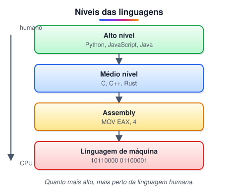

# Introdução a programação

> 🗺️ **Nesta aula:** o que é programar, o que é um algoritmo e como as linguagens se organizam do nível da máquina ao nível humano.

## Onde começamos

Este curso forma um desenvolvedor web do zero: primeiro os fundamentos (computador, internet, lógica), depois o front-end (HTML, CSS, JavaScript), o versionamento com Git e, por fim, o back-end (Node.js) e o banco de dados (SQL). Tudo parte de duas ideias: **programa** e **algoritmo**.

## O que é programar?

**Programar é escrever instruções precisas, em uma linguagem de programação, para que um computador execute uma tarefa.** O computador não entende intenção, só instruções: ele faz exatamente o que foi escrito, nem mais nem menos.

- Uma **linguagem de programação** é um conjunto de regras de **sintaxe** (como escrever) e **semântica** (o que cada coisa significa). Exemplos: C, C++, Java, Python e JavaScript, cada uma com características e usos próprios.
- Programar vai além de digitar código. O trabalho passa por várias etapas:
  1. **entender o problema**;
  2. **planejar a solução**, quebrando-a em passos menores;
  3. **codificar**;
  4. **testar e depurar** (encontrar e corrigir erros).

## O que é algoritmo?

**Algoritmo é uma sequência finita, ordenada e sem ambiguidade de passos que resolve um problema.** Uma receita de bolo é um algoritmo; um programa é um algoritmo escrito numa linguagem que o computador entende.

Um bom algoritmo é:

- **Correto**: produz o resultado esperado para todas as entradas válidas.
- **Finito**: termina em algum momento.
- **Eficiente**: usa pouco tempo e memória, mesmo quando a entrada cresce. Essa análise é chamada de *complexidade*, e costuma ser escrita em notação Big-O, como O(n).

Exemplo de algoritmo, em português, para descobrir o maior de três números:

```
1. Leia A, B e C
2. maior ← A
3. Se B > maior, então maior ← B
4. Se C > maior, então maior ← C
5. Mostre maior
```

Os mesmos passos em JavaScript:

```jsx
function maiorDeTres(a, b, c) {
  let maior = a;
  if (b > maior) maior = b;
  if (c > maior) maior = c;
  return maior;
}

console.log(maiorDeTres(7, 42, 13)); // 42
```

> 💡 Algoritmos não são exclusivos da computação: estão na matemática, na logística e no dia a dia. A diferença é que, para o computador, cada passo precisa ser **totalmente explícito**.

## Níveis das linguagens de programação



- **Linguagem de máquina**: zeros e uns, as instruções que o processador executa diretamente. Cada família de processador (x86, ARM) tem a sua.
- **Assembly**: apelidos legíveis (*mnemônicos*) para as instruções de máquina. Um programa chamado *assembler* faz a tradução.
- **Baixo/médio nível** (C, C++, Rust): dão controle fino da memória e do hardware, com alto desempenho.
- **Alto nível** (Python, JavaScript, Java): mais próximas da linguagem humana. Escondem detalhes do hardware e o mesmo código roda em máquinas diferentes.

Um **compilador** ou um **interpretador** faz a ponte entre o código de alto nível e o binário. Isso é detalhado na aula "Como as linguagens de programação funcionam".

## 🧠 Revisão rápida

**Quais são as quatro etapas do trabalho de programar?**

Entender o problema, planejar a solução, codificar e testar/depurar.

**Por que uma receita de bolo pode ser considerada um algoritmo?**

Porque é uma sequência finita e ordenada de passos que leva a um resultado.

**Qual a diferença entre linguagem de máquina e linguagem de alto nível?**

A de máquina são os zeros e uns que a CPU executa; a de alto nível é próxima da linguagem humana e precisa ser traduzida.

> ➡️ **Próximo passo:** como quase tudo neste curso roda na web, a próxima aula mostra o que acontece quando você digita um endereço no navegador: **Como funciona a Web**.

## 📌 Resumo

| Item | Em uma frase |
| --- | --- |
| Programar | escrever instruções precisas para o computador |
| Linguagem | regras de sintaxe e semântica |
| Algoritmo | passos finitos, ordenados e sem ambiguidade |
| Bom algoritmo | correto, finito e eficiente |
| Níveis | máquina, Assembly, médio e alto nível |
| Tradução | feita por compilador ou interpretador |
