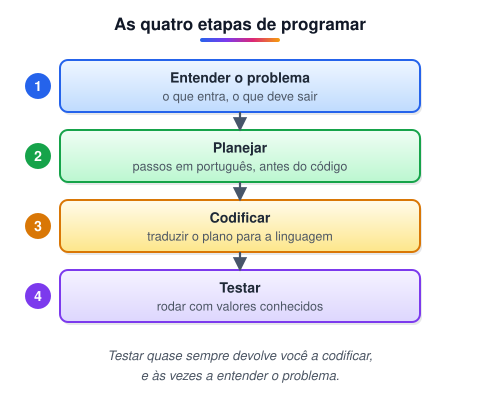
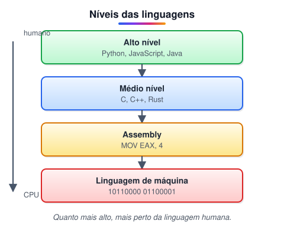

# Introdução a programação

> 🗺️ **Nesta aula:** o que é programar, o que é um algoritmo e como as linguagens se organizam do nível da máquina ao nível humano.

## Onde começamos

Este curso forma um desenvolvedor web do zero: primeiro os fundamentos (computador, internet, lógica), depois o front-end (HTML, CSS, JavaScript), o versionamento com Git e, por fim, o back-end (Node.js) e o banco de dados (SQL). Tudo parte de duas ideias: **programa** e **algoritmo**.

## O que é programar?

**Programar é escrever instruções precisas, em uma linguagem de programação, para que um computador execute uma tarefa.** O computador não entende intenção, só instruções: ele faz exatamente o que foi escrito, nem mais nem menos.

> 💡 **Analogia:** programar é como dar instruções a um GPS para alguém que nunca saiu de casa. "Vá até a padaria" não serve; é preciso dizer "saia pela porta, vire à direita, ande 200 metros, atravesse na faixa".

O computador faz bilhões de operações por segundo, mas não decide nada sozinho. Ele é rápido e obediente, nunca criativo. Programar preenche exatamente essa lacuna: você pensa uma vez, ele repete sem errar e sem cansar.

Pense numa loja com 300 produtos que vai dar 10% de desconto. Na mão, é abrir produto por produto, calcular e digitar o novo preço: umas duas horas de trabalho, com erros de digitação pelo caminho. Um programa faz o mesmo em menos de um segundo, e na milésima vez continua acertando. O ganho não é a inteligência da máquina: é a repetição sem desgaste.

- Uma **linguagem de programação** é um conjunto de regras de **sintaxe** (como escrever) e **semântica** (o que cada coisa significa). Exemplos: C, C++, Java, Python e JavaScript, cada uma com características e usos próprios.
- Programar vai além de digitar código. O trabalho passa por várias etapas:
  1. **entender o problema**;
  2. **planejar a solução**, quebrando-a em passos menores;
  3. **codificar**;
  4. **testar e depurar** (encontrar e corrigir erros).



> 💡 **Analogia:** programar é como cozinhar uma receita nova. Entender é saber para quantas pessoas é o prato, planejar é escrever os passos, codificar é cozinhar e testar é provar. Se faltar sal, você volta ao fogão.

Na prática, as etapas não têm o mesmo tamanho. Quem está começando imagina que codificar é o trabalho todo, mas entender o problema e testar costumam levar mais tempo do que escrever o código. No exemplo do desconto: **entender** é descobrir se o desconto também vale para produtos que já estão em promoção; **planejar** é decidir que você vai percorrer a lista e multiplicar cada preço por 0,9; **codificar** são três ou quatro linhas; **testar** é conferir se um produto de R$ 10,00 virou R$ 9,00 e se nenhum preço terminou negativo.

As etapas também não são uma fila de mão única. Testar quase sempre devolve você para o código, e às vezes mostra que o problema foi mal entendido desde o começo. Descobrir isso cedo é barato; descobrir depois de o sistema estar no ar, não.

## O que é algoritmo?

Antes de escrever qualquer linha de código, você precisa saber o que vai mandar o computador fazer. O algoritmo é esse plano, escrito de um jeito que não deixe dúvida.

**Algoritmo é uma sequência finita, ordenada e sem ambiguidade de passos que resolve um problema.** Uma receita de bolo é um algoritmo; um programa é um algoritmo escrito numa linguagem que o computador entende.

As três palavras da definição carregam peso. **Finita** quer dizer que acaba: um passo que manda voltar para si mesmo para sempre não é algoritmo, é um travamento. **Ordenada** quer dizer que a sequência importa: assar antes de misturar dá outro resultado. E **sem ambiguidade** é a mais traiçoeira das três. "Separe os alunos aprovados" parece claro, mas aprovado é nota acima de 7 ou de 7 para cima? E quem passou de nota mas faltou demais? O computador não pergunta: ele aplica a regra que você escreveu, mesmo quando você escreveu a errada.

Um bom algoritmo é:

- **Correto**: produz o resultado esperado para todas as entradas válidas.
- **Finito**: termina em algum momento.
- **Eficiente**: usa pouco tempo e memória, mesmo quando a entrada cresce. Essa análise é chamada de *complexidade*, e costuma ser escrita em notação Big-O, como O(n).

Exemplo de algoritmo, em português, para descobrir o maior de três números:

```
1. Leia A, B e C
2. maior ← A        (alguém precisa ser o
                     candidato inicial)
3. Se B > maior, então maior ← B
4. Se C > maior, então maior ← C
5. Mostre maior     (quem sobreviveu às
                     comparações é o maior)
```

Os mesmos passos em JavaScript:

```jsx
function maiorDeTres(a, b, c) {
  // começamos supondo que o primeiro é o maior
  let maior = a;
  // cada if só troca o candidato se achar
  // alguém realmente maior
  if (b > maior) maior = b;
  if (c > maior) maior = c;
  return maior;
}

// saída: 42
console.log(maiorDeTres(7, 42, 13));
```

Vale percorrer o algoritmo com valores de verdade. Com A = 7, B = 42 e C = 13, o passo 2 guarda 7 em `maior`. No passo 3, 42 é maior que 7, então `maior` passa a valer 42. No passo 4, 13 não é maior que 42, e nada muda. Sobra 42, que é a resposta certa. Repare que o passo 2 não é desperdício: sem um candidato inicial, não haveria com o que comparar o B.

> ⚠️ **Armadilha comum:** começar com `maior = 0` em vez do primeiro valor. Parece inofensivo e funciona em quase todo teste, até aparecerem três números negativos: com -5, -2 e -9, o resultado sairia 0, que não é nenhum dos três. Comece sempre pelo primeiro valor da lista.

> 💡 Algoritmos não são exclusivos da computação: estão na matemática, na logística e no dia a dia. A diferença é que, para o computador, cada passo precisa ser **totalmente explícito**.

## Níveis das linguagens de programação



> 💡 **Analogia:** é como pedir comida em outro país. A linguagem de máquina é o idioma local que só o cozinheiro (a CPU) entende; o Assembly é um dicionário palavra por palavra; as linguagens de alto nível são você falando português com um intérprete (o compilador) que traduz tudo para a cozinha.

- **Linguagem de máquina**: zeros e uns, as instruções que o processador executa diretamente. Cada família de processador (x86, ARM) tem a sua.
- **Assembly**: apelidos legíveis (*mnemônicos*) para as instruções de máquina. Um programa chamado *assembler* faz a tradução.
- **Baixo/médio nível** (C, C++, Rust): dão controle fino da memória e do hardware, com alto desempenho.
- **Alto nível** (Python, JavaScript, Java): mais próximas da linguagem humana. Escondem detalhes do hardware e o mesmo código roda em máquinas diferentes.

Para enxergar a diferença, pegue a tarefa mais simples que existe: somar 2 e 3. Em alto nível, você escreve `soma = 2 + 3`, uma linha que se lê quase como português. Em Assembly, a mesma conta vira três instruções separadas: carregue 2 num registrador, some 3 a ele, guarde o resultado na memória. Em linguagem de máquina, cada uma dessas instruções é uma sequência de bits como `10110000 00000010`. É o mesmo trabalho, descrito em três níveis de detalhe.

Não existe nível melhor, existe nível adequado. Quanto mais baixo, mais controle sobre memória e desempenho, e mais trabalho e chance de errar. Quanto mais alto, mais rápido você produz e mais o mesmo código roda em máquinas diferentes, ao custo de abrir mão do controle fino. É por isso que o software de um freio ABS é escrito em C, e um site é escrito em JavaScript: são exigências diferentes, não níveis de habilidade diferentes.

Um **compilador** ou um **interpretador** faz a ponte entre o código de alto nível e o binário. Isso é detalhado na aula "Como as linguagens de programação funcionam".

## 🧠 Revisão rápida

**Quais são as quatro etapas do trabalho de programar?**

Entender o problema, planejar a solução, codificar e testar/depurar.

**Por que uma receita de bolo pode ser considerada um algoritmo?**

Porque é uma sequência finita e ordenada de passos que leva a um resultado.

**Qual a diferença entre linguagem de máquina e linguagem de alto nível?**

A de máquina são os zeros e uns que a CPU executa; a de alto nível é próxima da linguagem humana e precisa ser traduzida.

> ➡️ **Próximo passo:** como quase tudo neste curso roda na web, a próxima aula mostra o que acontece quando você digita um endereço no navegador: **Como funciona a Web**.

## 📌 Resumo

| Item | Em uma frase |
| --- | --- |
| Programar | escrever instruções precisas para o computador |
| Linguagem | regras de sintaxe e semântica |
| Algoritmo | passos finitos, ordenados e sem ambiguidade |
| Bom algoritmo | correto, finito e eficiente |
| Níveis | máquina, Assembly, médio e alto nível |
| Tradução | feita por compilador ou interpretador |
