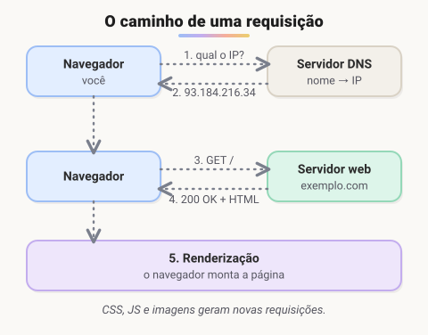
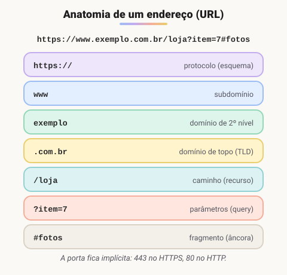

# Como funciona a Web

> 🗺️ **Nesta aula:** o caminho de uma requisição na web, os protocolos envolvidos (IP, DNS, TCP, HTTP) e as partes de uma URL.

## De onde paramos

Na aula anterior você viu que um programa é um algoritmo escrito numa linguagem. Os programas deste curso vão rodar na **web**: no navegador (front-end) e em servidores (back-end). Antes de escrever o primeiro HTML, vale entender como uma página chega até a tela.

## O caminho de uma requisição

Quando você digita um endereço no navegador, acontece mais ou menos isto:



1. **DNS**: o navegador pergunta qual é o endereço IP de `exemplo.com`. A resposta fica em cache por um tempo.
2. **Conexão**: o navegador abre uma conexão **TCP** com o servidor. No HTTPS, também negocia a criptografia (**TLS**).
3. **Requisição HTTP**: o navegador envia algo como `GET /` com cabeçalhos.
4. **Resposta**: o servidor devolve um **código de status** (ex.: `200 OK`) e o conteúdo, normalmente HTML.
5. **Renderização**: o navegador lê o HTML, descobre que precisa de CSS, JS e imagens, faz novas requisições para cada um e monta a página.

> 💡 **Analogia:** abrir um site é como pedir comida por telefone. Primeiro você procura o número na agenda (DNS), liga e espera atender (conexão TCP), faz o pedido (requisição HTTP), recebe a comida (resposta) e monta o prato na mesa (renderização).

## Termos importantes

### IP (Internet Protocol)

- É o protocolo que **endereça e encaminha pacotes** entre redes. Cada dispositivo conectado tem um endereço IP.
- **IPv4** usa 32 bits (ex.: `192.168.0.10`), cerca de 4,3 bilhões de endereços, que já se esgotaram. O **IPv6** usa 128 bits (ex.: `2001:db8::1`).
- Endereços como `192.168.x.x` e `10.x.x.x` são **privados**: só valem dentro da rede local. O roteador faz a tradução para o IP público (**NAT**).

### DNS (Domain Name System)

- É a "agenda de contatos" da internet: traduz **nomes** (`google.com`) em **endereços IP**.
- É distribuído e hierárquico: servidores raiz → servidores do `.com`, `.br` etc. → servidor do domínio.
- Existe porque nomes são fáceis de lembrar e o IP de um site pode mudar sem que o nome mude.

> ⚠️ **Correção:** o DNS não "otimiza o roteamento". Ele só resolve nomes em IPs. Quem escolhe o caminho dos pacotes são os **roteadores**, usando protocolos de roteamento como o BGP.

### TCP e UDP

- **TCP** garante entrega **completa e em ordem**: reenvia o que se perder. É usado pela Web, por e-mail e por transferência de arquivos.
- **UDP** é mais leve e não garante entrega. É usado onde atraso é pior que perda: chamadas de voz, jogos online, streaming ao vivo.

### HTTP e HTTPS

- O **HTTP** é o protocolo da Web: o cliente pede (requisição) e o servidor responde (resposta).
- O **HTTPS** é o HTTP dentro de uma conexão criptografada com **TLS**. Ele protege senhas e dados contra espionagem e adulteração no caminho. Hoje é o padrão.
- **Métodos** mais usados: `GET` (buscar), `POST` (criar/enviar), `PUT`/`PATCH` (atualizar), `DELETE` (remover).
- **Códigos de status**: `2xx` sucesso (200, 201), `3xx` redirecionamento (301, 302), `4xx` erro do cliente (400, 401, 403, 404) e `5xx` erro do servidor (500, 503).

Uma requisição e sua resposta, em texto, têm esta cara:

```
GET /produtos HTTP/1.1
Host: loja.exemplo.com
Accept: text/html

HTTP/1.1 200 OK
Content-Type: text/html; charset=utf-8

<!DOCTYPE html> ...
```

### VoIP (Voz sobre IP)

- Tecnologia de chamadas de voz pela internet: o áudio é digitalizado e enviado em pacotes, normalmente via UDP.
- Substitui a linha telefônica tradicional. WhatsApp, Teams e Zoom usam essa ideia.

## Anatomia de uma URL

A **URL** (*Uniform Resource Locator*) é o endereço completo de um recurso na web.



| Parte | Exemplo | Para que serve |
| --- | --- | --- |
| Protocolo | `https` | como conversar com o servidor |
| Subdomínio | `www.` | subdivisão do domínio (ex.: `blog.`, `api.`) |
| Domínio | `exemplo.com.br` | o nome registrado do site |
| Porta | `:443` | "porta de entrada" no servidor; 80 (HTTP) e 443 (HTTPS) ficam implícitas |
| Caminho | `/blog/artigo` | qual recurso dentro do site |
| Query string | `?id=7&p=2` | parâmetros extras, no formato chave=valor separados por `&` |
| Fragmento | `#comentarios` | posição dentro da página; fica só no navegador |

> 💡 Quer ver isso acontecendo? Abra o **DevTools** do navegador (F12), vá na aba **Network** e recarregue a página. Cada linha é uma requisição HTTP, com método, status, tamanho e tempo.

## 🧠 Revisão rápida

**O que o DNS faz?**

Traduz um nome de domínio (`google.com`) no endereço IP do servidor.

**Qual a diferença entre HTTP e HTTPS?**

O HTTPS é o HTTP dentro de uma conexão criptografada (TLS), que protege os dados no caminho.

**O que significa um status 404? E um 500?**

404: o recurso pedido não existe (erro do cliente). 500: erro interno no servidor.

**Na URL `https://loja.com/busca?q=tenis#filtros`, qual é a query string?**

`?q=tenis`.

> ➡️ **Próximo passo:** por trás do navegador e do servidor existem máquinas físicas. A próxima aula abre o computador: **Hardware, software e estrutura do computador**.

## 📌 Resumo

| Item | Em uma frase |
| --- | --- |
| IP | endereço de cada dispositivo na rede |
| DNS | traduz nomes em IPs |
| TCP / UDP | entrega garantida / entrega rápida sem garantia |
| HTTP / HTTPS | protocolo da web / com criptografia TLS |
| Métodos | GET busca, POST cria, PUT/PATCH alteram, DELETE remove |
| Status | 2xx ok, 3xx redireciona, 4xx erro do cliente, 5xx erro do servidor |
| URL | protocolo, domínio, porta, caminho, query e fragmento |
