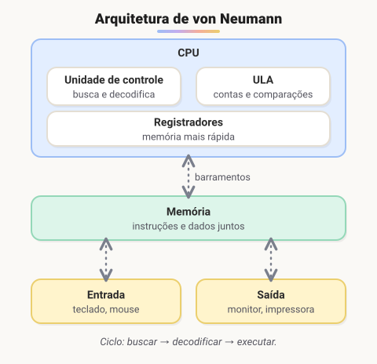

# Hardware, software e estrutura do computador

> 🗺️ **Nesta aula:** a diferença entre hardware e software, os componentes do computador e o modelo de von Neumann, que explica como o processador executa um programa.

## De onde paramos

Na aula anterior, uma requisição saiu do navegador e chegou a um servidor. Tanto o seu notebook quanto o servidor são computadores com as mesmas peças básicas. Entender essas peças ajuda a entender por que um programa "trava", por que a memória acaba e o que significa "rodar" um código.

## Hardware

**Hardware é a parte física do computador**: tudo o que dá para tocar.

### Componentes centrais e periféricos

| Centrais (dentro do gabinete) | Periféricos (conectados a ele) |
| --- | --- |
| **Processador (CPU)**: executa as instruções | teclado, mouse, monitor |
| **Memória RAM**: guarda o que está em uso agora; é volátil (apaga ao desligar) | impressora, caixa de som, webcam |
| **Placa-mãe**: liga todos os componentes | HD/SSD externo, pendrive |
| **Armazenamento (SSD/HD)**: guarda arquivos de forma permanente | fone, microfone, joystick |

### Funções do hardware

- **Entrada**: levam dados para o computador. Ex.: teclado, mouse, microfone, scanner.
- **Saída**: mostram ou entregam resultados. Ex.: monitor, impressora, caixa de som.
- **Entrada e saída (mistos)**: fazem as duas coisas. Ex.: tela touch, modem, placa de rede.
- **Processamento**: fazem cálculos. Ex.: CPU e GPU (placa de vídeo).
- **Armazenamento**: guardam dados. Ex.: SSD, HD, cartão de memória.

> 💡 **Hierarquia de memória:** quanto mais perto da CPU, mais rápida, mais cara e menor a memória. A ordem é: registradores → cache (L1/L2/L3) → RAM → SSD → HD. Por isso um programa abre devagar (vem do disco) e depois fica rápido (está na RAM).

## Software

**Software é a parte lógica**: os programas que dão vida ao hardware e o controlam.

- **Software de sistema**: sistema operacional, drivers, firmware (BIOS/UEFI).
- **Software de aplicação**: navegador, editor de texto, jogos, apps.
- **Ferramentas de desenvolvimento**: compiladores, interpretadores e IDEs, que são os programas usados para criar outros programas.

> ⚠️ **Correções:** "linguagens de programação" não são software. Uma linguagem é um conjunto de regras; o software é o **compilador ou interpretador** que a executa. E o termo para a caixa de graves é **subwoofer**, não "subwolf".

## Bits e bytes

O computador só entende dois estados elétricos, representados por **0** e **1**. Cada um é um **bit**. Juntando bits, representa-se qualquer coisa:

| Unidade | Tamanho | Exemplo |
| --- | --- | --- |
| bit | 0 ou 1 | ligado/desligado |
| byte | 8 bits | uma letra em ASCII (`A` = 01000001) |
| KB / MB | mil / milhão de bytes | um texto / uma foto |
| GB / TB | bilhão / trilhão de bytes | a RAM / um disco |

Com 8 bits há 2⁸ = 256 combinações, de 00000000 a 11111111. Textos, imagens e sons viram números binários antes de serem processados.

## Estrutura do computador

**Computação** vem do latim *computare*, que significa calcular. Os primeiros computadores eram máquinas de calcular gigantes. Hoje, tudo (texto, imagem, som) é representado como números binários e processado da mesma forma.

### Arquitetura de von Neumann

Quase todos os computadores atuais seguem o modelo descrito pelo matemático **John von Neumann** em 1945. A grande ideia foi guardar **programa e dados na mesma memória**. Antes, a máquina era "reprogramada" mudando fios e chaves.

- **Unidade de controle (UC)**: busca a próxima instrução na memória, decodifica e coordena a execução.
- **Unidade lógica e aritmética (ULA)**: faz contas (soma, subtração, multiplicação, divisão) e comparações (maior, menor, igual).
- **Registradores**: pequenas memórias dentro da CPU, as mais rápidas de todas.
- **Memória**: guarda instruções e dados.
- **Barramentos**: as "estradas" que levam dados, endereços e sinais de controle entre as partes.

O processador repete sem parar o ciclo **buscar → decodificar → executar**, bilhões de vezes por segundo. O ritmo é dado pelo **clock**, medido em GHz (bilhões de ciclos por segundo).

## 🧠 Revisão rápida

**Por que a RAM é chamada de memória volátil?**

Porque perde o conteúdo quando o computador desliga; o que precisa ficar guardado vai para o SSD ou HD.

**Um compilador é hardware ou software?**

Software (uma ferramenta de desenvolvimento).

**Qual foi a grande ideia da arquitetura de von Neumann?**

Guardar o programa e os dados na mesma memória.

**Quantos valores diferentes cabem em um byte?**

256 (2⁸).

> ➡️ **Próximo passo:** quem decide qual programa usa a CPU e a memória é um software especial: o **Sistemas operacionais**.

## 📌 Resumo

| Item | Em uma frase |
| --- | --- |
| Hardware | a parte física |
| Software | a parte lógica: os programas |
| CPU | executa as instruções |
| RAM | memória rápida e volátil do que está em uso |
| SSD/HD | armazenamento permanente |
| Bit / byte | 0 ou 1 / 8 bits |
| Von Neumann | programa e dados na mesma memória |
| Ciclo da CPU | buscar, decodificar, executar |
