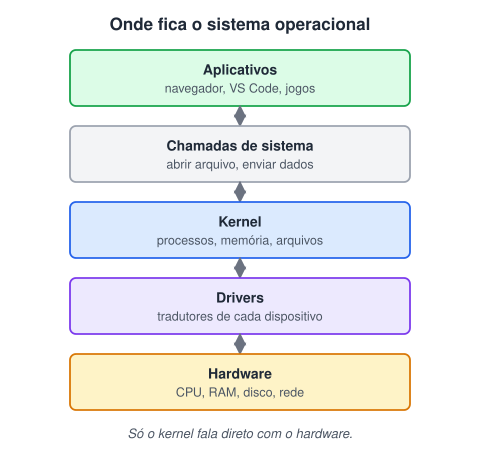

# Sistemas operacionais

> 🗺️ **Nesta aula:** o papel do sistema operacional, suas partes (kernel, drivers, shell) e os tipos de SO que você vai encontrar como desenvolvedor.

## De onde paramos

A aula anterior mostrou as peças físicas do computador. Mas nenhum programa (nem o navegador, nem o VS Code) fala diretamente com essas peças. Entre eles há uma camada de software que organiza tudo: o sistema operacional.

## O que é um sistema operacional?

**O sistema operacional (SO) é o software que fica entre o hardware e os programas.** Ele gerencia os recursos do computador (processador, memória, disco, rede) e oferece serviços para que os aplicativos não precisem lidar diretamente com o hardware.

> 💡 **Analogia:** o SO é o gerente de um restaurante. Os clientes (aplicativos) não entram na cozinha nem mexem no fogão (hardware): fazem o pedido ao gerente, que organiza a fila, distribui as mesas (memória) e garante que um cliente não coma o prato do outro.

## Responsabilidades

1. **Gerenciar processos**: carregar, executar, pausar e encerrar programas. Também alterna entre eles tão rápido que parece que tudo roda ao mesmo tempo (multitarefa).
2. **Gerenciar memória**: decidir quanto de RAM cada programa usa e isolar um do outro, para que um app não leia a memória de outro.
3. **Gerenciar arquivos**: organizar pastas e arquivos no disco, usando um *sistema de arquivos* (NTFS no Windows, ext4 no Linux, APFS no macOS).
4. **Controlar dispositivos**: conversar com teclado, impressora e placa de vídeo por meio de **drivers**.
5. **Segurança**: usuários, senhas, permissões e isolamento.
6. **Rede**: pilha TCP/IP, Wi-Fi e compartilhamento de recursos.
7. **Interface com o usuário**: gráfica (GUI) ou linha de comando (CLI).

## Partes de um SO

- **Kernel (núcleo)**: o coração do SO. Roda com privilégio máximo e é o único que acessa o hardware diretamente. Os programas pedem coisas a ele por meio de **chamadas de sistema** (*syscalls*), como "abrir arquivo" ou "enviar dados pela rede".
- **Escalonador** (*scheduler*): decide qual processo usa a CPU e por quanto tempo.
- **Gerenciador de memória**: memória virtual, paginação e *swap* (usar o disco quando a RAM acaba).
- **Sistema de arquivos**: regras de como os dados ficam gravados no disco.
- **Drivers**: "tradutores" entre o kernel e cada dispositivo.
- **Shell / interface**: por onde o usuário dá comandos. Pode ser em texto (Bash, Zsh, PowerShell, CMD) ou gráfica (área de trabalho do Windows, GNOME, macOS).

## Processo × programa

Um **programa** é um arquivo parado no disco (ex.: `code.exe`). Quando você o abre, o SO cria um **processo**: o programa em execução, com memória própria e um número de identificação (PID). Abrir o navegador duas vezes cria dois processos do mesmo programa. O Gerenciador de Tarefas (Windows) e o Monitor de Atividade (macOS) listam os processos.

## Tipos de sistemas operacionais

| Tipo | Exemplos | Característica |
| --- | --- | --- |
| Desktop | Windows, macOS, Linux (Ubuntu, Fedora) | uso pessoal, interface gráfica rica |
| Mobile | Android, iOS | tela touch, economia de bateria, lojas de apps |
| Servidor | Linux (Ubuntu Server, Debian, RHEL), Windows Server | estabilidade, rede, quase sempre sem interface gráfica |
| Embarcado | Linux embarcado, FreeRTOS, firmware | feito para um único aparelho: caixa eletrônico, smart TV, carro |

> 💡 **Curiosidade:** o Android usa o kernel Linux, e o macOS e o iOS derivam do Unix. A maior parte dos servidores da internet roda Linux. Por isso vale a pena aprender o terminal, tema da próxima aula.

## 🧠 Revisão rápida

**Por que um aplicativo não acessa o hardware diretamente?**

Porque só o kernel tem esse privilégio; o app faz uma chamada de sistema e o kernel executa por ele.

**Qual a diferença entre programa e processo?**

O programa é o arquivo no disco; o processo é o programa em execução, com memória própria.

**O que é um driver?**

O software que traduz os pedidos do kernel para um dispositivo específico.

> ➡️ **Próximo passo:** o shell em texto é a ferramenta de trabalho de todo desenvolvedor. Veja como usá-lo em **Terminal e linha de comando**.

## 📌 Resumo

| Item | Em uma frase |
| --- | --- |
| Sistema operacional | gerencia o hardware e serve os programas |
| Kernel | núcleo que fala com o hardware |
| Syscall | pedido de um programa ao kernel |
| Driver | tradutor de cada dispositivo |
| Shell | interface de comandos (texto ou gráfica) |
| Processo | programa em execução |
| Tipos | desktop, mobile, servidor, embarcado |
