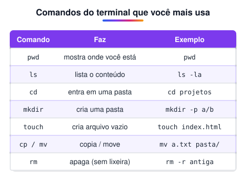
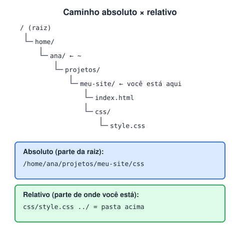

# Terminal e linha de comando (Adicionado pelo aluno para melhorar o estudo)

> 🗺️ **Nesta aula:** como navegar entre pastas, criar e apagar arquivos e encadear comandos no terminal, o básico para usar Git, npm e Node nos próximos módulos.

## De onde paramos

A aula anterior apresentou o shell, a interface em texto do sistema operacional. Agora você vai usá-lo. Git, npm, Node e servidores são usados principalmente pelo terminal, então dominar o básico economiza muito tempo.

## Por que aprender o terminal

Num primeiro momento, clicar parece mais fácil. Mas o terminal ganha de lavada em três situações: tarefas repetidas (criar vinte pastas com um comando), ferramentas que só existem em texto (Git, npm, Node) e servidores, que quase nunca têm tela gráfica. Além disso, um comando escrito pode ser copiado, guardado e repetido por qualquer pessoa, o que é impossível com uma sequência de cliques. Vale ver o terminal como um idioma curto, com poucas palavras que você usa todos os dias.



> 💡 **Analogia:** o terminal é como o vocabulário de um motorista de táxi: poucas frases bem usadas ("vire à esquerda", "siga reto") levam a qualquer lugar.

**O terminal é uma forma de controlar o computador digitando comandos em vez de clicar.** Cada comando tem o formato `programa opções argumentos`, por exemplo `ls -la projetos`.

- **Windows:** use o **Git Bash** (instalado junto com o Git) ou o **PowerShell**. Os comandos abaixo são do Bash.
- **macOS e Linux:** o app **Terminal**.
- **VS Code:** `Ctrl + '` abre um terminal integrado já na pasta do projeto.

## Navegando entre pastas

Quase tudo no terminal acontece "em uma pasta": você sempre está em algum lugar, e os comandos agem a partir dali. Por isso os três primeiros comandos são os de orientação: `pwd` diz onde você está, `ls` mostra o que há ali e `cd` leva você para outro lugar. Um bom hábito é rodar `pwd` e `ls` antes de qualquer comando que mude arquivos, para ter certeza de onde está.

```bash
pwd  # mostra em que pasta você está
ls  # lista o conteúdo
ls -la  # inclui ocultos e detalhes
cd projetos  # entra na pasta "projetos"
cd ..  # volta uma pasta
cd ~  # vai para a pasta do usuário
cd -  # volta para a pasta anterior
```



> 💡 **Analogia:** o caminho absoluto é o endereço completo com cidade e CEP; o relativo é "duas casas depois da padaria". O segundo só funciona se você souber onde está agora, e é isso que o `pwd` responde.

**Caminho absoluto** parte da raiz (`/home/ana/projetos`); **caminho relativo** parte da pasta atual (`css/style.css`). `..` significa "a pasta acima" e `.` significa "a pasta atual".

## Criando, copiando, movendo e apagando

Os nomes são curtos porque vêm de uma época em que cada tecla contava: `mkdir` (make directory), `cp` (copy), `mv` (move), `rm` (remove). O `mv` serve também para renomear, porque renomear é só mover para um nome novo. E o `rm` merece cuidado redobrado: não existe lixeira. Antes de apagar algo importante, rode o `ls` com o mesmo caminho e veja se aparece o que você espera.

```bash
mkdir meu-site  # cria pasta
mkdir -p src/css/temas  # cria a pasta e as intermediárias
touch index.html  # cria arquivo vazio
cp index.html sobre.html  # copia
mv sobre.html paginas/  # move (ou renomeia)
rm arquivo.txt  # apaga arquivo
rm -r pasta-velha  # apaga pasta e conteúdo
```

> ⚠️ `rm` **não manda para a lixeira**: o arquivo some de vez. Confira o caminho antes de apertar Enter e nunca rode `rm -rf` com um caminho que você não entendeu.

## Lendo arquivos

```bash
cat README.md  # mostra o arquivo inteiro
head -n 5 log.txt  # primeiras 5 linhas
tail -f log.txt  # acompanha o fim em tempo real
grep "erro" log.txt  # procura um texto
```

## Atalhos que fazem diferença

| Atalho | Faz |
| --- | --- |
| `Tab` | completa nomes de pastas e arquivos |
| `↑` / `↓` | percorre comandos anteriores |
| `Ctrl + C` | interrompe o programa em execução (ex.: um servidor) |
| `Ctrl + L` ou `clear` | limpa a tela |
| `Ctrl + R` | busca no histórico de comandos |

## Encadeando comandos

A força do terminal está em combinar comandos simples. O `&&` encadeia passos que dependem uns dos outros: criar a pasta **e, se deu certo**, entrar nela. O pipe `|` entrega a saída de um comando como entrada do outro: `ls | grep .js` lista os arquivos e mostra só os que têm `.js` no nome. Os sinais `>` e `>>` guardam o resultado em um arquivo, em vez de mostrar na tela. Com poucos blocos você monta tarefas que seriam longas no mouse.

```bash
# && só roda o segundo se o primeiro der certo
mkdir app && cd app
# | (pipe) envia a saída de um comando para outro
ls | grep .js
# > grava em arquivo (sobrescreve)
echo "node_modules" > .gitignore
# >> acrescenta ao final
echo ".env" >> .gitignore
```

## Pedindo ajuda

`comando --help` mostra as opções de quase qualquer programa (`git --help`, `npm --help`). No macOS e no Linux, `man ls` abre o manual completo.

## Exercício

Pelo terminal, crie a estrutura `meu-site/` com `index.html`, `css/style.css` e `js/main.js`, e depois liste tudo.

<details>
<summary>Ver resposta</summary>

```bash
# cria a pasta e as subpastas (-p cria o que faltar)
mkdir -p meu-site/css meu-site/js
# entra na pasta: os caminhos agora são relativos a ela
cd meu-site
# cria os arquivos vazios, cada um no seu lugar
touch index.html css/style.css js/main.js
# lista tudo, inclusive o conteúdo das subpastas
ls -R
```

O `-p` cria as pastas de uma vez, e `ls -R` lista as subpastas também.

</details>

## 🧠 Revisão rápida

**Você está em `/home/ana/projetos`. Para onde leva `cd ..`?**

Para `/home/ana`.

**Qual a diferença entre `>` e `>>`?**

`>` sobrescreve o arquivo; `>>` acrescenta ao final.

**Como parar um servidor rodando no terminal?**

`Ctrl + C`.

> ➡️ **Próximo passo:** depois de ver as máquinas e o sistema, volte um pouco no tempo para entender como elas passaram a se conectar: **Surgimento da internet e aplicações Web**.

## 📌 Resumo

| Comando | Faz |
| --- | --- |
| `pwd` · `ls` · `cd` | onde estou · o que tem aqui · mudar de pasta |
| `mkdir` · `touch` | cria pasta · cria arquivo |
| `cp` · `mv` · `rm` | copia · move/renomeia · apaga de vez |
| `cat` · `grep` | mostra arquivo · procura texto |
| `&&` e pipe · `>` | encadeia comandos · grava em arquivo |
| `--help` | ajuda de qualquer comando |
