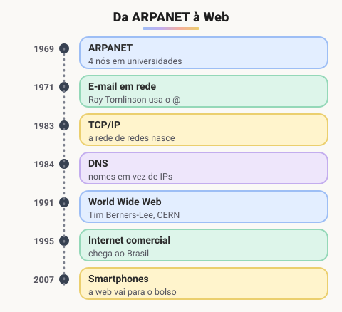
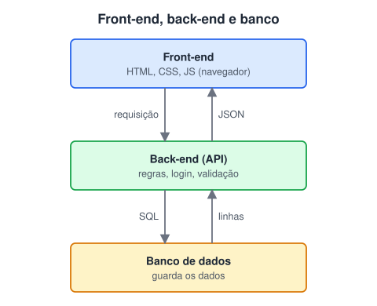

# Surgimento da internet e aplicações Web

> 🗺️ **Nesta aula:** como a internet surgiu, a diferença entre internet, Web e intranet, e como uma aplicação web se divide em front-end, back-end e API.

## De onde paramos

Você já viu como um computador funciona e como uma requisição percorre a Web. Esta aula fecha o módulo juntando as peças: de onde veio a rede, e como os sistemas que você vai construir no curso se organizam nela.

## Como surgiu a internet?

A internet nasceu da **ARPANET**, um projeto da agência de pesquisa do Departamento de Defesa dos EUA (ARPA). A ideia era ligar computadores de universidades e centros de pesquisa numa rede **descentralizada**: sem um ponto central, se um caminho caísse, os dados encontrariam outro.

A base técnica foi a **comutação de pacotes**, desenvolvida no início dos anos 1960 por Paul Baran (EUA) e Donald Davies (Reino Unido). A mensagem é quebrada em pequenos pacotes, cada um pode seguir um caminho diferente, e tudo é remontado no destino.



### Marcos principais

- **1969**: primeira conexão da ARPANET, com 4 nós (UCLA, Stanford Research Institute, UC Santa Barbara e Universidade de Utah).
- **1971**: Ray Tomlinson envia o primeiro e-mail em rede e adota o `@`.
- **1974**: Vint Cerf e Bob Kahn publicam o protocolo que daria origem ao **TCP/IP**.
- **1º de janeiro de 1983**: a ARPANET migra para o TCP/IP. É considerado o "aniversário" da internet como rede de redes.
- **1984**: surge o **DNS**.
- **1989**: **Tim Berners-Lee**, no CERN, propõe a **World Wide Web**. Em 1991 o primeiro site entra no ar.
- **1993**: o navegador gráfico **Mosaic** populariza a Web. No Brasil, a internet comercial chega em 1995.

> ⚠️ **Correções:** a ARPANET entrou no ar em **1969**, não em 1966, com 4 nós (não 17). O TCP/IP foi padronizado em 1982 e entrou em vigor em **1º de janeiro de 1983**. A internet foi financiada pela defesa, mas usada principalmente por universidades; "intranet" é um conceito bem posterior. E a origem da ideia de rede descentralizada é a comutação de pacotes de Baran e Davies.

### Internet × Web × intranet

- **Internet**: a infraestrutura, ou seja, a rede mundial de redes conectadas via TCP/IP.
- **Web (WWW)**: um *serviço* que roda sobre a internet: páginas ligadas por links, acessadas via HTTP. E-mail, jogos online e streaming também usam a internet, mas não são "a Web".
- **Intranet**: uma rede **privada** de uma organização que usa as mesmas tecnologias (TCP/IP, HTTP, navegador), mas acessível só para quem está dentro.

## Endereços na rede

- **IP**: endereço lógico de um dispositivo na rede. Pode mudar, por exemplo ao trocar de Wi-Fi. Versões: IPv4 (32 bits) e IPv6 (128 bits).
- **MAC**: endereço físico de 48 bits, gravado na placa de rede (ex.: `3C:22:FB:9A:10:7E`). Identifica o dispositivo **dentro da rede local** (camada de enlace). Não atravessa roteadores.
- **HTTP**: protocolo cliente-servidor para transferir páginas e recursos da Web.
- **URL**: endereço de um recurso (veja "Como funciona a Web").

> 💡 **Analogia:** o MAC é como o número de série de um celular, que nunca muda. O IP é como o endereço onde ele está agora, que muda quando você se muda.

## Aplicações web

**Aplicações web são programas acessados pelo navegador.** O código da interface é baixado e roda no navegador, enquanto a lógica principal e os dados ficam no servidor.

Características:

1. **Sem instalação**: basta um navegador (Chrome, Firefox, Safari, Edge).
2. **Multiplataforma**: o mesmo app funciona no computador, no celular e no tablet.
3. **Atualização centralizada**: atualizou o servidor, todos os usuários recebem a nova versão.
4. **Colaboração**: várias pessoas editando o mesmo documento ao mesmo tempo (ex.: Google Docs, Notion).

Exemplos: redes sociais, lojas virtuais, webmail, internet banking e ferramentas como o Notion.

## Front-end e back-end



> 💡 **Analogia:** num restaurante, o front-end é o salão (cardápio, mesas, garçom) e o back-end é a cozinha (receitas, estoque, regras). A API é a janela de pedidos entre os dois: o garçom entrega o pedido num formato combinado e recebe o prato pronto.

**Front-end** é a interface, o que o usuário vê e com o que interage.

- Na web: **HTML** (estrutura), **CSS** (aparência) e **JavaScript** (comportamento), muitas vezes com frameworks como React, Angular ou Vue.
- Em apps: Flutter (Dart), Swift (iOS) e Kotlin (Android).

**Back-end** é o "motor": regras de negócio, autenticação, acesso ao banco de dados e integrações.

- Linguagens comuns: Java, C#, Python, PHP, JavaScript/TypeScript (Node.js), Go e Ruby.

> ⚠️ **Correção:** a lista de linguagens de back-end estava copiada da de front-end (HTML, CSS, React...). HTML e CSS não rodam no servidor como lógica de negócio; as linguagens de back-end são as listadas acima.

Neste curso você passa pelas três camadas: HTML, CSS e JavaScript no front-end (módulos III a IX), Node.js no back-end (módulo X) e SQL no banco de dados (módulo XI).

## API e JSON

O front-end e o back-end conversam por meio de uma **API** (*Application Programming Interface*): um conjunto de **endpoints** (URLs e métodos HTTP) com um formato combinado de entrada e saída. Por exemplo, `GET /api/produtos` devolve a lista de produtos.

Um endpoint é definido por três coisas:

- **Endereço**: onde está (a URL).
- **Forma de acesso**: o método HTTP e o formato dos dados.
- **Contrato**: o que recebe e o que devolve.

> 💡 A divisão em *Address, Binding, Contract* ("ABC") vem do WCF, uma tecnologia da Microsoft. Em APIs REST, o contrato costuma ser documentado com **OpenAPI/Swagger**.

O formato mais usado para trafegar dados é o **JSON** (*JavaScript Object Notation*):

```json
{
  "id": 1,
  "nome": "Café especial",
  "preco": 29.9,
  "emEstoque": true,
  "tags": ["grãos", "250g"]
}
```

- É **texto** com sintaxe inspirada nos objetos do JavaScript, mas **independente de linguagem**: Java, Python e C# leem e escrevem JSON facilmente.
- É mais rígido que um objeto JS: as chaves vão **sempre entre aspas duplas**, sem vírgula sobrando e sem funções.
- No JavaScript, `JSON.parse(texto)` transforma texto em objeto, e `JSON.stringify(objeto)` faz o caminho inverso.

## 🧠 Revisão rápida

**Internet e Web são a mesma coisa?**

Não. A internet é a infraestrutura de redes; a Web é um serviço (páginas via HTTP) que roda sobre ela.

**O que muda quando você troca de rede Wi-Fi: o IP ou o MAC?**

O IP. O MAC é gravado na placa de rede.

**Em que camada fica a regra "só usuários logados podem comprar"?**

No back-end, que aplica as regras de negócio.

> ➡️ **Próximo passo:** sistemas desse tamanho são feitos em equipe e mantidos por anos. Para isso existem métodos e boas práticas: **Engenharia de software e boas práticas**.

## 📌 Resumo

| Item | Em uma frase |
| --- | --- |
| ARPANET | a rede de 1969 que deu origem à internet |
| TCP/IP | protocolos da internet desde 1983 |
| Web | páginas ligadas por links, via HTTP (1991) |
| IP × MAC | endereço lógico × endereço físico |
| Front-end | interface: HTML, CSS, JavaScript |
| Back-end | regras, autenticação, banco |
| API | contrato de comunicação entre front e back |
| JSON | formato de texto para trocar dados |
