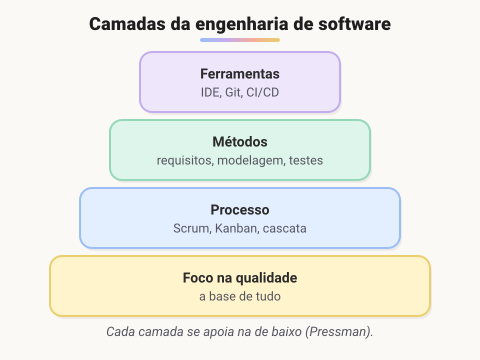
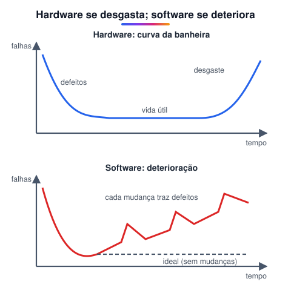
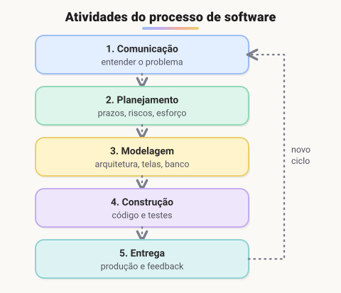
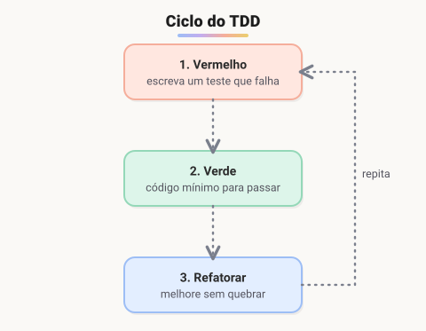

# Engenharia de software e boas práticas

> 🗺️ **Nesta aula:** o que é engenharia de software, como um projeto é organizado (cascata, Scrum, Kanban), o ciclo do TDD e as boas práticas que mantêm um código saudável.

## De onde paramos

O módulo mostrou o computador, a rede e a divisão entre front-end e back-end. Sistemas reais têm milhares de linhas, várias pessoas mexendo e anos de vida. Escrever código que funciona hoje é só metade do trabalho; a outra metade é organizar o trabalho para que ele continue funcionando amanhã.

## O que é engenharia de software?

**Engenharia de software é a aplicação de uma abordagem sistemática, disciplinada e mensurável ao desenvolvimento, à operação e à manutenção de software**, ou seja, aplicar engenharia ao software (definição do IEEE). Também inclui o estudo dessas abordagens.



- **Foco na qualidade**: a base de tudo. Sem compromisso com qualidade, o resto desmorona.
- **Processo**: *como* o trabalho é organizado: quais etapas, em que ordem, quem faz o quê. Exemplos: Scrum, Kanban e cascata.
- **Métodos**: o "como fazer" técnico: levantar requisitos, modelar, construir e testar.
- **Ferramentas**: suporte automatizado ao processo e aos métodos, como IDE, Git, CI/CD e frameworks de teste.

## Software não se desgasta, se deteriora



Uma peça de hardware segue a "curva da banheira": muitas falhas no início (defeitos de fabricação), uma vida útil estável e, depois, desgaste físico. O software não sofre desgaste físico, mas **muda o tempo todo**: correções, novas funções, outra equipe mexendo. Cada mudança mal feita introduz defeitos e aumenta a complexidade. É a **deterioração**, e as boas práticas existem para desacelerá-la.

## Atividades do processo de software



Todo processo de software, ágil ou tradicional, passa por cinco atividades genéricas:

1. **Comunicação**: conversar com o cliente e entender o problema e os requisitos.
2. **Planejamento**: estimar esforço, prazos, riscos e recursos.
3. **Modelagem**: projetar a solução: arquitetura, banco de dados, telas.
4. **Construção**: escrever o código e testá-lo.
5. **Entrega**: colocar em produção e coletar feedback, que alimenta o próximo ciclo.

## Cascata × métodos ágeis

|  | Cascata | Ágil (Scrum, Kanban) |
| --- | --- | --- |
| Ciclo | cada etapa uma vez, em sequência | ciclos curtos que se repetem |
| Entrega | tudo no fim | partes funcionando a cada ciclo |
| Mudanças | caras, depois do planejamento | esperadas e bem-vindas |
| Bom para | requisitos estáveis e bem conhecidos | requisitos que mudam |

- **Scrum**: o trabalho é dividido em **sprints** de 1 a 4 semanas. O *Product Owner* prioriza o **backlog** (lista do que fazer), o time escolhe o que cabe na sprint, faz uma reunião diária curta (*daily*) e, no fim, apresenta o resultado (*review*) e discute melhorias (*retrospectiva*).
- **Kanban**: um quadro com colunas como **A fazer → Fazendo → Feito**. Os cartões andam da esquerda para a direita, e limita-se quantos cartões podem ficar em "Fazendo" ao mesmo tempo, para terminar antes de começar algo novo.

## TDD: desenvolvimento guiado por testes



No **TDD** (*Test-Driven Development*), o teste é escrito **antes** do código:

1. 🔴 **Vermelho**: escreva um teste para a próxima funcionalidade. Ele falha, porque o código ainda não existe.
2. 🟢 **Verde**: escreva o **mínimo** de código para o teste passar.
3. 🔵 **Refatorar**: melhore o código (nomes, duplicação, estrutura) com a segurança de que os testes continuam passando.

```jsx
// 1. Vermelho: o teste vem primeiro
test("soma dois números", () => {
  expect(soma(2, 3)).toBe(5);
});

// 2. Verde: o mínimo para passar
function soma(a, b) {
  return a + b;
}
```

## Boas práticas no desenvolvimento

1. **Planejar antes de codar**: entender os requisitos e esboçar a arquitetura evita retrabalho.
2. **Código limpo**: nomes claros, funções pequenas que fazem uma coisa só e nada de código duplicado (princípio **DRY**, *Don't Repeat Yourself*).
3. **Modularidade**: dividir o sistema em partes coesas e pouco acopladas.
4. **Testes automatizados**: testes unitários, de integração e ponta a ponta pegam regressões antes do usuário.
5. **Controle de versão**: Git para histórico, colaboração e poder voltar atrás (módulo VI).
6. **Revisão de código** (*code review*): outra pessoa lê o código antes de entrar. Pega bugs e espalha conhecimento.
7. **Segurança desde o início**: validar entradas, proteger dados sensíveis e manter dependências atualizadas.
8. **Documentação**: o essencial (como rodar, decisões de arquitetura, contratos de API), e mantida atualizada.
9. **Refatoração contínua**: melhorar a estrutura aos poucos, sem mudar o comportamento.
10. **Aprendizado contínuo**: a área muda rápido.

Um exemplo de "código limpo" na prática:

```jsx
// difícil de ler
function c(a) { return a * 0.9; }

// claro
const DESCONTO = 0.1;
function precoComDesconto(preco) {
  return preco * (1 - DESCONTO);
}
```

## Os 7 princípios de David Hooker

Publicados em 1996, continuam atuais:

1. **A razão de existir**: um software existe para gerar valor ao usuário. Antes de qualquer decisão, pergunte: "isso agrega valor?".
2. **KISS** (*Keep It Simple, Stupid*): mantenha simples. Simples não é simplório; é sem complexidade desnecessária.
3. **Mantenha a visão**: uma visão clara de arquitetura evita que o sistema vire uma colcha de retalhos.
4. **O que você produz, outros consomem**: escreva pensando em quem vai ler, manter ou usar seu código depois.
5. **Esteja aberto para o futuro**: projete sistemas que se adaptem a mudanças, sem se amarrar a uma solução específica.
6. **Planeje a reutilização**: componentes bem pensados podem ser reaproveitados. Reutilizar exige planejamento.
7. **Pense!**: pensar com clareza antes de agir quase sempre produz resultados melhores.

> 💡 A frase "a simplicidade é o último grau de sofisticação" é muito atribuída a Leonardo da Vinci, mas não há registro de que ele a tenha dito. Vale a ideia, não a autoria.

## Para se aprofundar

- *Código Limpo* (*Clean Code*) e *Arquitetura Limpa* (*Clean Architecture*), de Robert C. Martin ("Uncle Bob").
- *Engenharia de Software: uma abordagem profissional*, de Roger Pressman, que é a base dos diagramas desta página.
- [Artigo no LinkedIn sobre os 7 princípios](https://www.linkedin.com/pulse/7-princ%C3%ADpios-da-engenharia-de-software-vieira-da-silva/?originalSubdomain=pt)
- [Texto original de David Hooker](http://wiki.c2.com/?SevenPrinciplesOfSoftwareDevelopment) (em inglês)

## 🧠 Revisão rápida

**Por que se diz que o software se deteriora, se ele não sofre desgaste?**

Porque muda o tempo todo, e cada mudança mal feita acrescenta defeitos e complexidade.

**Em que ordem acontecem as etapas do TDD?**

Vermelho (teste que falha), verde (código mínimo que passa) e refatorar.

**Qual a principal diferença entre cascata e Scrum?**

Na cascata cada etapa acontece uma vez e a entrega é no fim; no Scrum há ciclos curtos (sprints) com entregas frequentes.

> ➡️ **Próximo passo:** fim do módulo I. O módulo II entra nas ferramentas do programador, começando por **Como as linguagens de programação funcionam**.

## 📌 Resumo

| Item | Em uma frase |
| --- | --- |
| Engenharia de software | abordagem sistemática para criar e manter software |
| Camadas | qualidade, processo, métodos, ferramentas |
| Deterioração | o software piora a cada mudança mal feita |
| Atividades | comunicação, planejamento, modelagem, construção, entrega |
| Cascata × ágil | uma entrega no fim × entregas a cada ciclo |
| Scrum / Kanban | sprints e cerimônias / quadro de fluxo contínuo |
| TDD | teste primeiro, código depois, refatoração por último |
| DRY / KISS | não repita / mantenha simples |
