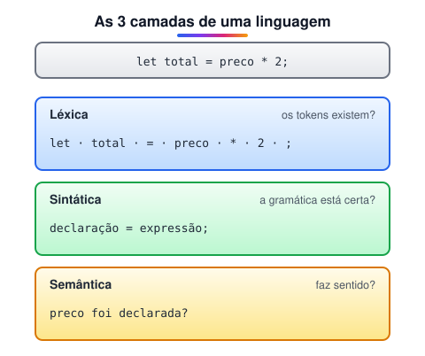

# Como as linguagens de programação funcionam

> 🗺️ **Nesta aula:** o que forma uma linguagem de programação e as três camadas de regras (léxica, sintática e semântica) que o computador confere antes de executar seu código.

## De onde paramos

No módulo I você viu que o computador só executa linguagem de máquina e que existem linguagens de alto nível mais próximas de nós. Agora vamos olhar para dentro dessas linguagens: do que são feitas e como o computador decide se o que você escreveu é válido.

## O que é uma linguagem de programação?

**Uma linguagem de programação é uma linguagem formal, com regras rígidas, usada para escrever algoritmos que um computador consegue executar.**

O que o programador escreve é o **código-fonte**. Um **compilador** ou **interpretador** traduz esse código em instruções de máquina. Toda linguagem oferece:

- **palavras-chave** (`if`, `while`, `function`, `return`);
- **operadores** (`+`, `==`, `&&`);
- **estruturas de controle** (decisões e repetições);
- **tipos de dados** (números, textos, listas);
- **bibliotecas** prontas para tarefas comuns (datas, rede, arquivos).

Exemplos populares: C, C++, Java, C#, Python, JavaScript, Go, Rust, PHP, Ruby, Swift e Kotlin.

## As 3 camadas de uma linguagem

Assim como o português tem vocabulário, gramática e significado, toda linguagem de programação tem três camadas de regras:



### 1. Léxica: as "palavras" válidas

Define quais sequências de caracteres formam **tokens** válidos: identificadores, números, operadores e palavras-chave.

```jsx
// em JS, ç é permitido em identificadores
let preço = 10;
// ✖ identificador não pode começar com número
let 2total = 5;
```

### 2. Sintática: a gramática

Define como os tokens podem ser combinados, ou seja, a **estrutura** das frases. O resultado é uma árvore sintática (AST).

```jsx
// ✖ erro de sintaxe: falta fechar o parêntese
if (idade >= 18 {
  console.log("maior");
}
```

### 3. Semântica: o significado

Mesmo com a gramática correta, a frase precisa **fazer sentido**: a variável existe? os tipos combinam? a função recebe esses argumentos?

```jsx
// ✖ ReferenceError se 'preco' não foi declarada
const total = preco * 2;
// NaN: sintaxe ok, mas sem significado útil
const x = "abc" * 2;
```

> 💡 **Analogia:** "Gato o mesa em subiu" tem palavras válidas (léxica ok), mas gramática errada. "A mesa comeu o gato" tem gramática perfeita, mas não faz sentido (erro semântico). O compilador funciona igual.

## Erro em tempo de compilação × em tempo de execução

- Erros **léxicos e sintáticos** são encontrados **antes** de rodar: o editor sublinha e o programa nem começa.
- Muitos erros **semânticos** só aparecem **durante a execução**, quando aquela linha roda (como o `ReferenceError` acima).
- O pior tipo é o **erro de lógica**: o programa roda sem reclamar, mas faz a coisa errada (ex.: usar `+` em vez de `-`). Só testes encontram esse erro.

## 🧠 Revisão rápida

**`let 2total = 5;` quebra qual regra?**

A léxica: um identificador não pode começar com número.

**Um código com a gramática perfeita pode estar errado?**

Sim: pode ter erro semântico (variável inexistente, tipos incompatíveis) ou de lógica.

**O que é o código-fonte?**

O texto do programa escrito pelo programador, antes de ser traduzido para a máquina.

> ➡️ **Próximo passo:** quem confere essas camadas e traduz o código é um compilador ou um interpretador. A diferença entre eles está em **Tipos de linguagens**.

## 📌 Resumo

| Item | Em uma frase |
| --- | --- |
| Código-fonte | o texto que o programador escreve |
| Léxica | quais tokens são válidos |
| Sintática | como os tokens se combinam (gramática) |
| Semântica | se a frase faz sentido |
| Erro de lógica | roda, mas faz a coisa errada |
