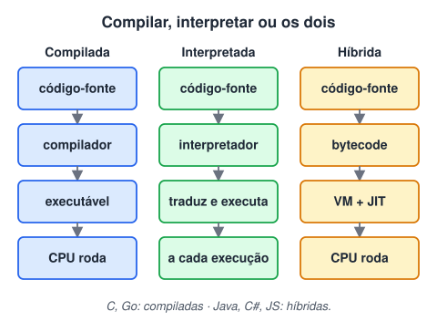
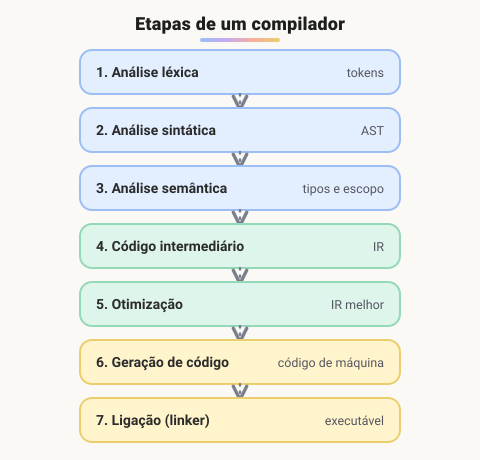

# Tipos de linguagens

> 🗺️ **Nesta aula:** linguagens de baixo e alto nível lado a lado, a diferença entre compilar e interpretar, as etapas de um compilador e o modelo híbrido com bytecode e JIT, usado pelo JavaScript.

## De onde paramos

A aula anterior mostrou as três camadas de regras de uma linguagem. Agora vem a pergunta seguinte: depois de conferido, como o código vira algo que a CPU executa? A resposta muda de uma linguagem para outra, e isso explica por que algumas são mais rápidas e outras mais práticas.

## Níveis das linguagens

As linguagens vão do **baixo nível**, perto da linguagem da máquina, ao **alto nível**, perto da linguagem humana. Compare o mesmo "Hello, World!" nos dois extremos.

**Assembly x86 (Linux, 32 bits): baixo nível**

```
section .data
  ; texto + quebra de linha
  hello db 'Hello, World!', 10
  ; tamanho calculado pelo montador
  len   equ $ - hello

section .text
  global _start

_start:
  mov eax, 4      ; syscall 4 = sys_write
  mov ebx, 1      ; 1 = stdout
  mov ecx, hello  ; endereço do texto
  mov edx, len    ; quantos bytes
  int 0x80        ; chama o kernel

  mov eax, 1      ; syscall 1 = sys_exit
  xor ebx, ebx    ; código de saída 0
  int 0x80
```

**Python: alto nível**

```python
print("Hello, World!")
```

> ⚠️ **Correção no Assembly:** a string terminava com `0` (estilo C), e o tamanho estava fixo em 13, então o texto saía sem quebra de linha. Agora o texto termina com `10` (a quebra de linha), e o tamanho é calculado com `$ - hello`, o que evita erro se o texto mudar.

## Alto nível × baixo nível

|  | Baixo nível (Assembly, C) | Alto nível (Python, JS, Java) |
| --- | --- | --- |
| Desempenho | máximo, com controle total do hardware | bom; perde um pouco para abstrações |
| Memória | gerenciada manualmente | automática (*garbage collector*) |
| Produtividade | baixa: muito código para pouca coisa | alta: uma linha faz muito |
| Portabilidade | Assembly é específico de cada CPU | o mesmo código roda em vários sistemas |
| Risco de bugs | alto (vazamentos, acesso indevido à memória) | menor |
| Usos típicos | sistemas operacionais, drivers, embarcados | web, APIs, automação, dados, apps |

## Compiladores × interpretadores



> 💡 **Analogia:** o compilador é o tradutor de um livro: traduz a obra inteira antes, e depois qualquer um lê rápido. O interpretador é o intérprete numa palestra: traduz frase por frase enquanto o palestrante fala; é mais lento, mas não precisa esperar o texto ficar pronto.

### Compiladores

Um **compilador** traduz **todo** o código-fonte para código de máquina **antes** da execução e gera um executável. Vantagens: execução rápida e erros pegos antes de rodar. Desvantagem: precisa recompilar a cada mudança, e o executável é específico do sistema e do processador.



1. **Análise léxica** (*tokenização*): quebra o código em tokens.
2. **Análise sintática** (*parsing*): confere a gramática e monta a **AST** (*Abstract Syntax Tree*, árvore sintática abstrata).
3. **Análise semântica**: verifica tipos, escopo de variáveis e se as operações fazem sentido.
4. **Código intermediário (IR)**: uma representação neutra, mais próxima da máquina, mas ainda independente do processador.
5. **Otimização**: remove código morto, simplifica contas, reorganiza instruções. O resultado é um programa mais rápido.
6. **Geração de código**: produz o código de máquina para a arquitetura alvo (x86, ARM).
7. **Ligação** (*linking*): o **linker** junta os módulos e as bibliotecas num único executável.

> ⚠️ **Correção:** a sigla **AST** é *Abstract Syntax Tree* (árvore sintática *abstrata*). Ela é diferente da árvore de análise completa (*parse tree*), que guarda todos os detalhes da gramática.

### Interpretadores

Um **interpretador** lê e executa o código **durante** a execução, sem gerar um executável. As primeiras etapas (léxica, sintática e semântica) são as mesmas; a diferença é que, em vez de gerar código de máquina, ele **executa** cada instrução na hora.

- ✅ Feedback imediato: escreveu, rodou. Ótimo para scripts, experimentos e aprendizado.
- ✅ O mesmo código roda em qualquer sistema que tenha o interpretador.
- ❌ Mais lento que código compilado, porque a tradução acontece a cada execução.
- ❌ Alguns erros só aparecem quando aquela linha é executada.

### O meio-termo: bytecode e JIT

A maioria das linguagens modernas mistura as duas abordagens:

- **Java e C#** compilam para **bytecode**, executado por uma máquina virtual (JVM, .NET CLR).
- **JavaScript** (motor V8, do Chrome e do Node.js) e **Python** (CPython) também passam por bytecode internamente.
- O **JIT** (*Just-In-Time*) compila para código de máquina, durante a execução, os trechos que rodam muitas vezes ("código quente"). Assim combina a flexibilidade da interpretação com a velocidade da compilação.

> 💡 "Compilada" ou "interpretada" é uma característica da **implementação**, não da linguagem em si. Python, por exemplo, tem o CPython (interpretador com bytecode) e o PyPy (com JIT).

## Outras classificações

Além do nível e da forma de execução, as linguagens também se classificam por:

| Critério | Opções | Exemplos |
| --- | --- | --- |
| Tipagem | estática (tipo fixo, conferido antes) × dinâmica (tipo decidido ao rodar) | Java × JavaScript |
| Força da tipagem | forte (não mistura tipos) × fraca (converte sozinha) | Python × JavaScript |
| Paradigma | estruturado, orientado a objetos, funcional | C, Java, Haskell |
| Uso | propósito geral × domínio específico | Python × SQL |

JavaScript é dinâmica e fraca (`"5" * 2` vira `10`), e mistura paradigmas: você verá o estruturado no módulo VII e a orientação a objetos no módulo IX.

## 🧠 Revisão rápida

**Qual a principal diferença entre compilar e interpretar?**

O compilador traduz tudo antes e gera um executável; o interpretador traduz e executa durante a execução.

**O que o JIT faz?**

Compila para código de máquina, durante a execução, os trechos que rodam muitas vezes.

**Por que um programa em Assembly não roda em qualquer processador?**

Porque as instruções Assembly são específicas de cada arquitetura (x86, ARM).

> ➡️ **Próximo passo:** hora de instalar o que você vai usar para escrever e rodar código: **Configurando o ambiente de desenvolvimento**.

## 📌 Resumo

| Item | Em uma frase |
| --- | --- |
| Baixo nível | controle e desempenho, pouca produtividade |
| Alto nível | produtividade e portabilidade |
| Compilador | traduz tudo antes e gera executável |
| Interpretador | traduz e executa na hora |
| Bytecode e JIT | o meio-termo usado por Java, C# e JS |
| AST | árvore que representa a estrutura do código |
| Tipagem | estática/dinâmica e forte/fraca |
