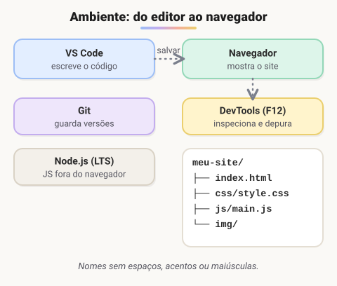

# Configurando o ambiente de desenvolvimento (Adicionado pelo aluno para melhorar o estudo)

> 🗺️ **Nesta aula:** instalar e conferir as ferramentas do curso (navegador, VS Code, Git e Node.js), usar o DevTools e organizar a pasta de um projeto.

## De onde paramos

Você já sabe que o código passa por um compilador ou interpretador. No desenvolvimento web, o "interpretador" do front-end é o próprio navegador, e o do back-end é o Node.js. Falta montar a bancada: as ferramentas para escrever, rodar e versionar o código.

## O kit básico



| Ferramenta | Para quê |
| --- | --- |
| **Navegador** (Chrome, Edge ou Firefox) | ver o site e usar o DevTools |
| **VS Code** | editor de código |
| **Git** | controle de versão (módulo VI) |
| **Node.js (LTS)** | rodar JavaScript fora do navegador e usar o npm (módulo X) |

Instale sempre a versão **LTS** do Node, que é a de suporte longo e a mais estável.

> 💡 **Analogia:** é a caixa de ferramentas de um marceneiro. O VS Code é a bancada onde se trabalha, o navegador é o espelho para ver o resultado, o Git é o caderno que anota cada mudança e o Node é a máquina que faz o JavaScript funcionar fora do navegador.

## Conferindo as instalações

```bash
code --version
git --version
node -v
npm -v
```

Se algum comando não for reconhecido, feche e abra o terminal de novo. No Windows, reinstale marcando a opção de adicionar ao **PATH**.

## VS Code: extensões úteis

- **Live Server**: abre o HTML no navegador e recarrega a cada salvamento (botão *Go Live* na barra inferior).
- **Prettier**: formata o código automaticamente. Ative *Format On Save* nas configurações.
- **ESLint**: aponta erros e más práticas no JavaScript.
- **Portuguese (Brazil) Language Pack**, se preferir a interface em português.

## Atalhos do VS Code

| Atalho (Windows/Linux) | macOS | Faz |
| --- | --- | --- |
| `Ctrl + P` | `Cmd + P` | abre arquivo pelo nome |
| `Ctrl + Shift + P` | `Cmd + Shift + P` | paleta de comandos |
| `Ctrl + '` | `Ctrl + '` | terminal integrado |
| `Alt + ↑/↓` | `Option + ↑/↓` | move a linha |
| `Ctrl + D` | `Cmd + D` | seleciona a próxima ocorrência |
| `Ctrl + /` | `Cmd + /` | comenta a linha |
| `!` e `Tab` | `!` e `Tab` | esqueleto HTML (Emmet) |

## DevTools do navegador

Abra com `F12` ou clique direito → **Inspecionar**.

- **Elements**: veja e edite HTML e CSS ao vivo. Ótimo para testar estilos antes de mexer no arquivo.
- **Console**: mensagens de `console.log`, erros de JavaScript e um lugar para testar código.
- **Network**: todas as requisições (arquivos, `fetch`, APIs), com status e tempo.
- **Modo responsivo** (`Ctrl + Shift + M`): simula telas de celular e tablet.

## Organizando um projeto

```
meu-site/
├── index.html
├── css/
│   └── style.css
├── js/
│   └── main.js
└── img/
```

Use nomes **sem espaços, acentos ou maiúsculas** (`sobre-nos.html`, e não `Sobre Nós.html`). Servidores costumam diferenciar maiúsculas de minúsculas, e um link que funciona no Windows pode quebrar quando publicado.

## Primeiro teste

1. Crie a pasta `meu-site` e abra no VS Code (**Arquivo → Abrir pasta**).
2. Crie `index.html`, digite `!` e aperte `Tab`.
3. Dentro do `body`, escreva `<h1>Olá, mundo!</h1>`.
4. Clique em **Go Live**: o navegador abre a página e atualiza sozinho quando você salva.

## 🧠 Revisão rápida

**Por que instalar a versão LTS do Node?**

Porque é a versão de suporte longo, mais estável e com atualizações de segurança por mais tempo.

**Em qual aba do DevTools aparecem os erros do JavaScript?**

No Console.

**Por que evitar espaços e acentos nos nomes de arquivos?**

Porque viram caracteres especiais em URLs e servidores diferenciam maiúsculas, o que quebra links.

> ➡️ **Próximo passo:** com o ambiente pronto, os erros vão aparecer. Saber pesquisá-los é uma habilidade em si: **Como tirar dúvidas de programação no Google e no Stack Overflow**.

## 📌 Resumo

| Item | Em uma frase |
| --- | --- |
| VS Code | editor do curso, com Live Server, Prettier e ESLint |
| Node.js LTS | roda JS fora do navegador e traz o npm |
| DevTools | Elements, Console, Network e modo responsivo |
| Estrutura | `index.html`, `css/`, `js/`, `img/` |
| Nomes de arquivo | minúsculas, sem espaços nem acentos |
