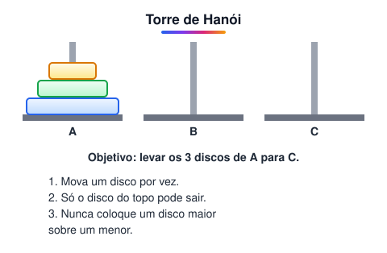
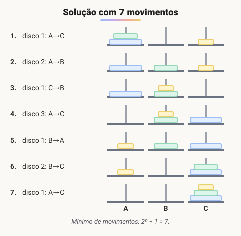
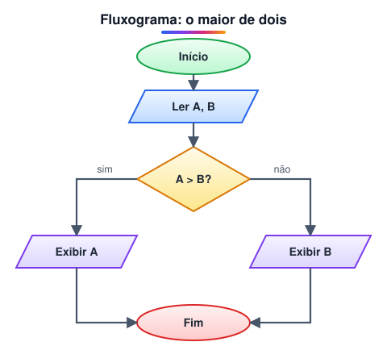
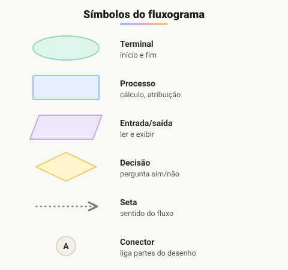
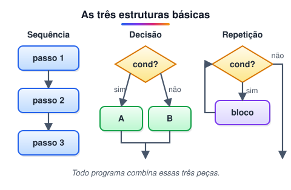

# Lógica de programação e algoritmos

> 🗺️ **Nesta aula:** o que é um algoritmo, como representá-lo em pseudocódigo e fluxograma, as três estruturas básicas, variáveis, operadores lógicos com tabela-verdade e o raciocínio por dedução.

## De onde paramos

Com o ambiente pronto e um método para tirar dúvidas, falta a habilidade mais importante: **pensar a solução antes de escrever o código**. É isso que a lógica de programação treina. Tudo o que aparece aqui volta no JavaScript (módulo VII), só que com outra sintaxe.

## O que é algoritmo?

- **Na matemática:** um procedimento de cálculo com regras formais que resolve, de forma geral, toda uma classe de problemas semelhantes. Por exemplo, o algoritmo de Euclides calcula o MDC de quaisquer dois números.
- **Em programação:** um conjunto de instruções **bem definidas, ordenadas e finitas** que resolve um problema ou uma classe de problemas.

## Exercício: Torre de Hanói

Um quebra-cabeça clássico, proposto em aula, para treinar o pensamento algorítmico. Dá para jogar on-line:

🔗 [https://www.mathsisfun.com/games/towerofhanoi.html](https://www.mathsisfun.com/games/towerofhanoi.html)



### Resolvendo com 3 discos



### Algoritmo que funciona para qualquer número de discos

```
início
  defina o sentido do menor disco:
    número ímpar de discos → A→C→B→A
    número par de discos  → A→B→C→A
  repita até a torre estar na haste C:
    1. mova o MENOR disco uma haste
       no sentido definido
    2. faça o único movimento válido
       que NÃO envolve o menor disco
fim
```

> ⚠️ **Correção:** nas anotações originais, o menor disco girava sempre A→B→C. Com número ímpar de discos (3, 5...), esse sentido leva a torre para a haste B, não para a C. O sentido depende da paridade, como no algoritmo acima.

> 💡 **Versão recursiva (a mais elegante):** para mover n discos de A para C, mova n−1 discos de A para B, mova o maior de A para C e depois mova os n−1 discos de B para C. O número mínimo de movimentos é **2ⁿ − 1**.

```jsx
function hanoi(n, origem, destino, auxiliar) {
  if (n === 0) return;
  hanoi(n - 1, origem, auxiliar, destino);
  console.log(
    `mova o disco ${n} de ${origem} para ${destino}`
  );
  hanoi(n - 1, auxiliar, destino, origem);
}

hanoi(3, "A", "C", "B"); // imprime os 7 movimentos
```

## Pseudocódigo e fluxograma

O **pseudocódigo** descreve o algoritmo em português estruturado, sem se prender à sintaxe de nenhuma linguagem:

```
Início
  Ler (A, B)
  Se (A > B) então
    Exibir (A)
  Senão
    Exibir (B)
  Fim Se
Fim
```

O **fluxograma** mostra o mesmo algoritmo de forma visual:



> 💡 Se A e B forem iguais, o algoritmo exibe B, o que está correto, porque qualquer um dos dois é o maior. Pensar nesses **casos-limite** (valores iguais, vazios, negativos) é parte essencial da lógica de programação.

### Palavras-chave do pseudocódigo

| Palavra | Significado | Em JavaScript |
| --- | --- | --- |
| `Início` / `Fim` | começa / termina o algoritmo | o arquivo ou a função |
| `Ler` | recebe um dado do usuário | `prompt()`, formulário |
| `Exibir` | mostra um dado | `console.log()` |
| `Se ... então ... Senão` | decisão | `if / else` |
| `Enquanto ... faça` | repete enquanto a condição for verdadeira | `while` |
| `Para ... de ... até` | repete um número conhecido de vezes | `for` |
| `←` | atribuição | `=` |

### Símbolos do fluxograma



## As três estruturas básicas

Qualquer algoritmo, por maior que seja, é feito de três peças combinadas:



- **Sequência**: um passo depois do outro, de cima para baixo.
- **Decisão** (ou seleção): um caminho ou outro, conforme uma condição (`se`).
- **Repetição** (ou laço): repete um bloco enquanto uma condição for verdadeira (`enquanto`, `para`).

Exemplo com as três: somar os números de 1 a 5.

```
Início
  soma ← 0
  i ← 1
  Enquanto (i <= 5) faça
    soma ← soma + i
    i ← i + 1
  Fim Enquanto
  Exibir (soma)
Fim
```

Fazendo o **teste de mesa** (executar à mão, anotando cada variável):

| Volta | i | soma |
| --- | --- | --- |
| início | 1 | 0 |
| 1 | 2 | 1 |
| 2 | 3 | 3 |
| 3 | 4 | 6 |
| 4 | 5 | 10 |
| 5 | 6 | **15** |

Quando `i` vira 6, a condição `i <= 5` fica falsa e o laço termina: o resultado é 15.

## Variáveis e tipos

Uma **variável** é um espaço na memória, com um nome, que guarda um valor que pode mudar. No pseudocódigo, a seta `←` lê-se "recebe": `soma ← soma + i` calcula o lado direito e guarda o resultado na variável da esquerda.

| Tipo | Guarda | Exemplo |
| --- | --- | --- |
| inteiro | números sem casas decimais | 42 |
| real | números com casas decimais | 7.5 |
| texto (caractere) | letras e palavras | "Ana" |
| lógico | verdadeiro ou falso | verdadeiro |

## Operadores lógicos e tabela-verdade

Condições podem ser combinadas com três operadores:

| Operador | Pseudocódigo | JavaScript | Verdadeiro quando |
| --- | --- | --- | --- |
| E | `e` | `&&` | as duas partes são verdadeiras |
| OU | `ou` | `\|\|` | pelo menos uma parte é verdadeira |
| NÃO | `não` | `!` | inverte o valor |

Tabela-verdade de E e OU (V = verdadeiro, F = falso):

| A | B | A e B | A ou B |
| --- | --- | --- | --- |
| V | V | V | V |
| V | F | F | V |
| F | V | F | V |
| F | F | F | F |

Exemplo: "pode entrar no show se tiver 18 anos **e** ingresso" vira `idade >= 18 && temIngresso`.

## O papel da lógica

A lógica estuda como chegar a **conclusões válidas** a partir de **proposições** (afirmações que podem ser verdadeiras ou falsas). Na programação, ela aparece em toda condição.

### Dedução

A conclusão **decorre necessariamente** das premissas: se as premissas forem verdadeiras, a conclusão também será.

- Premissa 1: se estiver chovendo, levarei meu guarda-chuva.
- Premissa 2: está chovendo.
- **Conclusão:** levarei meu guarda-chuva. ✔ (*modus ponens*)

### Indução

Parte de **casos observados** para uma **generalização provável**, sem garantia.

- Observação: o sol nasceu em todos os dias registrados até hoje.
- **Conclusão:** o sol vai nascer amanhã. (muito provável, mas não provado logicamente)

### Cuidado com a armadilha

- Premissa 1: se estiver chovendo, levarei meu guarda-chuva.
- Premissa 2: peguei meu guarda-chuva.
- **Conclusão:** então está chovendo. ✖

Isso **não** é indução. É uma falácia chamada **afirmação do consequente**: dá para levar o guarda-chuva por outros motivos (a previsão era de chuva, o sol estava forte...). Em código, é o erro de assumir "se A implica B, e B aconteceu, então A aconteceu".

> ⚠️ **Correções:** "preposições" foi trocado por **proposições** (preposição é classe gramatical; proposição é a afirmação lógica). O exemplo de "indução" das anotações era, na verdade, a falácia da afirmação do consequente. E a ideia de que "na computação só usamos dedução" vale para a lógica **do código**, que deve ser determinística; o aprendizado de máquina é essencialmente indutivo.

> 💡 **Dica prática:** muitos bugs vêm de suposições não verificadas, como "esse campo nunca vem vazio" ou "esse array sempre tem item". Valide as entradas e escreva testes para os casos-limite.

## Exercício

Escreva em pseudocódigo um algoritmo que leia a nota de um aluno e exiba "Aprovado" (nota 7 ou mais), "Recuperação" (de 5 a menos de 7) ou "Reprovado" (abaixo de 5).

<details>
<summary>Ver resposta</summary>

```
Início
  Ler (nota)
  Se (nota >= 7) então
    Exibir ("Aprovado")
  Senão Se (nota >= 5) então
    Exibir ("Recuperação")
  Senão
    Exibir ("Reprovado")
  Fim Se
Fim
```

Quando o algoritmo chega ao segundo `Se`, já sabe que a nota é menor que 7, então basta testar `nota >= 5`.

</details>

## 🧠 Revisão rápida

**Quais são as três estruturas básicas de um algoritmo?**

Sequência, decisão e repetição.

**Quanto vale `V e F`? E `V ou F`?**

`V e F` = F; `V ou F` = V.

**Quantos movimentos são necessários, no mínimo, para 4 discos na Torre de Hanói?**

2⁴ − 1 = 15.

**"Peguei o guarda-chuva, então está chovendo" é dedução válida?**

Não: é a falácia da afirmação do consequente.

> ➡️ **Próximo passo:** fim do módulo II. Agora começa o front-end, pela linguagem que estrutura toda página: **História de criação do HTML**.

## 📌 Resumo

| Item | Em uma frase |
| --- | --- |
| Algoritmo | passos finitos e ordenados que resolvem um problema |
| Pseudocódigo | algoritmo em português estruturado |
| Fluxograma | algoritmo em forma de desenho |
| Estruturas básicas | sequência, decisão e repetição |
| Teste de mesa | executar à mão, anotando cada variável |
| Variável | espaço na memória com nome e valor |
| E / OU / NÃO | `&&` / `\|\|` / `!` |
| Dedução | conclusão garantida pelas premissas |
| Hanói | 2ⁿ − 1 movimentos; recursão resolve |
